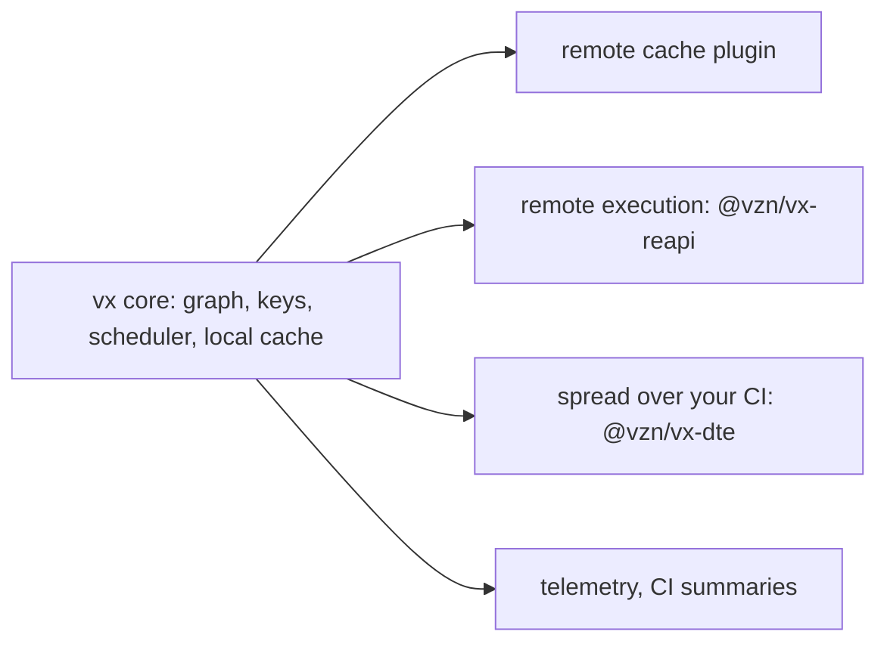

Turborepo runs and caches. Nx adds a platform around its runner. We
wanted the runner with open plugin points, and nothing behind a paid
cloud. So we built vx.

| Time added over the ideal run, 9,603 tasks | vx      | Turborepo  | Nx         | Vite Task |
| ------------------------------------------ | ------- | ---------- | ---------- | --------- |
| Nothing changed                            | 799 ms  | 927 ms     | 24.15 s    | 12.07 s   |
| Cold build                                 | 7.57 s  | 9.63 s    | 3 min 6 s  | 9.01 s    |
| Cold build: CPU the runner burns           | 36.64 s | 1 min 12 s | 5 min 34 s | 25.32 s   |

<small>Synthetic monorepo, 1,601 projects, 9,603 tasks, 30 levels · linux x64, 4 cores, concurrency 10 · vx 0be036747, Turborepo 2.11.10, Nx 24.0.1, Vite Task 1.4.0 · 2026-10-23 · real repos with uneven task times will differ</small>

With nothing changed, Nx adds 24.15 s against Turborepo's 927 ms and
vx's 799 ms, Nx's daemon off as in CI. Source:
[Benchmarks](../../benchmarks/).

## What each one is

| Tool      | In one line                                                                 |
| --------- | --------------------------------------------------------------------------- |
| Turborepo | runs and caches tasks from one `turbo.json`; remote cache over an open API  |
| Nx        | a project graph, `affected` and plugins; distribution and flaky detection in Nx Cloud |
| vx        | runs and caches; where a task runs and where artifacts live are plugins     |

Both got a lot right. Turborepo's `dependsOn` syntax and pnpm-style
`--filter` read the way you think, and vx uses both. Nx's project graph
and `affected` scale to very large repos.

## What vx adds

- **Keys that are right more often:** [computed
  config](../resolved-config-hashing/), [strict
  outputs](../strict-output-ownership/), no false miss after a commit
  ([keys from git](../keys-from-git/)).
- **Plugins, not a service.** Remote cache, remote execution,
  scheduling and telemetry use a public plugin API. `@vzn/vx-reapi`
  talks to any Bazel Remote Execution server. `@vzn/vx-dte` spreads a
  run over workers your own CI starts.
- **Nothing to keep alive:** no daemon, no account, no cloud.

## The bar

vx has to do what both do. A parity suite writes each Turborepo or Nx
habit in vx and tests it against the real CLI.

Where vx differs (no `--parallel`, because `dependsOn` says the order),
the page says so. Full matrix, with upstream sources: [Compared to
Turborepo, Nx, vite-task](../../comparison/).

More at [vznjs.github.io/vx](https://vznjs.github.io/vx/).
