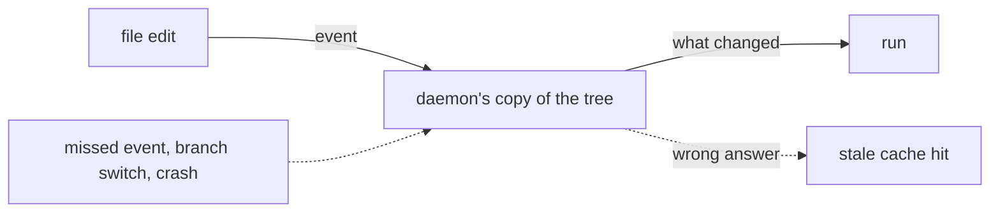
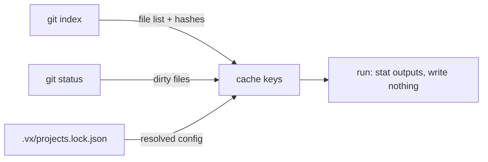

vx runs no background process. When nothing changed, a run over %bench.tasks%
tasks still finishes in %bench.vx.warm%.

| Runner    | Nothing changed | Daemon              |
| --------- | --------------- | ------------------- |
| vx        | %bench.vx.warm% | none                |
| Turborepo | %bench.turbo.warm% | not for `turbo run` |
| Nx        | %bench.nx.warm% | off, as in CI       |

<small>Synthetic monorepo, %bench.projects% projects, %bench.tasks% tasks · concurrency %bench.concurrency% · [benchmarks](../../benchmarks/)</small>

<small>%bench.provenance%</small>

Nx runs a daemon by default. Turborepo shipped one and, since 2.8.11,
no longer uses it for `turbo run`.

## A daemon can be wrong

A daemon keeps its own copy of your tree. One missed file event and that
copy is wrong. For a build cache, wrong means old bytes under a green
check.

## vx reads the tree fresh, every run

Each run asks git, which already holds a hash for every clean file. A
clean tree is keyed with no read of a source file
([how](../keys-from-git/)).

Config comes from the lock file, so no `vx.config.ts` is evaluated. A
hit on an up-to-date tree only checks that the outputs are there
([how](../strict-output-ownership/)).

That is the %bench.vx.warm%. Nothing stays running after it, and a run in a
terminal, in CI or in a container gives the same answer.

More at [vznjs.github.io/vx](https://vznjs.github.io/vx/).
