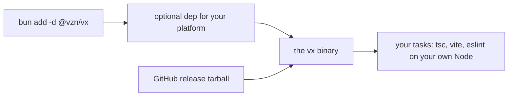

vx is one file per platform. No Node to pick, no Bun to install, no
daemon. On a 1,000-project workspace with everything up to date:

```sh frame="terminal"
$ ls -l vx-linux-x64
-rwxr-xr-x 1 root root 117532848 vx-linux-x64

$ time ./vx-linux-x64 run build --all
real    0m0.163s

$ time bun packages/vx/src/bin.ts run build --all
real    0m0.253s
```

| Same run, 1,000 tasks up to date | Wall time |
| -------------------------------- | --------- |
| release binary (`--bytecode`)    | 163 ms    |
| from source under Bun            | 253 ms    |

<small>Min of 15 runs, 3 interleaved arms · `private/vx-bench/generate.ts`, 1,000 projects · Linux x64, 4 cores · vx 22f6eb7 · 2026-10-23</small>

The binary carries its runtime and its code precompiled, so nothing has
to parse vx before it runs.

## What you install

```bash
bun add -d @vzn/vx
```



You get the prebuilt binary for your platform: Linux (glibc, not
Alpine's musl) and macOS, x64 and arm64 (Windows under WSL).

The GitHub release carries the same binary, so CI can skip the package
manager. No postinstall, no first-run download. The npm package's `vx`
command is a small sh launcher that execs that binary.

Your tasks don't change. `tsc`, `vite` and `eslint` run on your own
Node. vx only adds `node_modules/.bin` to their `PATH`.

## What that buys

- **No CI setup.** No `setup-node` first. Fetch, run. Through npm, the launcher costs one shell start first, a few milliseconds; Node starts only when no prebuilt binary fits.
- **No version drift.** The `vx` that ran yesterday is the same bytes
  today, on every machine.
- **`vx.config.ts` runs as is.** No transpile step. Keep `@vzn/vx` in
  `devDependencies` for the types.

## Why Bun, and why it does not leak

Bun gives vx most of what a runner needs, built in: `bun:sqlite` for the
cache index, `Bun.zstd*` for compression, `Bun.spawn`, `Bun.Glob`, and
`bun build --compile` for the binary.

So vx has very few dependencies.

None of that reaches you. A workspace on Node 18 with pnpm works under
vx as it does under Turborepo. Only running vx *from source* needs
Bun ≥ 1.4.4.

## No daemon, no service

The binary is the whole install. No background process
([why](../no-daemon/)), no account, no service. `vx run` in a container
with no network works like on a laptop.

Plugins that talk to the outside world are packages you add.

Install and first run: the [Quickstart](../../quickstart/). More at
[vznjs.github.io/vx](https://vznjs.github.io/vx/).
