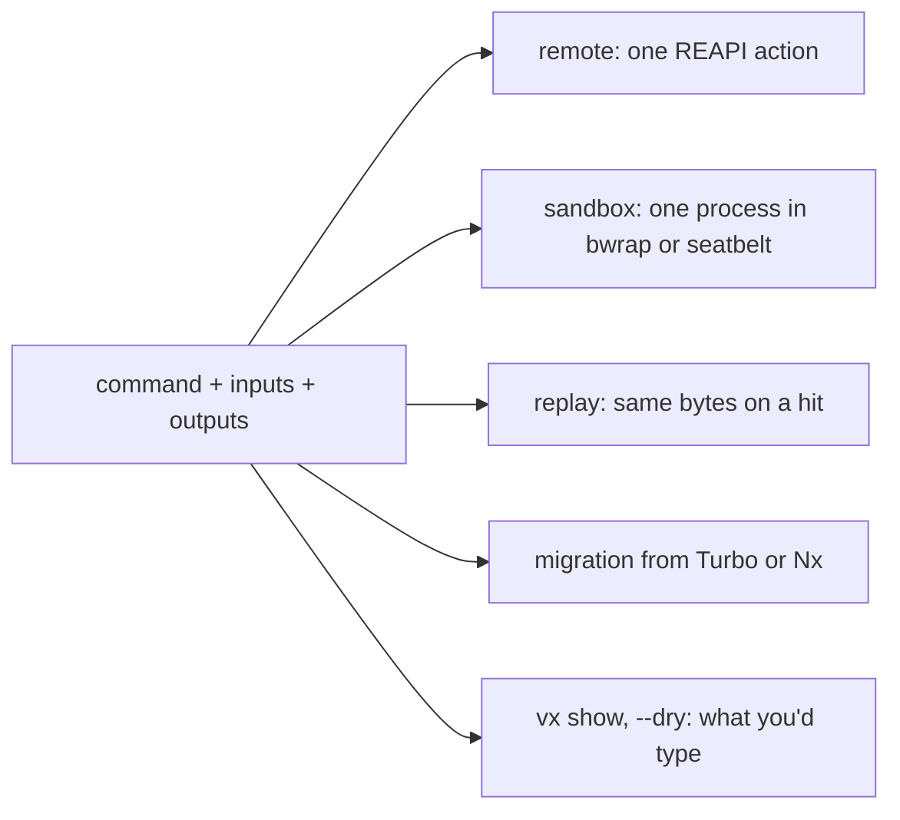

A vx task is one shell command. That one rule is why remote runs,
the sandbox and cache replay work without special cases. A task is one
string:

```ts
color: {
  exec: { command: "printf 'step 1\\rstep 2\\rdone\\n'" },
  inputs: { files: [] },
  cache: { outputs: { files: [] } },
}
```

Run it twice, the second time from the cache, and compare the bytes:

```sh frame="terminal"
$ vx run packages/d#color | sed -n 3p | od -c     # miss: ran
0000000   s   t   e   p       1  \r   s   t   e   p       2  \r   d   o
0000020   n   e  \n
$ vx run packages/d#color | sed -n 3p | od -c     # hit: replayed
0000000   s   t   e   p       1  \r   s   t   e   p       2  \r   d   o
0000020   n   e  \n
```

Same bytes, carriage returns included. A hit looks like the run.

<small>Demo workspace · vx 69617eb · 2026-10-23</small>

`exec.command` runs under `sh -c` in the project's folder, with
`node_modules/.bin` on `PATH` and the env you declared. That's all.

## What it rules out

| Not in vx                    | Why                                                                 |
| ---------------------------- | ------------------------------------------------------------------- |
| JavaScript-function tasks    | can't go to a worker, be sandboxed or replayed                      |
| executor plugins             | a wrapper between you and the tool's own flags and docs             |
| step lists                   | many steps under one key: use `&&`, or split with `dependsOn`       |

A plugin changes *where* a command runs, never what it is.

## What it makes possible



Every feature works on the same three things. Replay stores the captured stdout in the cache index and prints it byte for byte on a hit,
carriage returns and colours included.

## The environment is declared too

Each task gets an isolated environment: a small essential allowlist
(`PATH`, `HOME`, `CI`, `NODE_OPTIONS` and a few more), then what
`exec.env` says. Values you `define` are in the key.

Variables you `passThrough` are not. `inputs.env` puts a variable in the
key without passing it, so a variable that changes the output goes in
both.

The most common mistake is a variable that changes the output but is
missing from `inputs.env`. The key doesn't change, so vx restores the
old output. More in [the env post](../env-isolation/).

## The API is the one you already have

vx needs no plugin per tool. There is no `@vzn/vx-vite` or
`@vzn/vx-jest`, because `vite build` and `jest` already are the API.
Tool settings belong in TypeScript presets.

Reference: [Running tasks](../../docs/running-tasks/) and
[Environment variables](../../docs/environment-variables/).
More at [vznjs.github.io/vx](https://vznjs.github.io/vx/).
