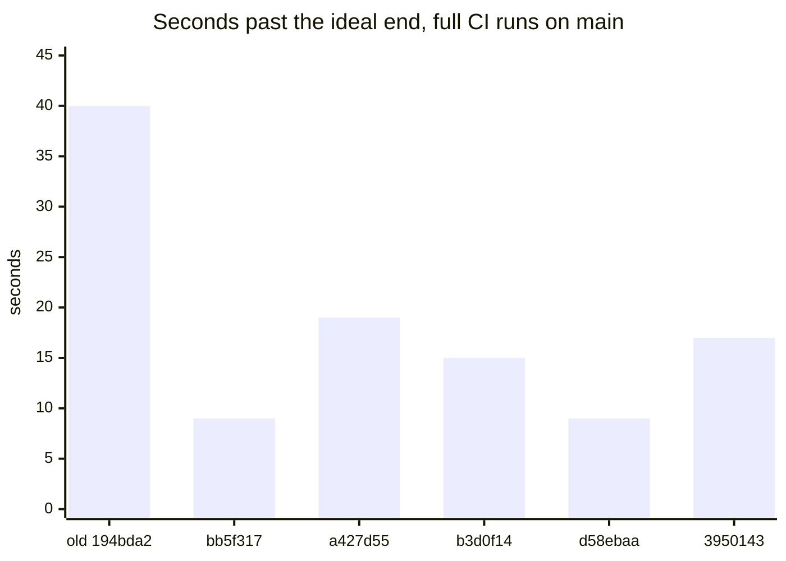
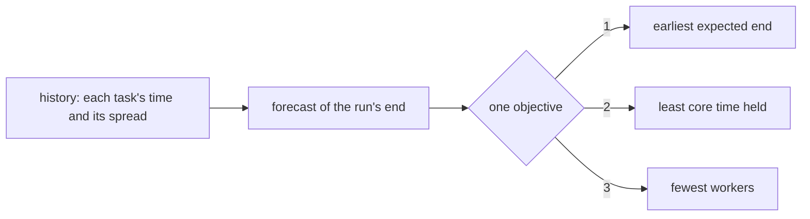
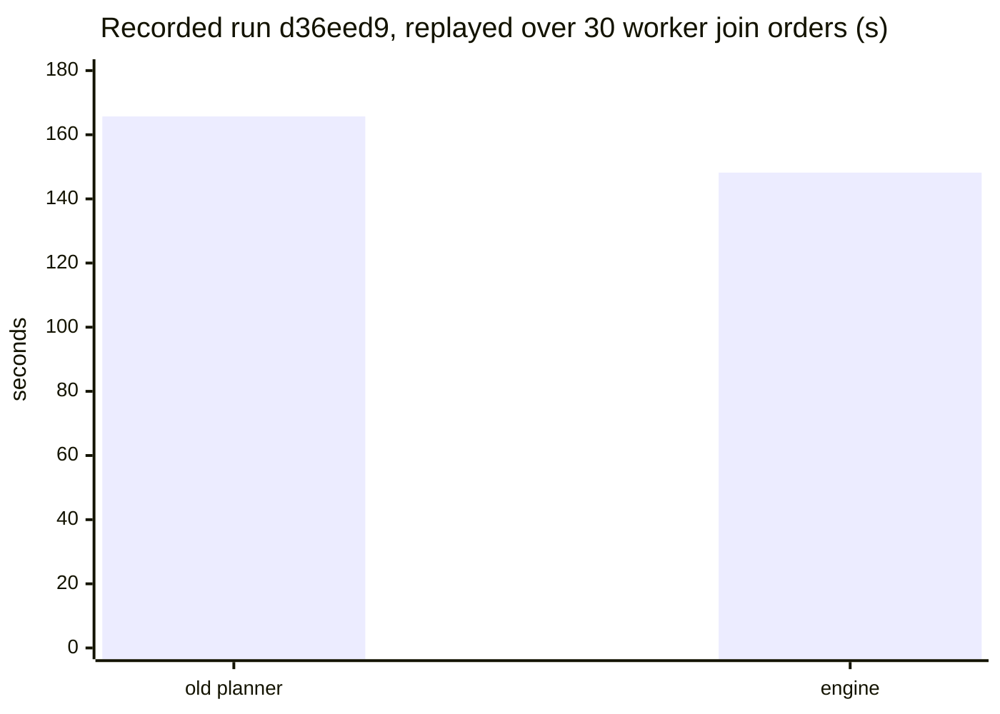

A full run of vx's own CI used to end about 40 s later than its workers
could have finished it. With the new DTE planner it ends 9 to 19 s late.

<small>vx CI on GitHub runners, 9 Linux + 1 arm + 3 Mac workers, about 200 tasks · 2026-11-18 to 11-20 · new runs: each run's own `ideal` footer line · old run: 166.8 s against the 127 s its 9 Linux workers needed, from its profile</small>

## The old planner was rules on top of rules

It placed tasks with best-fit, holds, packing and about twenty constants.
Each constant was a guess about the world, and each rule had fixed one
slow run.

Then they started to move each other. One fix shipped, made runs 8 to
20 s slower in the replay, and was reverted 25 minutes later.

[The engine](https://github.com/vznjs/vx/pull/5378) is one model. Every
choice, where a task goes and when to ask for a worker, comes from the
same plan. The change added 3,968 lines and removed 11,136.

## What we learned

**A task's time is a range.** Tasks stray 22 to 25% from their history
on every run. The first engine read history as exact and asked for
workers at the last moment. One run ended at 98 s against a 70.6 s ideal.
Planning with the spread took its replay from 78.9 s to 72.4 s.

**Short tasks finish first, and they lie.** With a third of the tasks
never measured, guessing from the ones already done ended a run at
152 s. Counting the ones still running as "at least this long" gave 135 s.

**Replay before you ship.** A simulator runs the same engine on recorded
runs, with the times tasks really took. It killed several ideas that
looked right on paper.

**Some of the gap is hardware.** Our three 2-core Macs have 612 s of
work. Perfect packing ends near 127 s. We searched 30,000 orderings and
the best beat our plan by 6 s.

**It was not smooth.** The first merge made main slower, and we fixed it
forward. A missing `max` in a config became a NaN and a hung run.

A million tasks plan in 2.0 s. The design, with every sim result:
[DTE planner](https://github.com/vznjs/vx/blob/main/packages/vx/docs/design/dte-planner-2026-11.md).
More at [vznjs.github.io/vx](https://vznjs.github.io/vx/).
