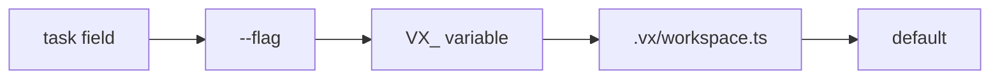

Every vx setting has one name. Its environment variable and flag are
spelled from it, so learn one and you know all three.

| Setting          | Variable             | Flag            |
| ---------------- | -------------------- | --------------- |
| `run.retries`    | `VX_RUN_RETRIES`     | `--retries`     |
| `run.concurrency` | `VX_RUN_CONCURRENCY` | `--concurrency` |
| `cache.dir`      | `VX_CACHE_DIR`       | `--cache-dir`   |
| `cache.policy`   | `VX_CACHE_POLICY`    | `--cache-policy` |

Settings live in four groups in `.vx/workspace.ts`: `run`, `cache`,
`lock` and `watch`.

```ts title=".vx/workspace.ts"
import { defineWorkspace } from '@vzn/vx/config'

export default defineWorkspace({
  run: { concurrency: 4, retries: 2 },
  cache: { dir: 'build/.vx' },
})
```

## Which value wins



Left wins. `exec.retries` on a task beats `--retries`. `vx info` shows
each changed setting and where its value came from:

```sh frame="terminal"
$ VX_RUN_CONCURRENCY=2 vx info
…
  settings          run.concurrency 2 (VX_RUN_CONCURRENCY), run.retries 2 (.vx/workspace)
```

## Units are part of the value

Durations carry a unit (`'500ms'`, `'30s'`, `'2h'`), sizes too
(`'32KiB'`). A bare number is refused. Nobody can tell if `2000` means
milliseconds or seconds:

```sh frame="terminal"
$ VX_CONFIG_WORKER_TIMEOUT=2000 vx run build
✗ vx run  VX_CONFIG_WORKER_TIMEOUT takes a duration with its unit, like '2000ms' or '2s' (got 2000)
```

## Unknown names are refused

A typo in a key or a flag stops the run with the line to fix:

```sh frame="terminal"
$ vx run build
✗ vx run  config refused

  .vx/workspace.ts:4:3
  unknown field "concurrency"
  allowed: baseBranch, cache, lock, plugins, run, watch

    2 |
    3 | export default defineWorkspace({
  > 4 |   concurrency: 4,
      |   ^
```

A few settings, like `run.outputLogs` and `debug.timing`, are read
before the file loads, so only a variable or flag sets them.

<small>Demo workspace · vx 22f6eb7 · 2026-10-23</small>

Every setting: [settings table](../../schema/#settings). More at
[vznjs.github.io/vx](https://vznjs.github.io/vx/).
