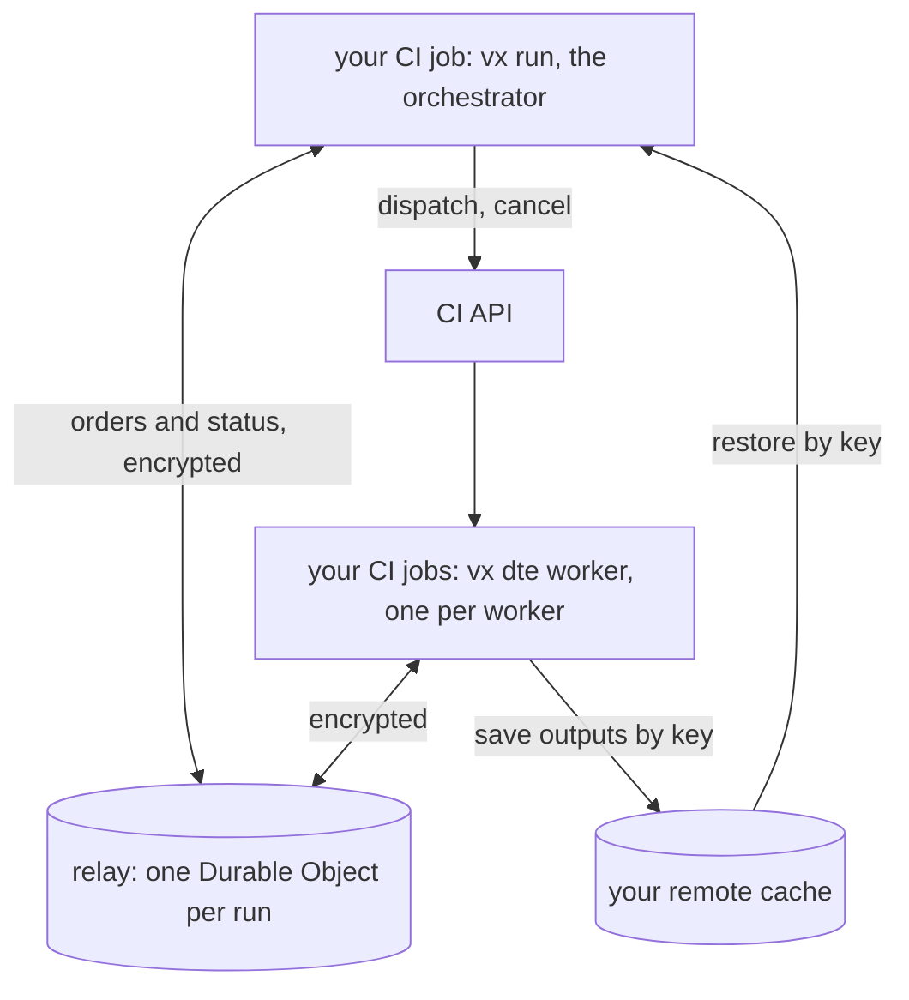

:::caution[Alpha, not released]
`@vzn/vx-dte` and `@vzn/vx-dte-relay` are alpha. They are not on npm
and not in any vx release. They are open source, MIT, in
[the vx repository](https://github.com/vznjs/vx/tree/main/packages/vx-dte),
and vx's own CI runs on them every push. Names and options may still
change.
:::

**$14,304 a year** is what this repository's CI would cost on Nx
Cloud's Team plan with Nx's agents, at the 108 runs a day it really
had last week; on vx DTE it costs $0. The math and its assumptions are in
[What it costs](#what-it-costs-next-to-nx-cloud): Nx's public prices
read 2026-10-23, Mac work and concurrent connections not counted.

Until today vx's CI had three jobs: Linux, the arm64 binary and macOS.
[#4119](https://github.com/vznjs/vx/pull/4119) made them one
distributed run. Tasks bound to a platform say so
(`exec.platforms`), and the run starts a Mac or arm worker only when
the graph has such a task.

The first green main after it, on
[49adc41](https://github.com/vznjs/vx/actions/runs/39985872848), took
1 min 59 s from job start to end, docs deploy included:

| What                                 | Count |
| ------------------------------------ | ----: |
| tasks                                |   129 |
| answered by the local cache          |    96 |
| downloaded from the remote cache     |     8 |
| ran on workers                       |    22 |
| workers that ran tasks (4 Linux, 2 Mac) |  6 |
| workers started, then cancelled as not needed | 13 |

The job's own `vx run` step took 93 s; vx's footer says 89.93 s. Each
worker's warm-up, from the dispatch to its join, and its time online:

| Worker  | Warm-up | Online |
| ------- | ------: | -----: |
| small#1 | 19.9 s  | 47.3 s |
| small#4 | 21.1 s  | 58.9 s |
| small#6 | 20.3 s  | 19.8 s |
| small#8 | 19.8 s  | 52.8 s |
| mac#17  | 37.2 s  | 52.5 s |
| mac#19  | 31.9 s  | 15.4 s |

The workers are jobs of the repository's own `vx-worker.yml`, and they
meet the run at a relay anyone can host.

## The pieces



- **The orchestrator** is your CI job's own `vx run`. It builds the
  graph, asks the cache what it already has, plans how many workers the
  rest needs, starts them through the CI's API and hands each ready task
  to a worker with room. It runs no task itself.
- **A worker** is `vx dte worker` in a CI job of yours. It checks out the
  run's commit, joins, runs what it is sent and saves each task's output
  and declared files to the workspace's cache under the task's key. It
  reports its cores, memory and platform when it joins, and its load
  with every frame after.
- **The relay** passes messages, because CI runners take no inbound
  connection: the orchestrator and every worker dial out to it.
- **The cache** carries every file. No file travels through the relay.
  The orchestrator restores each task's outputs by its key, so the run
  reports the task as its own, as if it ran here.

Adapters start the workers: `github()` dispatches `vx-worker.yml` once
per size with the workers as a matrix and cancels the ones the run no
longer needs, `gitlab()` writes a child pipeline, `local()` uses git
worktrees and `docker()` containers on this machine.

## The relay

[`@vzn/vx-dte-relay`](https://github.com/vznjs/vx/tree/main/packages/vx-dte-relay)
is a generic package. Its one runtime dependency is
[`jose`](https://github.com/panva/jose), which checks CI OIDC tokens;
it does not import vx. Any server that speaks its
[PROTOCOL.md](https://github.com/vznjs/vx/blob/main/packages/vx-dte-relay/PROTOCOL.md)
can replace it.

- **Two requests.** A participant joins on the websocket it opens
  ([#4128](https://github.com/vznjs/vx/pull/4128)), one request, and
  falls back to an HTTP `join` only when that socket does not open.
- **One Durable Object per run** on Cloudflare, or memory on Bun. The
  object hibernates between messages, the runtime answers pings without
  waking it, and an alarm finds a participant that went silent.
- **It stores no message.** It keeps who takes part in which run, never
  what they say.
- **One var, `ALLOW`**, lists who may take part as
  `issuer:owner/repo:workflow`; every other token is refused. The
  README has a Deploy to Cloudflare button.

It fits the Workers free plan. Cloudflare's free plan allows 100,000
Durable Object requests and 100,000 rows written a day, and counts 20
incoming websocket messages as one request
([Durable Objects pricing](https://developers.cloudflare.com/durable-objects/platform/pricing/),
read 2026-10-23). The relay's
[README](https://github.com/vznjs/vx/blob/main/packages/vx-dte-relay/README.md#on-cloudflare-workers)
measures a CI run of 18 participants over two minutes at about 65 Durable
Object requests and 60 rows written: about 1,500 such runs a day. A
run with 50 workers would be about three times that run's participants;
if its requests grow the same way, that is about 500 runs a day. That
second figure is an estimate, not a measurement.

## End-to-end encryption

The relay reads nothing it carries. Each worker runs a
[Noise](https://noiseprotocol.org/noise.html) handshake with the
orchestrator through it, one session per worker, on WebCrypto with no
dependency, held to the cacophony test vectors
(`packages/vx-dte/src/noise.ts`, tested in `packages/vx-dte/tests/noise.test.ts`).


- **With a run key** (`VX_DTE_SECRET`, or one an adapter makes for its
  workers) it is `Noise_NNpsk0_25519_AESGCM_SHA256`. The key is the
  pre-shared key, so a side without it cannot finish the handshake.
- **On GitHub Actions with no key** it is `Noise_NN_25519_AESGCM_SHA256`,
  and each side binds the handshake with an OIDC token of the same
  repository. No secret is stored anywhere.
- **Ephemeral keys only.** The run key never encrypts a message, so a
  leaked one opens no past run.
- **Each message names its nonce.** A message the relay changes loses
  its worker; one it replays is dropped.
- **The orchestrator claims the run** with a P-256 key made for that
  run. The relay keeps the public half and takes a request as the
  orchestrator only when it is signed by it.
- **Env travels encrypted**, and each task gets only the env its config
  passes, not the worker's whole environment.
- **Cache access is lent, never stored.** The orchestrator lends a
  worker the short-lived token its remote cache got from an OIDC
  exchange, so the worker reads and writes the cache under the run's
  rules.

## How a run schedules

Only work counts: a task that missed the cache, or one waiting on a
miss. Hits and groups need no worker, so a run the cache answers whole
starts none.

**How many workers.** At each miss, finish and join, the planner
(`packages/vx-dte/src/planner.ts`) plays the known work out on the
workers online and starting, and on N more joining after the warm-up
the first took (20 s before any has joined). It starts the fewest N
that end within 5% (5 s at least) of the best. A worker the plan needs
later starts when its warm-up nears. An idle worker leaves when the plan
ends as well without it.

**Where a task goes.** A task is sent only to a worker where it fits
now: a core free and its memory fitting what the worker's running tasks
used last time, or the worker's live load, whichever is more. It goes to
the worker that holds most of its dependencies' outputs, so a chain
stays on one machine, then to the one with fewest cores free, so workers
fill before the next takes work. A task naming `exec.platforms` runs
only on a worker of that platform.

**Which task first.** The longest tail: its recorded duration plus its
longest chain of dependants.

**What a task books.** What history measured: the most cores any of
its recent runs kept busy, and its peak memory. A task with no history gets a whole worker. One
that used 90% of its worker's cores or memory moves up one size next
run.

Each of those four is a layer you can swap with `dte({ scheduler })`
(`packages/vx-dte/src/strategy.ts`):

| Layer   | Choices (default first)                                                                                   |
| ------- | --------------------------------------------------------------------------------------------------------- |
| `order` | `critical-path` (HEFT's rank), `graphene` (long and wide first, Grandl OSDI'16), `fifo`                   |
| `place` | `best-fit` (fewest cores left), `tetris` (needs aligned with what is free, SIGCOMM'14), `worst-fit`, `first-fit` |
| `book`  | `measured` (history), `margin` (a fifth more, as Borg does), `whole` (a worker each)                        |
| `scale` | `plan` (the planner above), `backlog` (cores for what is ready or running, as Spark's dynamic allocation)  |

## The simulator

`packages/vx-dte/tests/sim.ts` plays a distributed run on a virtual
clock with the plugin's own decide and dispatch code: core hands over
each miss as its dependencies end, workers join after their warm-up and
run each task for as long as it took on main. It is pure and
deterministic, so a run of minutes plays in milliseconds.
`packages/vx-dte/tests/sim.test.ts` holds every scheduling change to it: no worker
booked past its cores, every miss run once, no worker idle while a task
waits, no worker let go and started again.

Main's run at a09b987 (65 misses, recorded as a fixture, its misses
forecast right), every choice
of every layer, the rest at their defaults, 4-core workers with 20 s
warm-up. The best possible end on unlimited workers is 120.5 s:

| Strategy          | Simulated end | Workers | Utilization | Worker time |
| ----------------- | ------------: | ------: | ----------: | ----------: |
| default           |       120.5 s |      10 |         86% |    13.1 min |
| order: graphene   |       120.5 s |      10 |         89% |    12.7 min |
| order: fifo       |       120.5 s |      10 |         76% |    14.8 min |
| place: tetris     |       120.5 s |      10 |         77% |    14.6 min |
| place: worst-fit  |       120.5 s |      10 |         77% |    14.6 min |
| place: first-fit  |       120.5 s |      10 |         86% |    13.1 min |
| book: margin      |       120.5 s |      12 |         69% |    16.2 min |
| book: whole       |       348.9 s |      11 |         19% |    58.9 min |
| scale: backlog    |       120.5 s |      12 |         86% |    13.1 min |

All nine played in under a second on one machine, Bun's start included. Run it
yourself from a checkout:

```sh
bun test packages/vx-dte/tests/sim.test.ts
```

The simulator matches real runs. Main's run at
[c5d8353](https://github.com/vznjs/vx/actions/runs/40014645919), played
on its own graph with each task's measured time, CPU and memory:

| c5d8353           | Real    | Simulated |
| ----------------- | ------: | --------: |
| run end           | 113.8 s |   112.7 s |
| CPU used          |     53% |       56% |
| workers           |       4 |         4 |
| cancelled workers |       0 |         0 |

## Why not split it another way

The same graphs, played five ways on 4 vCPU machines that each take
20 s to start (checkout and install):

- **One machine.** Every task on one CI job, packed onto its 4 cores.
- **Static matrix.** N jobs written in YAML, each a fixed share of the
  tasks by count, the way test sharding is done, with N set for a full
  run. A job runs again the misses its share depends on. A job whose
  share all hit still starts.
- **Build stage, then a matrix.** One job runs every task another waits
  on; then N jobs split the rest.
- **Naive DTE.** N workers start up front, each takes one task at a
  time in the order tasks got ready, and all stay until the run ends.
- **vx DTE.** The default above: critical path first, tasks booked by
  measured CPU, workers started as the plan needs them.

N is the number of workers vx DTE starts for the full run. Machine time
is what CI bills: every job and worker from its start to its end,
warm-up and vx DTE's orchestrator job included. CPU used is the work's
core-minutes over the cores of that machine time. Every way but vx DTE
is played by the planner's ideal packer, where no task slows another;
vx DTE is played by the full simulator. Run it yourself:

```sh
bun packages/vx-dte/scripts/compare.ts
```

**vx's main run, a09b987.** 65 tasks run, 45.0 core-minutes of work.
The graph is flat: 52 test shards and a few short tasks.

| Way                       |    Ends | Machine time | CPU used |
| ------------------------- | ------: | -----------: | -------: |
| One machine               | 751.0 s |     12.5 min |      90% |
| Static matrix, 10 jobs    | 126.0 s |     18.3 min |      62% |
| Build stage, then 10 jobs | 190.0 s |     18.6 min |      60% |
| Naive DTE, 10 workers     | 392.8 s |     72.0 min |      16% |
| vx DTE, 10 workers        | 120.5 s |     18.4 min |      61% |

**A vx PR.** The same graph; only lint and 6 test shards miss. 16 tasks
run, 9.2 core-minutes of work.

| Way                       |    Ends | Machine time | CPU used |
| ------------------------- | ------: | -----------: | -------: |
| One machine               | 189.9 s |      3.2 min |      73% |
| Static matrix, 10 jobs    |  90.1 s |     13.2 min |      17% |
| Build stage, then 10 jobs | 110.1 s |     13.6 min |      17% |
| Naive DTE, 10 workers     | 120.2 s |     22.0 min |      10% |
| vx DTE, 3 workers         |  90.1 s |      5.5 min |      42% |

**An app monorepo after a change to its base library.** Not ours: 24
libraries, each built on the one before it and one further down, each
with a test and a lint, and 4 apps on six libraries each, built, tested
and run end to end. 84 tasks run, 71.0 core-minutes of work.

| Way                      |     Ends | Machine time | CPU used |
| ------------------------ | -------: | -----------: | -------: |
| One machine              | 1205.0 s |     20.1 min |      88% |
| Static matrix, 6 jobs    |  810.0 s |     73.1 min |      24% |
| Build stage, then 6 jobs | 1060.0 s |     27.3 min |      65% |
| Naive DTE, 6 workers     |  765.0 s |     89.3 min |      20% |
| vx DTE, 6 workers        |  720.0 s |     43.7 min |      41% |

**The same monorepo, one app changed.** 3 tasks run, 9.3 core-minutes
of work.

| Way                      |    Ends | Machine time | CPU used |
| ------------------------ | ------: | -----------: | -------: |
| One machine              | 260.0 s |      4.3 min |      53% |
| Static matrix, 6 jobs    | 260.0 s |     10.0 min |      23% |
| Build stage, then 6 jobs | 280.0 s |      7.3 min |      32% |
| Naive DTE, 6 workers     | 260.0 s |     30.3 min |       8% |
| vx DTE, 1 worker         | 260.0 s |      8.7 min |      27% |

Why each loses:

- **One machine** bills the least in every case and ends last whenever
  there is work to spread: 751.0 s on our main run.
- **A static matrix** is sized once, for the full run. On our flat main
  run it comes close to vx DTE, because its shards were split for that
  graph. On a PR all 10 jobs still start: 13.2 machine-minutes for 9.2
  core-minutes of work. On a deep graph each job builds again the
  libraries its share needs: 73.1 machine-minutes.
- **A build stage** makes every test wait for the slowest build, and
  each stage pays its own warm-up: 1060.0 s on the monorepo.
- **Naive DTE** gives each task a whole worker and keeps every worker
  until the end: 72.0 machine-minutes on our main run, at 16% CPU.
- **vx DTE** ends first, or level with the best, in all four. Of the
  ways that end as early, it bills the least in three. With one app
  changed, one machine ends as early and bills 4.3 machine-minutes
  against 8.7: vx DTE's orchestrator job runs no task itself.

## What is still slow

These are known, measured, and on the list before DTE leaves alpha:

- **Real runs trail the simulator**, a known gap under investigation.
  a09b987's real workers ended at
  210.8 s, against 120.5 s simulated; the fixture records both.
  `sim.test.ts` marks the 90% utilization bound as not yet met on every
  recorded run, and the 5% makespan bound on most.
- **Booking ran ahead of use.** On 49adc41 the run booked small#4 for
  3.9 cores on average and it used 0.4; across every machine, cpu
  utilization was 42%. Part of it was a bug: the plans saw no task
  timings. [#4135](https://github.com/vznjs/vx/pull/4135) fixes it, and
  [e3c76a2](https://github.com/vznjs/vx/actions/runs/39989179814) planned
  with 75 measured tasks at 48%. The rest is a choice: a task books the
  most cores any of its recent runs kept busy, not a typical run's, so
  it is never short of cores.
- **The first ask came before history.** 49adc41 first asked 14 workers
  for 122 tasks with none measured, and cancelled 13 of them.
  [#4132](https://github.com/vznjs/vx/pull/4132) now waits for history
  before the first ask.
- **Mac workers warm up longer**: 31.9 s and 37.2 s, against about 20 s
  on Linux. Most of it is the macOS runner's own boot.
  [#4136](https://github.com/vznjs/vx/pull/4136) shares Bun's package
  cache with Linux workers; Mac workers keep their own.

## What it costs, next to Nx Cloud

vx DTE is self-hosted end to end: the orchestrator and the workers are
your CI's jobs, the relay is yours, and so is the cache. Nx Cloud is the
closest product. On its Hobby and Team plans, Nx Cloud's own service
coordinates the run; its agents are Nx's machines, billed in credits a
minute, or jobs your CI starts. Running Nx Cloud yourself is on its
Enterprise plan, at a custom price. Its public prices, read 2026-10-23
from [nx.dev/pricing](https://nx.dev/pricing),
[Credit Pricing](https://nx.dev/docs/reference/nx-cloud/credits-pricing)
and
[CI with Nx Cloud](https://nx.dev/docs/features/ci-features#what-happens-when-i-use-up-my-credits):

| Item                                 | Nx Cloud                                                               | vx DTE        |
| ------------------------------------ | ---------------------------------------------------------------------- | ------------- |
| Hobby plan                           | free, 50,000 credits a month, 5 contributors, 10 concurrent CI connections; features turn off when credits run out | —             |
| Team plan                            | $29 a month, $29 of usage included                                     | —             |
| Extra credits                        | $5.50 per 10,000                                                       | —             |
| Each CI pipeline execution           | 500 credits                                                            | nothing       |
| Contributors beyond 5                | $19 each                                                               | nothing       |
| Concurrent CI connections beyond 10  | $2.25 each                                                             | nothing       |
| Its agents, Linux x64                | 5 credits/min per vCPU (4 vCPU: 20)                                    | your CI's own runners |
| Its agents, Linux arm64              | 26 credits/min for 4 vCPU                                              | your CI's own runners |
| Its agents, macOS                    | no resource class listed                                               | your CI's own runners |
| Self-hosted                          | Enterprise plan, custom price                                          | every plan there is: MIT, all of it |

Assumptions: 30-day months, the Team plan with Nx's agents, a 4 vCPU
agent per worker, resource-usage reports off, concurrent connections,
the Mac work and taxes not counted. The Team plan's $29 fee buys $29 of
usage, so the bill is the usage alone once it passes $29.

**This repository.** CI ran to an end 760 times in the 7 days before
18:00 UTC on 2026-10-23: 451 PR runs, 304 main runs, 5 manual
(GitHub's API; cancelled runs not counted). That is 108 a day, 3,257
a month.

No two runs do the same work: a PR runs only what it affects, and the
cache answers what did not change. So the agent minutes come from the
38 runs that finished since #4119, each worker's time online in its
`vx dte worker` step. A PR run kept Linux workers online 5.2 minutes
on average (1.8 to 11.5), a main run 12.9 (0 to 34.9). Weighted by
last week's mix, a run is 165 agent credits and, with the 500 per
execution, 665. That is 2,167,312 credits a month: $1,192, with one
contributor. The Hobby plan's 50,000 credits cover 75 runs, under one
day. [The per-run numbers](https://github.com/vznjs/vx/pull/4138) are
in the PR.

**A 20-person team**, a made-up case, with 200 executions per working day, 21 working
days a month, and 10 agent minutes per execution: 4,200 executions of
700 credits, 2,940,000 credits, $1,617, plus 15 contributors beyond the
first 5 at $19, $285. $1,902 a month.

| Scenario            | Nx Cloud Team, Nx's agents      | vx DTE |
| ------------------- | ------------------------------: | -----: |
| this repository     | $1,192 a month, $14,304 a year  |     $0 |
| a 20-person team    | $1,902 a month, $22,824 a year  |     $0 |

vx DTE costs $0 for both: no plan, no credits, no seats. Its compute is
the CI minutes your runners already bill (or don't). The relay runs on
the Workers free plan, and 200 runs a day is well under what our run's
size fits there.

## Try it

It is not on npm yet: import `dte` and `github` from a checkout's
`packages/vx-dte/src/index.ts`, as the
[README](https://github.com/vznjs/vx/tree/main/packages/vx-dte#try-it)
shows. Then host a relay
([README](https://github.com/vznjs/vx/tree/main/packages/vx-dte-relay#run-it)):

```ts
// in .vx/workspace.ts's plugins
dte({
  relay: 'https://relay.example.com',
  workers: { small: { max: 8, cpu: 4, memory: '16GB' } },
  adapter: github(),
})
```

The run's job needs `id-token: write` and `actions: write`, and a
`vx-worker.yml` whose jobs run `bunx @vzn/vx dte worker`. The
[package README](https://github.com/vznjs/vx/tree/main/packages/vx-dte#on-github)
has both workflows, GitLab's pipeline and every option. vx's own are
[ci.yml](https://github.com/vznjs/vx/blob/main/.github/workflows/ci.yml)
and
[vx-worker.yml](https://github.com/vznjs/vx/blob/main/.github/workflows/vx-worker.yml).

More at [vznjs.github.io/vx](https://vznjs.github.io/vx/).
