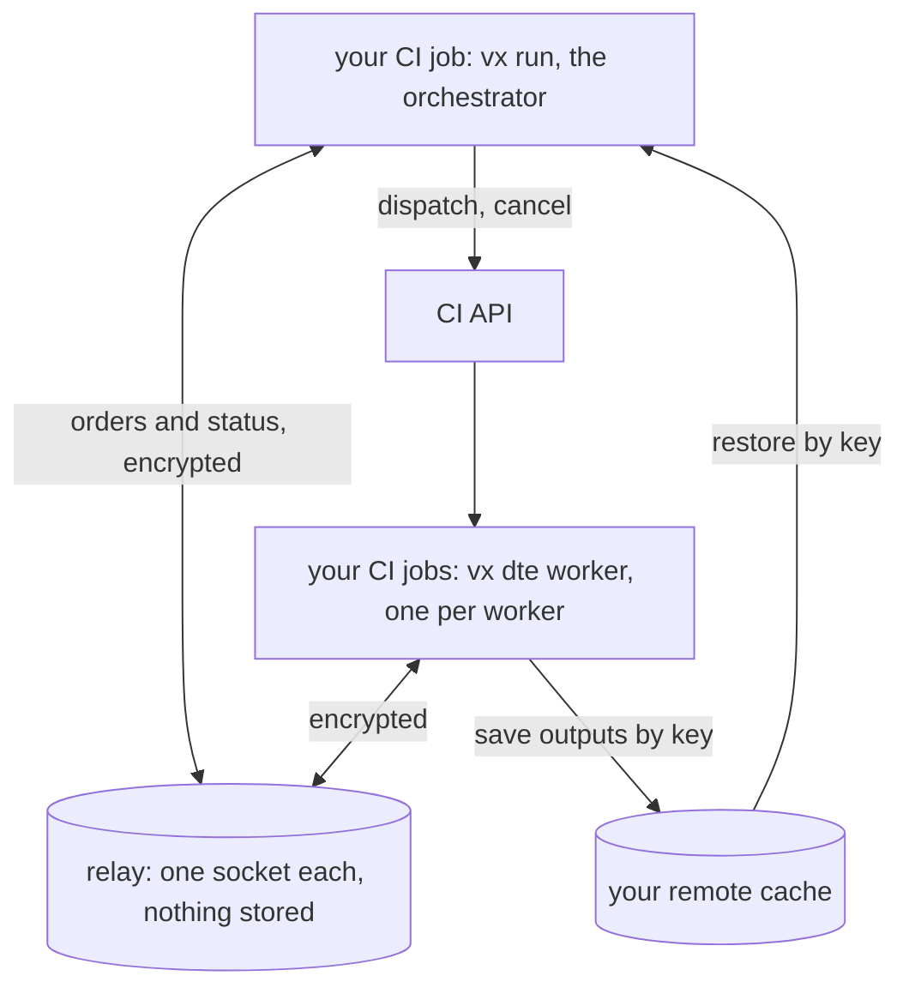
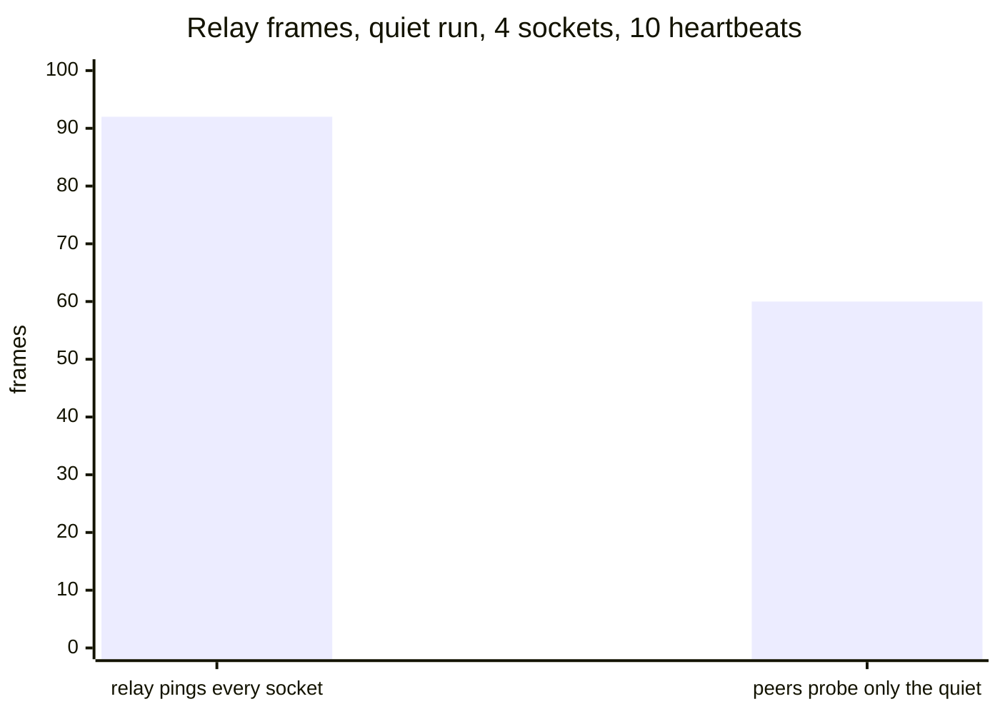
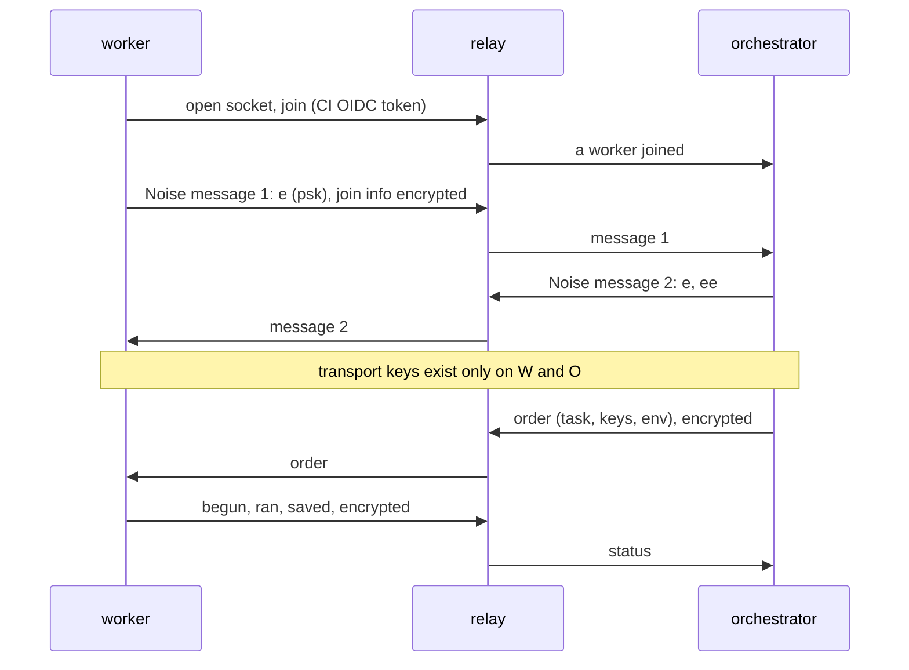
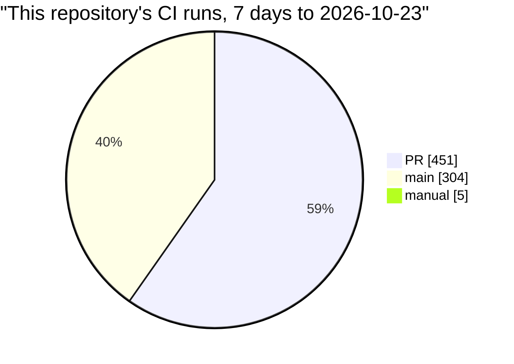

:::caution[Alpha]
`@vzn/vx-dte` and `@vzn/vx-dte-server` are alpha. They are open source,
MIT, in [the vx
repository](https://github.com/vznjs/vx/tree/main/packages/vx-dte), and
vx's own CI runs on them every push.

Names and options may still change.
:::

vx's CI runs on its own GitHub runners, spread by `@vzn/vx-dte`. On Nx
Cloud's Team plan with Nx's agents, the same CI would cost about
**$12,192 a year**. On vx it costs $0.

| Scenario            | Nx Cloud Team, Nx's agents      | vx DTE |
| ------------------- | ------------------------------: | -----: |
| this repository     | $1,016 a month, $12,192 a year  |     $0 |
| a 20-person team    | $1,902 a month, $22,824 a year  |     $0 |

<small>This repository: 108 CI runs a day, week to 2026-10-23 · Nx's public prices read 2026-10-23 · Mac work and concurrent connections not counted · [the math](#what-it-costs-next-to-nx-cloud)</small>

## One run, two minutes, six workers

The first green main as one DTE run
([#4119](https://github.com/vznjs/vx/pull/4119),
[49adc41](https://github.com/vznjs/vx/actions/runs/39985872848)) took 1
min 59 s, docs deploy included.

It was three jobs before: Linux, arm64 and macOS.

| What                                 | Count |
| ------------------------------------ | ----: |
| tasks                                |   129 |
| answered by the local cache          |    96 |
| downloaded from the remote cache     |     8 |
| ran on workers                       |    22 |
| workers that ran tasks (4 Linux, 2 Mac) |  6 |
| workers started, then cancelled as not needed | 13 |

A Mac or arm worker starts only when the graph has a task for it
(`exec.platforms`). Each worker's warm-up and time online:

| Worker  | Warm-up | Online |
| ------- | ------: | -----: |
| small#1 | 19.9 s  | 47.3 s |
| small#4 | 21.1 s  | 58.9 s |
| small#6 | 20.3 s  | 19.8 s |
| small#8 | 19.8 s  | 52.8 s |
| mac#17  | 37.2 s  | 52.5 s |
| mac#19  | 31.9 s  | 15.4 s |

## How the pieces talk



- **The orchestrator** is your CI job's `vx run`. It plans how many
  workers the misses need, starts them and hands out tasks. It runs none
  itself.
- **A worker** is `vx dte worker` in a CI job. It runs what it is sent
  and saves outputs to your cache under the task's key.
- **The relay** passes messages, since CI runners take no inbound
  connection. It keeps none: each side numbers its messages and sends one
  again until the other acks it.
- **The cache** carries every file. No file goes through the relay.

Adapters start workers: `github()`, `gitlab()`, `local()` (git
worktrees) and `docker()`.

## The relay stores nothing

[`@vzn/vx-dte-server`][dte-server] depends only on
[`jose`](https://github.com/panva/jose) and speaks
[PROTOCOL.md][dte-protocol].

[dte-server]: https://github.com/vznjs/vx/tree/main/packages/vx-dte-server
[dte-protocol]: https://github.com/vznjs/vx/blob/main/packages/vx-dte-server/PROTOCOL.md

It has one route: a websocket that joins as it opens. It pushes each
message down the receiver's socket and keeps no copy.

It runs one Durable Object per run on Cloudflare's free plan, or on Bun
in Docker. One var, `ALLOW`, lists who may join as
`issuer:owner/repo:workflow`.



<small>1 orchestrator and 3 idle workers · before: 88-96 frames, 44-48 each way · after: 24 up, 36 down ([#4309](https://github.com/vznjs/vx/pull/4309)) · each participant joins with one request; Workers bills 20 websocket messages as one request, and the relay writes no storage row ([pricing](https://developers.cloudflare.com/durable-objects/platform/pricing/), read 2026-10-23) · [how it works](../relay-stores-nothing/)</small>

## The relay reads nothing it carries



Each worker runs a [Noise](https://noiseprotocol.org/noise.html)
handshake with the orchestrator, on WebCrypto, checked against the
cacophony vectors (`packages/vx-dte/src/noise.ts`).

- With a run key (`VX_DTE_SECRET`) it is
  `Noise_NNpsk0_25519_AESGCM_SHA256`. On GitHub Actions with no key it is
  `Noise_NN_25519_AESGCM_SHA256`, bound by OIDC tokens of the same repo.
- Keys are ephemeral, so a leaked run key opens no past run.
- Each task gets only the env its config passes, encrypted.
- Workers borrow the orchestrator's short-lived cache token. Nothing is
  stored.

## How a run schedules

Only misses need workers. A run the cache answers whole starts none.

- **How many workers:** the planner (`packages/vx-dte/src/planner.ts`)
  starts the fewest that end within 5% of the best. Idle workers leave.
- **Where a task goes:** to a worker with room, holding most of its
  dependencies' outputs, then the fullest one.
- **Which first:** the longest tail of recorded time.
- **What it books:** the cores and memory its history used. No history
  gets one free core.

Each is a layer you swap with `dte({ scheduler })`
(`packages/vx-dte/src/strategy.ts`):

| Layer   | Choices (default first)                                                                                   |
| ------- | --------------------------------------------------------------------------------------------------------- |
| `order` | `critical-path` (HEFT's rank), `graphene` (long and wide first, Grandl OSDI'16), `fifo`                   |
| `place` | `best-fit` (fewest cores left), `tetris` (needs aligned with what is free, SIGCOMM'14), `worst-fit`, `first-fit` |
| `book`  | `measured` (history), `margin` (a fifth more, as Borg does), `whole` (a worker each)                        |
| `scale` | `plan` (the planner above), `backlog` (cores for what is ready or running, as Spark's dynamic allocation)  |

## The simulator matches real runs

`packages/vx-dte/tests/sim.ts` plays a run on a virtual clock with the
plugin's own code, so minutes play in milliseconds.

Main's run at
[c5d8353](https://github.com/vznjs/vx/actions/runs/40014645919), with
each task's measured time, CPU and memory:

| c5d8353           | Real    | Simulated |
| ----------------- | ------: | --------: |
| run end           | 113.8 s |   112.7 s |
| CPU used          |     53% |       56% |
| workers           |       4 |         4 |
| cancelled workers |       0 |         0 |

Every strategy on main's a09b987 run (65 misses, 4-core workers, 20 s
warm-up). The best end on unlimited workers is 120.5 s:

| Strategy          | Simulated end | Workers | Utilization | Worker time |
| ----------------- | ------------: | ------: | ----------: | ----------: |
| default           |       120.5 s |      10 |         86% |    13.1 min |
| order: graphene   |       120.5 s |      10 |         89% |    12.7 min |
| order: fifo       |       120.5 s |      10 |         76% |    14.8 min |
| place: tetris     |       120.5 s |      10 |         77% |    14.6 min |
| place: worst-fit  |       120.5 s |      10 |         77% |    14.6 min |
| place: first-fit  |       120.5 s |      10 |         86% |    13.1 min |
| book: margin      |       120.5 s |      12 |         69% |    16.2 min |
| book: whole       |       348.9 s |      11 |         19% |    58.9 min |
| scale: backlog    |       120.5 s |      12 |         86% |    13.1 min |

```sh
bun test packages/vx-dte/tests/sim.test.ts
```

## Other ways to split a run

Five ways, on 4 vCPU machines that take 20 s to start:

- **One machine:** every task on one job.
- **Static matrix:** N YAML jobs, each a fixed share, tuned once.
- **Build stage, then a matrix:** one job builds, N jobs split the rest.
- **Naive DTE:** N workers up front, one task each, all stay to the end.
- **vx DTE:** the default above.

<small>Machine time is billed 4 vCPU minutes, warm-up included; the 1 vCPU orchestrator counts a quarter · CPU used is work over billed cores · every way but vx DTE played by the ideal packer, vx DTE by the full simulator · `bun packages/vx-dte/scripts/compare.ts`</small>

**vx's main run, a09b987.** 65 tasks, 45.0 core-minutes, a flat graph.

| Way                       |    Ends | Machine time | CPU used |
| ------------------------- | ------: | -----------: | -------: |
| One machine               | 751.0 s |     12.5 min |      90% |
| Static matrix, 10 jobs    | 126.0 s |     18.3 min |      62% |
| Build stage, then 10 jobs | 190.0 s |     18.6 min |      60% |
| Naive DTE, 10 workers     | 392.8 s |     67.1 min |      17% |
| vx DTE, 10 workers        | 120.5 s |     16.9 min |      67% |

**A vx PR.** 16 tasks, 9.2 core-minutes. A bar is a task, as tall as
its cores. Orange is warm-up, grey is billed and idle.

<figure class="vx-gantt"><figcaption>A vx PR, as it runs</figcaption><div class="vx-gantt-way"><div class="vx-gantt-head"><span>One machine</span><span class="vx-gantt-end">189.9 s · 3.2 min</span></div><svg viewBox="0 0 1000 24" preserveAspectRatio="none" height="24" role="img" aria-label="One machine: ends 189.9 s, 3.2 machine-minutes"><rect class="w" x="0" y="0" width="105.3" height="20"/><rect class="o" x="105.3" y="0" width="894.7" height="20"/><rect class="t" x="105.3" y="16.3" width="369.4" height="3.8"/><rect class="t" x="105.3" y="12.8" width="362.7" height="3.5"/><rect class="t" x="105.3" y="9" width="356.9" height="3.8"/><rect class="t" x="105.3" y="5.5" width="313.4" height="3.5"/><rect class="t" x="105.3" y="2" width="309.6" height="3.5"/><rect class="t" x="414.9" y="2" width="289.8" height="3.5"/><rect class="t" x="418.7" y="0" width="289.1" height="3.8"/><rect class="t" x="462.2" y="9" width="285.5" height="3.8"/><rect class="t" x="468" y="0" width="274.6" height="3.8"/><rect class="t" x="474.7" y="16.3" width="273.8" height="3.8"/><rect class="t" x="704.7" y="12.8" width="253.2" height="3.5"/><rect class="t" x="707.8" y="5.5" width="224.7" height="3.5"/><rect class="t" x="742.6" y="0.5" width="94.9" height="5"/><rect class="t" x="748.5" y="0" width="0.7" height="5"/><rect class="t" x="932.5" y="0" width="61.5" height="15"/><rect class="t" x="994" y="5" width="6" height="15"/></svg></div><div class="vx-gantt-way"><div class="vx-gantt-head"><span>Static matrix, 10 jobs</span><span class="vx-gantt-end">90.1 s · 13.2 min</span></div><svg viewBox="0 0 1000 240" preserveAspectRatio="none" height="240" role="img" aria-label="Static matrix, 10 jobs: ends 90.1 s, 13.2 machine-minutes"><rect class="w" x="0" y="0" width="105.3" height="20"/><rect class="o" x="105.3" y="0" width="309.6" height="20"/><rect class="t" x="105.3" y="16.5" width="309.6" height="3.5"/><rect class="t" x="105.3" y="1.5" width="61.5" height="15"/><rect class="w" x="0" y="24" width="105.3" height="20"/><rect class="o" x="105.3" y="24" width="289.7" height="20"/><rect class="t" x="105.3" y="40.5" width="289.7" height="3.5"/><rect class="t" x="105.3" y="35.5" width="0.7" height="5"/><rect class="w" x="0" y="48" width="105.3" height="20"/><rect class="o" x="105.3" y="48" width="362.7" height="20"/><rect class="t" x="105.3" y="64.5" width="362.7" height="3.5"/><rect class="t" x="105.3" y="59.5" width="94.9" height="5"/><rect class="w" x="0" y="72" width="105.3" height="20"/><rect class="o" x="105.3" y="72" width="274.6" height="20"/><rect class="t" x="105.3" y="88.3" width="274.6" height="3.8"/><rect class="t" x="105.3" y="84.8" width="224.8" height="3.5"/><rect class="w" x="0" y="96" width="105.3" height="20"/><rect class="o" x="105.3" y="96" width="369.4" height="20"/><rect class="t" x="105.3" y="112.3" width="369.4" height="3.8"/><rect class="t" x="105.3" y="108.8" width="253.3" height="3.5"/><rect class="w" x="0" y="120" width="105.3" height="20"/><rect class="o" x="105.3" y="120" width="289.1" height="20"/><rect class="t" x="105.3" y="136.3" width="289.1" height="3.8"/><rect class="w" x="0" y="144" width="105.3" height="20"/><rect class="o" x="105.3" y="144" width="356.9" height="20"/><rect class="t" x="105.3" y="160.3" width="356.9" height="3.8"/><rect class="t" x="105.3" y="145.3" width="6" height="15"/><rect class="w" x="0" y="168" width="105.3" height="20"/><rect class="o" x="105.3" y="168" width="285.5" height="20"/><rect class="t" x="105.3" y="184.3" width="285.5" height="3.8"/><rect class="w" x="0" y="192" width="105.3" height="20"/><rect class="o" x="105.3" y="192" width="273.9" height="20"/><rect class="t" x="105.3" y="208.3" width="273.9" height="3.8"/><rect class="w" x="0" y="216" width="105.3" height="20"/><rect class="o" x="105.3" y="216" width="313.4" height="20"/><rect class="t" x="105.3" y="232.5" width="313.4" height="3.5"/></svg></div><div class="vx-gantt-way"><div class="vx-gantt-head"><span>Build stage, then 10 jobs</span><span class="vx-gantt-end">110.1 s · 13.6 min</span></div><svg viewBox="0 0 1000 264" preserveAspectRatio="none" height="264" role="img" aria-label="Build stage, then 10 jobs: ends 110.1 s, 13.6 machine-minutes"><rect class="w" x="0" y="0" width="105.3" height="20"/><rect class="w" x="105.3" y="24" width="105.4" height="20"/><rect class="o" x="210.7" y="24" width="309.6" height="20"/><rect class="t" x="210.7" y="40.5" width="309.6" height="3.5"/><rect class="t" x="210.7" y="25.5" width="61.5" height="15"/><rect class="w" x="105.3" y="48" width="105.4" height="20"/><rect class="o" x="210.7" y="48" width="289.7" height="20"/><rect class="t" x="210.7" y="64.5" width="289.7" height="3.5"/><rect class="t" x="210.7" y="59.5" width="0.7" height="5"/><rect class="w" x="105.3" y="72" width="105.4" height="20"/><rect class="o" x="210.7" y="72" width="362.7" height="20"/><rect class="t" x="210.7" y="88.5" width="362.7" height="3.5"/><rect class="t" x="210.7" y="83.5" width="94.8" height="5"/><rect class="w" x="105.3" y="96" width="105.4" height="20"/><rect class="o" x="210.7" y="96" width="274.6" height="20"/><rect class="t" x="210.7" y="112.3" width="274.6" height="3.8"/><rect class="t" x="210.7" y="108.8" width="224.7" height="3.5"/><rect class="w" x="105.3" y="120" width="105.4" height="20"/><rect class="o" x="210.7" y="120" width="369.3" height="20"/><rect class="t" x="210.7" y="136.3" width="369.3" height="3.8"/><rect class="t" x="210.7" y="132.8" width="253.2" height="3.5"/><rect class="w" x="105.3" y="144" width="105.4" height="20"/><rect class="o" x="210.7" y="144" width="289" height="20"/><rect class="t" x="210.7" y="160.3" width="289" height="3.8"/><rect class="w" x="105.3" y="168" width="105.4" height="20"/><rect class="o" x="210.7" y="168" width="356.8" height="20"/><rect class="t" x="210.7" y="184.3" width="356.8" height="3.8"/><rect class="t" x="210.7" y="169.3" width="6" height="15"/><rect class="w" x="105.3" y="192" width="105.4" height="20"/><rect class="o" x="210.7" y="192" width="285.5" height="20"/><rect class="t" x="210.7" y="208.3" width="285.5" height="3.8"/><rect class="w" x="105.3" y="216" width="105.4" height="20"/><rect class="o" x="210.7" y="216" width="273.8" height="20"/><rect class="t" x="210.7" y="232.3" width="273.8" height="3.8"/><rect class="w" x="105.3" y="240" width="105.4" height="20"/><rect class="o" x="210.7" y="240" width="313.4" height="20"/><rect class="t" x="210.7" y="256.5" width="313.4" height="3.5"/></svg></div><div class="vx-gantt-way"><div class="vx-gantt-head"><span>Naive DTE, 10 workers</span><span class="vx-gantt-end">120.2 s · 20.5 min</span></div><svg viewBox="0 0 1000 240" preserveAspectRatio="none" height="240" role="img" aria-label="Naive DTE, 10 workers: ends 120.2 s, 20.5 machine-minutes"><rect class="w" x="0" y="0" width="105.3" height="20"/><rect class="o" x="105.3" y="0" width="527.9" height="20"/><rect class="t" x="105.3" y="5" width="61.5" height="15"/><rect class="t" x="166.8" y="16.5" width="289.8" height="3.5"/><rect class="w" x="0" y="24" width="105.3" height="20"/><rect class="o" x="105.3" y="24" width="527.9" height="20"/><rect class="t" x="105.3" y="39" width="94.9" height="5"/><rect class="t" x="200.2" y="40.5" width="362.7" height="3.5"/><rect class="w" x="0" y="48" width="105.3" height="20"/><rect class="o" x="105.3" y="48" width="527.9" height="20"/><rect class="t" x="105.3" y="64.3" width="274.6" height="3.8"/><rect class="t" x="379.9" y="64.5" width="253.3" height="3.5"/><rect class="w" x="0" y="72" width="105.3" height="20"/><rect class="o" x="105.3" y="72" width="527.9" height="20"/><rect class="t" x="105.3" y="88.3" width="369.4" height="3.8"/><rect class="w" x="0" y="96" width="105.3" height="20"/><rect class="o" x="105.3" y="96" width="527.9" height="20"/><rect class="t" x="105.3" y="112.3" width="289.1" height="3.8"/><rect class="t" x="394.4" y="111" width="0.7" height="5"/><rect class="w" x="0" y="120" width="105.3" height="20"/><rect class="o" x="105.3" y="120" width="527.9" height="20"/><rect class="t" x="105.3" y="136.3" width="356.9" height="3.8"/><rect class="w" x="0" y="144" width="105.3" height="20"/><rect class="o" x="105.3" y="144" width="527.9" height="20"/><rect class="t" x="105.3" y="160.3" width="285.5" height="3.8"/><rect class="t" x="390.8" y="149" width="6" height="15"/><rect class="w" x="0" y="168" width="105.3" height="20"/><rect class="o" x="105.3" y="168" width="527.9" height="20"/><rect class="t" x="105.3" y="184.3" width="273.9" height="3.8"/><rect class="t" x="379.2" y="184.5" width="224.7" height="3.5"/><rect class="w" x="0" y="192" width="105.3" height="20"/><rect class="o" x="105.3" y="192" width="527.9" height="20"/><rect class="t" x="105.3" y="208.5" width="313.4" height="3.5"/><rect class="w" x="0" y="216" width="105.3" height="20"/><rect class="o" x="105.3" y="216" width="527.9" height="20"/><rect class="t" x="105.3" y="232.5" width="309.6" height="3.5"/></svg></div><div class="vx-gantt-way vx-gantt-lead"><div class="vx-gantt-head"><span>vx DTE, 3 workers</span><span class="vx-gantt-end">90.1 s · 4.4 min</span></div><svg viewBox="0 0 1000 72" preserveAspectRatio="none" height="72" role="img" aria-label="vx DTE, 3 workers: ends 90.1 s, 4.4 machine-minutes"><rect class="w" x="0" y="0" width="105.3" height="20"/><rect class="o" x="105.3" y="0" width="369.4" height="20"/><rect class="t" x="105.3" y="16.3" width="369.4" height="3.8"/><rect class="t" x="105.3" y="12.8" width="362.7" height="3.5"/><rect class="t" x="105.3" y="9" width="356.9" height="3.8"/><rect class="t" x="105.3" y="5.5" width="313.4" height="3.5"/><rect class="t" x="105.3" y="2" width="309.6" height="3.5"/><rect class="w" x="0" y="24" width="105.3" height="20"/><rect class="o" x="105.3" y="24" width="289.7" height="20"/><rect class="t" x="105.3" y="40.5" width="289.7" height="3.5"/><rect class="t" x="105.3" y="36.8" width="289.1" height="3.8"/><rect class="t" x="105.3" y="33" width="285.5" height="3.8"/><rect class="t" x="105.3" y="29.3" width="274.6" height="3.8"/><rect class="t" x="105.3" y="25.5" width="273.9" height="3.8"/><rect class="w" x="0" y="48" width="105.3" height="20"/><rect class="o" x="105.3" y="48" width="292.3" height="20"/><rect class="t" x="105.3" y="64.5" width="253.3" height="3.5"/><rect class="t" x="105.3" y="61" width="224.8" height="3.5"/><rect class="t" x="105.3" y="56" width="94.9" height="5"/><rect class="t" x="105.3" y="51" width="0.7" height="5"/><rect class="t" x="330.1" y="49.5" width="61.5" height="15"/><rect class="t" x="391.6" y="53" width="6" height="15"/></svg></div></figure>

| Way                       |    Ends | Machine time | CPU used |
| ------------------------- | ------: | -----------: | -------: |
| One machine               | 189.9 s |      3.2 min |      73% |
| Static matrix, 10 jobs    |  90.1 s |     13.2 min |      17% |
| Build stage, then 10 jobs | 110.1 s |     13.6 min |      17% |
| Naive DTE, 10 workers     | 120.2 s |     20.5 min |      11% |
| vx DTE, 3 workers         |  90.1 s |      4.4 min |      53% |

**An app monorepo after a base library change.** 24 chained libraries,
4 apps, 84 tasks, 71.0 core-minutes.

<figure class="vx-gantt"><figcaption>The app monorepo after a base library change, as it runs</figcaption><div class="vx-gantt-way"><div class="vx-gantt-head"><span>One machine</span><span class="vx-gantt-end">1205.0 s · 20.1 min</span></div><svg viewBox="0 0 1000 24" preserveAspectRatio="none" height="24" role="img" aria-label="One machine: ends 1205.0 s, 20.1 machine-minutes"><rect class="w" x="0" y="0" width="16.6" height="20"/><rect class="o" x="16.6" y="0" width="983.4" height="20"/><rect class="t" x="16.6" y="12.5" width="16.6" height="7.5"/><rect class="t" x="16.6" y="7.5" width="8.3" height="5"/><rect class="t" x="16.6" y="2.5" width="8.3" height="5"/><rect class="t" x="24.9" y="7.5" width="8.3" height="5"/><rect class="t" x="24.9" y="2.5" width="8.3" height="5"/><rect class="t" x="33.2" y="12.5" width="16.6" height="7.5"/><rect class="t" x="33.2" y="7.5" width="37.3" height="5"/><rect class="t" x="33.2" y="2.5" width="8.3" height="5"/><rect class="t" x="41.5" y="2.5" width="8.3" height="5"/><rect class="t" x="49.8" y="12.5" width="16.6" height="7.5"/><rect class="t" x="49.8" y="2.5" width="37.3" height="5"/><rect class="t" x="66.4" y="12.5" width="16.6" height="7.5"/><rect class="t" x="70.5" y="7.5" width="37.4" height="5"/><rect class="t" x="83" y="12.5" width="16.6" height="7.5"/><rect class="t" x="87.1" y="2.5" width="37.4" height="5"/><rect class="t" x="99.6" y="12.5" width="16.6" height="7.5"/><rect class="t" x="107.9" y="7.5" width="37.3" height="5"/><rect class="t" x="116.2" y="12.5" width="16.6" height="7.5"/><rect class="t" x="124.5" y="2.5" width="37.3" height="5"/><rect class="t" x="132.8" y="12.5" width="16.6" height="7.5"/><rect class="t" x="145.2" y="7.5" width="37.4" height="5"/><rect class="t" x="149.4" y="12.5" width="16.6" height="7.5"/><rect class="t" x="161.8" y="2.5" width="37.4" height="5"/><rect class="t" x="166" y="12.5" width="16.6" height="7.5"/><rect class="t" x="182.6" y="12.5" width="16.6" height="7.5"/><rect class="t" x="182.6" y="7.5" width="37.3" height="5"/><rect class="t" x="199.2" y="12.5" width="16.6" height="7.5"/><rect class="t" x="199.2" y="2.5" width="37.3" height="5"/><rect class="t" x="215.8" y="12.5" width="16.6" height="7.5"/><rect class="t" x="219.9" y="7.5" width="37.4" height="5"/><rect class="t" x="232.4" y="12.5" width="16.6" height="7.5"/><rect class="t" x="236.5" y="2.5" width="37.4" height="5"/><rect class="t" x="249" y="12.5" width="16.6" height="7.5"/><rect class="t" x="257.3" y="7.5" width="37.3" height="5"/><rect class="t" x="265.6" y="12.5" width="16.6" height="7.5"/><rect class="t" x="273.9" y="2.5" width="37.3" height="5"/><rect class="t" x="282.2" y="12.5" width="16.6" height="7.5"/><rect class="t" x="294.6" y="7.5" width="37.4" height="5"/><rect class="t" x="298.8" y="12.5" width="16.6" height="7.5"/><rect class="t" x="311.2" y="2.5" width="37.3" height="5"/><rect class="t" x="315.4" y="12.5" width="16.6" height="7.5"/><rect class="t" x="332" y="12.5" width="16.5" height="7.5"/><rect class="t" x="332" y="7.5" width="37.3" height="5"/><rect class="t" x="348.5" y="12.5" width="16.6" height="7.5"/><rect class="t" x="348.5" y="2.5" width="37.4" height="5"/><rect class="t" x="365.1" y="12.5" width="16.6" height="7.5"/><rect class="t" x="369.3" y="7.5" width="37.3" height="5"/><rect class="t" x="381.7" y="12.5" width="16.6" height="7.5"/><rect class="t" x="385.9" y="2.5" width="37.3" height="5"/><rect class="t" x="398.3" y="12.5" width="16.6" height="7.5"/><rect class="t" x="406.6" y="7.5" width="37.4" height="5"/><rect class="t" x="414.9" y="15" width="37.4" height="5"/><rect class="t" x="414.9" y="0" width="37.4" height="5"/><rect class="t" x="423.2" y="0" width="37.4" height="5"/><rect class="t" x="444" y="10" width="8.3" height="5"/><rect class="t" x="452.3" y="5" width="74.7" height="15"/><rect class="t" x="460.6" y="0" width="8.3" height="5"/><rect class="t" x="468.9" y="0" width="8.3" height="5"/><rect class="t" x="477.2" y="0" width="8.3" height="5"/><rect class="t" x="485.5" y="0" width="8.3" height="5"/><rect class="t" x="493.8" y="0" width="8.3" height="5"/><rect class="t" x="502.1" y="0" width="8.3" height="5"/><rect class="t" x="510.4" y="0" width="8.3" height="5"/><rect class="t" x="518.7" y="0" width="8.3" height="5"/><rect class="t" x="527" y="5" width="74.7" height="15"/><rect class="t" x="527" y="0" width="49.8" height="5"/><rect class="t" x="576.8" y="0" width="8.3" height="5"/><rect class="t" x="585.1" y="0" width="8.3" height="5"/><rect class="t" x="593.4" y="0" width="8.3" height="5"/><rect class="t" x="601.7" y="5" width="74.6" height="15"/><rect class="t" x="601.7" y="0" width="49.8" height="5"/><rect class="t" x="651.5" y="0" width="8.3" height="5"/><rect class="t" x="659.8" y="0" width="8.2" height="5"/><rect class="t" x="668" y="0" width="8.3" height="5"/><rect class="t" x="676.3" y="5" width="74.7" height="15"/><rect class="t" x="676.3" y="0" width="49.8" height="5"/><rect class="t" x="726.1" y="0" width="8.3" height="5"/><rect class="t" x="734.4" y="0" width="8.3" height="5"/><rect class="t" x="742.7" y="0" width="8.3" height="5"/><rect class="t" x="751" y="12.5" width="124.5" height="7.5"/><rect class="t" x="751" y="5" width="124.5" height="7.5"/><rect class="t" x="751" y="0" width="49.8" height="5"/><rect class="t" x="875.5" y="12.5" width="124.5" height="7.5"/><rect class="t" x="875.5" y="5" width="124.5" height="7.5"/></svg></div><div class="vx-gantt-way"><div class="vx-gantt-head"><span>Static matrix, 6 jobs</span><span class="vx-gantt-end">810.0 s · 73.1 min</span></div><svg viewBox="0 0 1000 144" preserveAspectRatio="none" height="144" role="img" aria-label="Static matrix, 6 jobs: ends 810.0 s, 73.1 machine-minutes"><rect class="w" x="0" y="0" width="16.6" height="20"/><rect class="o" x="16.6" y="0" width="531.1" height="20"/><rect class="t" x="16.6" y="12.5" width="16.6" height="7.5"/><rect class="t" x="33.2" y="12.5" width="16.6" height="7.5"/><rect class="t" x="49.8" y="12.5" width="16.6" height="7.5"/><rect class="t" x="66.4" y="12.5" width="16.6" height="7.5"/><rect class="t" x="83" y="12.5" width="16.6" height="7.5"/><rect class="t" x="99.6" y="12.5" width="16.6" height="7.5"/><rect class="t" x="116.2" y="12.5" width="16.6" height="7.5"/><rect class="t" x="132.8" y="12.5" width="16.6" height="7.5"/><rect class="t" x="149.4" y="12.5" width="16.6" height="7.5"/><rect class="t" x="166" y="12.5" width="16.6" height="7.5"/><rect class="t" x="182.6" y="12.5" width="16.6" height="7.5"/><rect class="t" x="199.2" y="12.5" width="16.6" height="7.5"/><rect class="t" x="215.8" y="12.5" width="16.6" height="7.5"/><rect class="t" x="232.4" y="12.5" width="16.6" height="7.5"/><rect class="t" x="249" y="12.5" width="16.6" height="7.5"/><rect class="t" x="265.6" y="12.5" width="16.6" height="7.5"/><rect class="t" x="282.2" y="12.5" width="16.6" height="7.5"/><rect class="t" x="298.8" y="12.5" width="16.6" height="7.5"/><rect class="t" x="315.4" y="12.5" width="16.6" height="7.5"/><rect class="t" x="332" y="12.5" width="16.5" height="7.5"/><rect class="t" x="348.5" y="12.5" width="16.6" height="7.5"/><rect class="t" x="365.1" y="12.5" width="16.6" height="7.5"/><rect class="t" x="381.7" y="12.5" width="16.6" height="7.5"/><rect class="t" x="398.3" y="5" width="74.7" height="15"/><rect class="t" x="473" y="5" width="74.7" height="15"/><rect class="w" x="0" y="24" width="16.6" height="20"/><rect class="o" x="16.6" y="24" width="580.9" height="20"/><rect class="t" x="16.6" y="36.5" width="16.6" height="7.5"/><rect class="t" x="33.2" y="36.5" width="16.6" height="7.5"/><rect class="t" x="33.2" y="31.5" width="37.3" height="5"/><rect class="t" x="49.8" y="36.5" width="16.6" height="7.5"/><rect class="t" x="66.4" y="36.5" width="16.6" height="7.5"/><rect class="t" x="66.4" y="26.5" width="37.3" height="5"/><rect class="t" x="83" y="36.5" width="16.6" height="7.5"/><rect class="t" x="99.6" y="36.5" width="16.6" height="7.5"/><rect class="t" x="99.6" y="31.5" width="37.3" height="5"/><rect class="t" x="116.2" y="36.5" width="16.6" height="7.5"/><rect class="t" x="132.8" y="36.5" width="16.6" height="7.5"/><rect class="t" x="132.8" y="26.5" width="37.3" height="5"/><rect class="t" x="149.4" y="36.5" width="16.6" height="7.5"/><rect class="t" x="166" y="36.5" width="16.6" height="7.5"/><rect class="t" x="166" y="31.5" width="37.3" height="5"/><rect class="t" x="182.6" y="36.5" width="16.6" height="7.5"/><rect class="t" x="199.2" y="36.5" width="16.6" height="7.5"/><rect class="t" x="199.2" y="26.5" width="37.3" height="5"/><rect class="t" x="215.8" y="36.5" width="16.6" height="7.5"/><rect class="t" x="232.4" y="36.5" width="16.6" height="7.5"/><rect class="t" x="232.4" y="31.5" width="37.3" height="5"/><rect class="t" x="249" y="36.5" width="16.6" height="7.5"/><rect class="t" x="265.6" y="36.5" width="16.6" height="7.5"/><rect class="t" x="265.6" y="26.5" width="37.3" height="5"/><rect class="t" x="282.2" y="36.5" width="16.6" height="7.5"/><rect class="t" x="298.8" y="36.5" width="16.6" height="7.5"/><rect class="t" x="298.8" y="31.5" width="37.3" height="5"/><rect class="t" x="315.4" y="36.5" width="16.6" height="7.5"/><rect class="t" x="332" y="36.5" width="16.5" height="7.5"/><rect class="t" x="332" y="26.5" width="37.3" height="5"/><rect class="t" x="348.5" y="36.5" width="16.6" height="7.5"/><rect class="t" x="365.1" y="36.5" width="16.6" height="7.5"/><rect class="t" x="365.1" y="31.5" width="37.4" height="5"/><rect class="t" x="381.7" y="36.5" width="16.6" height="7.5"/><rect class="t" x="398.3" y="24" width="74.7" height="15"/><rect class="t" x="402.5" y="39" width="37.3" height="5"/><rect class="t" x="473" y="29" width="74.7" height="15"/><rect class="t" x="473" y="24" width="49.8" height="5"/><rect class="t" x="547.7" y="39" width="49.8" height="5"/><rect class="w" x="0" y="48" width="16.6" height="20"/><rect class="o" x="16.6" y="48" width="655.6" height="20"/><rect class="t" x="16.6" y="60.5" width="16.6" height="7.5"/><rect class="t" x="16.6" y="55.5" width="8.3" height="5"/><rect class="t" x="16.6" y="50.5" width="8.3" height="5"/><rect class="t" x="24.9" y="55.5" width="8.3" height="5"/><rect class="t" x="24.9" y="50.5" width="8.3" height="5"/><rect class="t" x="33.2" y="60.5" width="16.6" height="7.5"/><rect class="t" x="33.2" y="55.5" width="8.3" height="5"/><rect class="t" x="33.2" y="50.5" width="8.3" height="5"/><rect class="t" x="41.5" y="55.5" width="8.3" height="5"/><rect class="t" x="41.5" y="50.5" width="8.3" height="5"/><rect class="t" x="49.8" y="60.5" width="16.6" height="7.5"/><rect class="t" x="49.8" y="55.5" width="8.3" height="5"/><rect class="t" x="49.8" y="50.5" width="8.3" height="5"/><rect class="t" x="58.1" y="55.5" width="8.3" height="5"/><rect class="t" x="58.1" y="50.5" width="8.3" height="5"/><rect class="t" x="66.4" y="60.5" width="16.6" height="7.5"/><rect class="t" x="83" y="60.5" width="16.6" height="7.5"/><rect class="t" x="99.6" y="60.5" width="16.6" height="7.5"/><rect class="t" x="116.2" y="60.5" width="16.6" height="7.5"/><rect class="t" x="132.8" y="60.5" width="16.6" height="7.5"/><rect class="t" x="149.4" y="60.5" width="16.6" height="7.5"/><rect class="t" x="166" y="60.5" width="16.6" height="7.5"/><rect class="t" x="182.6" y="60.5" width="16.6" height="7.5"/><rect class="t" x="199.2" y="60.5" width="16.6" height="7.5"/><rect class="t" x="215.8" y="60.5" width="16.6" height="7.5"/><rect class="t" x="232.4" y="60.5" width="16.6" height="7.5"/><rect class="t" x="249" y="60.5" width="16.6" height="7.5"/><rect class="t" x="265.6" y="60.5" width="16.6" height="7.5"/><rect class="t" x="282.2" y="60.5" width="16.6" height="7.5"/><rect class="t" x="298.8" y="60.5" width="16.6" height="7.5"/><rect class="t" x="315.4" y="60.5" width="16.6" height="7.5"/><rect class="t" x="332" y="60.5" width="16.5" height="7.5"/><rect class="t" x="348.5" y="60.5" width="16.6" height="7.5"/><rect class="t" x="365.1" y="60.5" width="16.6" height="7.5"/><rect class="t" x="381.7" y="60.5" width="16.6" height="7.5"/><rect class="t" x="398.3" y="53" width="74.7" height="15"/><rect class="t" x="473" y="53" width="74.7" height="15"/><rect class="t" x="547.7" y="60.5" width="124.5" height="7.5"/><rect class="t" x="547.7" y="53" width="124.5" height="7.5"/><rect class="w" x="0" y="72" width="16.6" height="20"/><rect class="o" x="16.6" y="72" width="547.7" height="20"/><rect class="t" x="16.6" y="84.5" width="16.6" height="7.5"/><rect class="t" x="33.2" y="84.5" width="16.6" height="7.5"/><rect class="t" x="49.8" y="84.5" width="16.6" height="7.5"/><rect class="t" x="66.4" y="84.5" width="16.6" height="7.5"/><rect class="t" x="83" y="84.5" width="16.6" height="7.5"/><rect class="t" x="99.6" y="84.5" width="16.6" height="7.5"/><rect class="t" x="116.2" y="84.5" width="16.6" height="7.5"/><rect class="t" x="132.8" y="84.5" width="16.6" height="7.5"/><rect class="t" x="149.4" y="84.5" width="16.6" height="7.5"/><rect class="t" x="166" y="84.5" width="16.6" height="7.5"/><rect class="t" x="182.6" y="84.5" width="16.6" height="7.5"/><rect class="t" x="199.2" y="84.5" width="16.6" height="7.5"/><rect class="t" x="215.8" y="84.5" width="16.6" height="7.5"/><rect class="t" x="232.4" y="84.5" width="16.6" height="7.5"/><rect class="t" x="249" y="84.5" width="16.6" height="7.5"/><rect class="t" x="265.6" y="84.5" width="16.6" height="7.5"/><rect class="t" x="282.2" y="84.5" width="16.6" height="7.5"/><rect class="t" x="298.8" y="84.5" width="16.6" height="7.5"/><rect class="t" x="315.4" y="84.5" width="16.6" height="7.5"/><rect class="t" x="332" y="84.5" width="16.5" height="7.5"/><rect class="t" x="348.5" y="84.5" width="16.6" height="7.5"/><rect class="t" x="365.1" y="84.5" width="16.6" height="7.5"/><rect class="t" x="381.7" y="77" width="74.7" height="15"/><rect class="t" x="456.4" y="77" width="74.7" height="15"/><rect class="t" x="531.1" y="84.5" width="16.6" height="7.5"/><rect class="t" x="547.7" y="84.5" width="16.6" height="7.5"/><rect class="w" x="0" y="96" width="16.6" height="20"/><rect class="o" x="16.6" y="96" width="585.1" height="20"/><rect class="t" x="16.6" y="108.5" width="16.6" height="7.5"/><rect class="t" x="33.2" y="108.5" width="16.6" height="7.5"/><rect class="t" x="49.8" y="108.5" width="16.6" height="7.5"/><rect class="t" x="49.8" y="103.5" width="37.3" height="5"/><rect class="t" x="66.4" y="108.5" width="16.6" height="7.5"/><rect class="t" x="83" y="108.5" width="16.6" height="7.5"/><rect class="t" x="83" y="98.5" width="37.3" height="5"/><rect class="t" x="99.6" y="108.5" width="16.6" height="7.5"/><rect class="t" x="116.2" y="108.5" width="16.6" height="7.5"/><rect class="t" x="116.2" y="103.5" width="37.3" height="5"/><rect class="t" x="132.8" y="108.5" width="16.6" height="7.5"/><rect class="t" x="149.4" y="108.5" width="16.6" height="7.5"/><rect class="t" x="149.4" y="98.5" width="37.3" height="5"/><rect class="t" x="166" y="108.5" width="16.6" height="7.5"/><rect class="t" x="182.6" y="108.5" width="16.6" height="7.5"/><rect class="t" x="182.6" y="103.5" width="37.3" height="5"/><rect class="t" x="199.2" y="108.5" width="16.6" height="7.5"/><rect class="t" x="215.8" y="108.5" width="16.6" height="7.5"/><rect class="t" x="215.8" y="98.5" width="37.3" height="5"/><rect class="t" x="232.4" y="108.5" width="16.6" height="7.5"/><rect class="t" x="249" y="108.5" width="16.6" height="7.5"/><rect class="t" x="249" y="103.5" width="37.3" height="5"/><rect class="t" x="265.6" y="108.5" width="16.6" height="7.5"/><rect class="t" x="282.2" y="108.5" width="16.6" height="7.5"/><rect class="t" x="282.2" y="98.5" width="37.3" height="5"/><rect class="t" x="298.8" y="108.5" width="16.6" height="7.5"/><rect class="t" x="315.4" y="108.5" width="16.6" height="7.5"/><rect class="t" x="315.4" y="103.5" width="37.3" height="5"/><rect class="t" x="332" y="108.5" width="16.5" height="7.5"/><rect class="t" x="348.5" y="108.5" width="16.6" height="7.5"/><rect class="t" x="348.5" y="98.5" width="37.4" height="5"/><rect class="t" x="365.1" y="108.5" width="16.6" height="7.5"/><rect class="t" x="381.7" y="96" width="74.7" height="15"/><rect class="t" x="385.9" y="111" width="37.3" height="5"/><rect class="t" x="456.4" y="101" width="74.7" height="15"/><rect class="t" x="456.4" y="96" width="49.8" height="5"/><rect class="t" x="531.1" y="108.5" width="16.6" height="7.5"/><rect class="t" x="531.1" y="103.5" width="49.8" height="5"/><rect class="t" x="547.7" y="108.5" width="16.6" height="7.5"/><rect class="t" x="564.3" y="111" width="37.4" height="5"/><rect class="w" x="0" y="120" width="16.6" height="20"/><rect class="o" x="16.6" y="120" width="639" height="20"/><rect class="t" x="16.6" y="132.5" width="16.6" height="7.5"/><rect class="t" x="16.6" y="127.5" width="8.3" height="5"/><rect class="t" x="16.6" y="122.5" width="8.3" height="5"/><rect class="t" x="24.9" y="127.5" width="8.3" height="5"/><rect class="t" x="24.9" y="122.5" width="8.3" height="5"/><rect class="t" x="33.2" y="132.5" width="16.6" height="7.5"/><rect class="t" x="33.2" y="127.5" width="8.3" height="5"/><rect class="t" x="33.2" y="122.5" width="8.3" height="5"/><rect class="t" x="41.5" y="127.5" width="8.3" height="5"/><rect class="t" x="41.5" y="122.5" width="8.3" height="5"/><rect class="t" x="49.8" y="132.5" width="16.6" height="7.5"/><rect class="t" x="49.8" y="127.5" width="8.3" height="5"/><rect class="t" x="49.8" y="122.5" width="8.3" height="5"/><rect class="t" x="58.1" y="127.5" width="8.3" height="5"/><rect class="t" x="58.1" y="122.5" width="8.3" height="5"/><rect class="t" x="66.4" y="132.5" width="16.6" height="7.5"/><rect class="t" x="83" y="132.5" width="16.6" height="7.5"/><rect class="t" x="99.6" y="132.5" width="16.6" height="7.5"/><rect class="t" x="116.2" y="132.5" width="16.6" height="7.5"/><rect class="t" x="132.8" y="132.5" width="16.6" height="7.5"/><rect class="t" x="149.4" y="132.5" width="16.6" height="7.5"/><rect class="t" x="166" y="132.5" width="16.6" height="7.5"/><rect class="t" x="182.6" y="132.5" width="16.6" height="7.5"/><rect class="t" x="199.2" y="132.5" width="16.6" height="7.5"/><rect class="t" x="215.8" y="132.5" width="16.6" height="7.5"/><rect class="t" x="232.4" y="132.5" width="16.6" height="7.5"/><rect class="t" x="249" y="132.5" width="16.6" height="7.5"/><rect class="t" x="265.6" y="132.5" width="16.6" height="7.5"/><rect class="t" x="282.2" y="132.5" width="16.6" height="7.5"/><rect class="t" x="298.8" y="132.5" width="16.6" height="7.5"/><rect class="t" x="315.4" y="132.5" width="16.6" height="7.5"/><rect class="t" x="332" y="132.5" width="16.5" height="7.5"/><rect class="t" x="348.5" y="132.5" width="16.6" height="7.5"/><rect class="t" x="365.1" y="132.5" width="16.6" height="7.5"/><rect class="t" x="381.7" y="125" width="74.7" height="15"/><rect class="t" x="456.4" y="125" width="74.7" height="15"/><rect class="t" x="531.1" y="132.5" width="124.5" height="7.5"/><rect class="t" x="531.1" y="125" width="124.5" height="7.5"/></svg></div><div class="vx-gantt-way"><div class="vx-gantt-head"><span>Build stage, then 6 jobs</span><span class="vx-gantt-end">1060.0 s · 27.3 min</span></div><svg viewBox="0 0 1000 168" preserveAspectRatio="none" height="168" role="img" aria-label="Build stage, then 6 jobs: ends 1060.0 s, 27.3 machine-minutes"><rect class="w" x="0" y="0" width="16.6" height="20"/><rect class="o" x="16.6" y="0" width="697.1" height="20"/><rect class="t" x="16.6" y="12.5" width="16.6" height="7.5"/><rect class="t" x="33.2" y="12.5" width="16.6" height="7.5"/><rect class="t" x="49.8" y="12.5" width="16.6" height="7.5"/><rect class="t" x="66.4" y="12.5" width="16.6" height="7.5"/><rect class="t" x="83" y="12.5" width="16.6" height="7.5"/><rect class="t" x="99.6" y="12.5" width="16.6" height="7.5"/><rect class="t" x="116.2" y="12.5" width="16.6" height="7.5"/><rect class="t" x="132.8" y="12.5" width="16.6" height="7.5"/><rect class="t" x="149.4" y="12.5" width="16.6" height="7.5"/><rect class="t" x="166" y="12.5" width="16.6" height="7.5"/><rect class="t" x="182.6" y="12.5" width="16.6" height="7.5"/><rect class="t" x="199.2" y="12.5" width="16.6" height="7.5"/><rect class="t" x="215.8" y="12.5" width="16.6" height="7.5"/><rect class="t" x="232.4" y="12.5" width="16.6" height="7.5"/><rect class="t" x="249" y="12.5" width="16.6" height="7.5"/><rect class="t" x="265.6" y="12.5" width="16.6" height="7.5"/><rect class="t" x="282.2" y="12.5" width="16.6" height="7.5"/><rect class="t" x="298.8" y="12.5" width="16.6" height="7.5"/><rect class="t" x="315.4" y="12.5" width="16.6" height="7.5"/><rect class="t" x="332" y="12.5" width="16.5" height="7.5"/><rect class="t" x="348.5" y="12.5" width="16.6" height="7.5"/><rect class="t" x="365.1" y="12.5" width="16.6" height="7.5"/><rect class="t" x="381.7" y="12.5" width="16.6" height="7.5"/><rect class="t" x="398.3" y="5" width="74.7" height="15"/><rect class="t" x="473" y="5" width="74.7" height="15"/><rect class="t" x="547.7" y="5" width="74.7" height="15"/><rect class="t" x="622.4" y="5" width="74.7" height="15"/><rect class="t" x="697.1" y="12.5" width="16.6" height="7.5"/><rect class="w" x="713.7" y="24" width="16.6" height="20"/><rect class="w" x="713.7" y="48" width="16.6" height="20"/><rect class="o" x="730.3" y="48" width="149.4" height="20"/><rect class="t" x="730.3" y="63" width="49.8" height="5"/><rect class="t" x="730.3" y="58" width="49.8" height="5"/><rect class="t" x="730.3" y="53" width="37.3" height="5"/><rect class="t" x="730.3" y="48" width="37.3" height="5"/><rect class="t" x="767.6" y="53" width="37.4" height="5"/><rect class="t" x="767.6" y="48" width="37.4" height="5"/><rect class="t" x="780.1" y="63" width="37.3" height="5"/><rect class="t" x="780.1" y="58" width="37.3" height="5"/><rect class="t" x="805" y="53" width="37.3" height="5"/><rect class="t" x="805" y="48" width="37.3" height="5"/><rect class="t" x="817.4" y="63" width="37.4" height="5"/><rect class="t" x="817.4" y="58" width="37.4" height="5"/><rect class="t" x="842.3" y="53" width="37.4" height="5"/><rect class="t" x="842.3" y="48" width="37.4" height="5"/><rect class="w" x="713.7" y="72" width="16.6" height="20"/><rect class="o" x="730.3" y="72" width="124.5" height="20"/><rect class="t" x="730.3" y="84.5" width="124.5" height="7.5"/><rect class="t" x="730.3" y="77" width="124.5" height="7.5"/><rect class="t" x="730.3" y="72" width="8.3" height="5"/><rect class="t" x="738.6" y="72" width="8.3" height="5"/><rect class="t" x="746.9" y="72" width="8.3" height="5"/><rect class="t" x="755.2" y="72" width="8.3" height="5"/><rect class="t" x="763.5" y="72" width="8.3" height="5"/><rect class="t" x="771.8" y="72" width="8.3" height="5"/><rect class="t" x="780.1" y="72" width="8.3" height="5"/><rect class="t" x="788.4" y="72" width="8.3" height="5"/><rect class="t" x="796.7" y="72" width="8.3" height="5"/><rect class="t" x="805" y="72" width="8.3" height="5"/><rect class="t" x="813.3" y="72" width="8.3" height="5"/><rect class="t" x="821.6" y="72" width="8.3" height="5"/><rect class="w" x="713.7" y="96" width="16.6" height="20"/><rect class="w" x="713.7" y="120" width="16.6" height="20"/><rect class="o" x="730.3" y="120" width="149.4" height="20"/><rect class="t" x="730.3" y="135" width="49.8" height="5"/><rect class="t" x="730.3" y="130" width="49.8" height="5"/><rect class="t" x="730.3" y="125" width="37.3" height="5"/><rect class="t" x="730.3" y="120" width="37.3" height="5"/><rect class="t" x="767.6" y="125" width="37.4" height="5"/><rect class="t" x="767.6" y="120" width="37.4" height="5"/><rect class="t" x="780.1" y="135" width="37.3" height="5"/><rect class="t" x="780.1" y="130" width="37.3" height="5"/><rect class="t" x="805" y="125" width="37.3" height="5"/><rect class="t" x="805" y="120" width="37.3" height="5"/><rect class="t" x="817.4" y="135" width="37.4" height="5"/><rect class="t" x="817.4" y="130" width="37.4" height="5"/><rect class="t" x="842.3" y="125" width="37.4" height="5"/><rect class="t" x="842.3" y="120" width="37.4" height="5"/><rect class="w" x="713.7" y="144" width="16.6" height="20"/><rect class="o" x="730.3" y="144" width="124.5" height="20"/><rect class="t" x="730.3" y="156.5" width="124.5" height="7.5"/><rect class="t" x="730.3" y="149" width="124.5" height="7.5"/><rect class="t" x="730.3" y="144" width="8.3" height="5"/><rect class="t" x="738.6" y="144" width="8.3" height="5"/><rect class="t" x="746.9" y="144" width="8.3" height="5"/><rect class="t" x="755.2" y="144" width="8.3" height="5"/><rect class="t" x="763.5" y="144" width="8.3" height="5"/><rect class="t" x="771.8" y="144" width="8.3" height="5"/><rect class="t" x="780.1" y="144" width="8.3" height="5"/><rect class="t" x="788.4" y="144" width="8.3" height="5"/><rect class="t" x="796.7" y="144" width="8.3" height="5"/><rect class="t" x="805" y="144" width="8.3" height="5"/><rect class="t" x="813.3" y="144" width="8.3" height="5"/><rect class="t" x="821.6" y="144" width="8.3" height="5"/></svg></div><div class="vx-gantt-way"><div class="vx-gantt-head"><span>Naive DTE, 6 workers</span><span class="vx-gantt-end">765.0 s · 79.7 min</span></div><svg viewBox="0 0 1000 144" preserveAspectRatio="none" height="144" role="img" aria-label="Naive DTE, 6 workers: ends 765.0 s, 79.7 machine-minutes"><rect class="w" x="0" y="0" width="16.6" height="20"/><rect class="o" x="16.6" y="0" width="618.3" height="20"/><rect class="t" x="16.6" y="12.5" width="16.6" height="7.5"/><rect class="t" x="33.2" y="15" width="8.3" height="5"/><rect class="t" x="41.5" y="15" width="8.3" height="5"/><rect class="t" x="49.8" y="15" width="8.3" height="5"/><rect class="t" x="66.4" y="15" width="37.3" height="5"/><rect class="t" x="116.2" y="15" width="37.3" height="5"/><rect class="t" x="166" y="15" width="37.3" height="5"/><rect class="t" x="215.8" y="15" width="37.3" height="5"/><rect class="t" x="265.6" y="15" width="37.3" height="5"/><rect class="t" x="315.4" y="15" width="37.3" height="5"/><rect class="t" x="365.1" y="15" width="37.4" height="5"/><rect class="t" x="402.5" y="12.5" width="16.6" height="7.5"/><rect class="t" x="419.1" y="5" width="74.7" height="15"/><rect class="t" x="493.8" y="15" width="49.8" height="5"/><rect class="w" x="0" y="24" width="16.6" height="20"/><rect class="o" x="16.6" y="24" width="618.3" height="20"/><rect class="t" x="16.6" y="39" width="8.3" height="5"/><rect class="t" x="24.9" y="39" width="8.3" height="5"/><rect class="t" x="33.2" y="39" width="8.3" height="5"/><rect class="t" x="41.5" y="39" width="8.3" height="5"/><rect class="t" x="49.8" y="39" width="8.3" height="5"/><rect class="t" x="66.4" y="36.5" width="16.6" height="7.5"/><rect class="t" x="83" y="39" width="37.3" height="5"/><rect class="t" x="132.8" y="39" width="37.3" height="5"/><rect class="t" x="182.6" y="39" width="37.3" height="5"/><rect class="t" x="232.4" y="39" width="37.3" height="5"/><rect class="t" x="282.2" y="39" width="37.3" height="5"/><rect class="t" x="332" y="39" width="37.3" height="5"/><rect class="t" x="373.4" y="39" width="49.8" height="5"/><rect class="t" x="423.2" y="36.5" width="16.6" height="7.5"/><rect class="t" x="439.8" y="39" width="37.4" height="5"/><rect class="t" x="493.8" y="36.5" width="124.5" height="7.5"/><rect class="w" x="0" y="48" width="16.6" height="20"/><rect class="o" x="16.6" y="48" width="618.3" height="20"/><rect class="t" x="16.6" y="63" width="8.3" height="5"/><rect class="t" x="24.9" y="63" width="8.3" height="5"/><rect class="t" x="33.2" y="63" width="8.3" height="5"/><rect class="t" x="41.5" y="63" width="8.3" height="5"/><rect class="t" x="49.8" y="63" width="37.3" height="5"/><rect class="t" x="99.6" y="63" width="37.3" height="5"/><rect class="t" x="149.4" y="63" width="37.3" height="5"/><rect class="t" x="199.2" y="63" width="37.3" height="5"/><rect class="t" x="249" y="63" width="37.3" height="5"/><rect class="t" x="298.8" y="63" width="37.3" height="5"/><rect class="t" x="348.5" y="63" width="37.4" height="5"/><rect class="t" x="385.9" y="53" width="74.7" height="15"/><rect class="t" x="460.6" y="63" width="49.8" height="5"/><rect class="t" x="510.4" y="63" width="49.8" height="5"/><rect class="w" x="0" y="72" width="16.6" height="20"/><rect class="o" x="16.6" y="72" width="618.3" height="20"/><rect class="t" x="16.6" y="87" width="8.3" height="5"/><rect class="t" x="24.9" y="87" width="8.3" height="5"/><rect class="t" x="33.2" y="87" width="8.3" height="5"/><rect class="t" x="41.5" y="87" width="8.3" height="5"/><rect class="t" x="49.8" y="84.5" width="16.6" height="7.5"/><rect class="t" x="83" y="84.5" width="16.6" height="7.5"/><rect class="t" x="99.6" y="84.5" width="16.6" height="7.5"/><rect class="t" x="116.2" y="84.5" width="16.6" height="7.5"/><rect class="t" x="132.8" y="84.5" width="16.6" height="7.5"/><rect class="t" x="149.4" y="84.5" width="16.6" height="7.5"/><rect class="t" x="166" y="84.5" width="16.6" height="7.5"/><rect class="t" x="182.6" y="84.5" width="16.6" height="7.5"/><rect class="t" x="199.2" y="84.5" width="16.6" height="7.5"/><rect class="t" x="215.8" y="84.5" width="16.6" height="7.5"/><rect class="t" x="232.4" y="84.5" width="16.6" height="7.5"/><rect class="t" x="249" y="84.5" width="16.6" height="7.5"/><rect class="t" x="265.6" y="84.5" width="16.6" height="7.5"/><rect class="t" x="282.2" y="84.5" width="16.6" height="7.5"/><rect class="t" x="298.8" y="84.5" width="16.6" height="7.5"/><rect class="t" x="315.4" y="84.5" width="16.6" height="7.5"/><rect class="t" x="332" y="84.5" width="16.5" height="7.5"/><rect class="t" x="348.5" y="84.5" width="16.6" height="7.5"/><rect class="t" x="365.1" y="84.5" width="16.6" height="7.5"/><rect class="t" x="381.7" y="87" width="37.4" height="5"/><rect class="t" x="419.1" y="87" width="37.3" height="5"/><rect class="t" x="460.6" y="84.5" width="124.5" height="7.5"/><rect class="w" x="0" y="96" width="16.6" height="20"/><rect class="o" x="16.6" y="96" width="618.3" height="20"/><rect class="t" x="16.6" y="111" width="8.3" height="5"/><rect class="t" x="24.9" y="111" width="8.3" height="5"/><rect class="t" x="33.2" y="111" width="8.3" height="5"/><rect class="t" x="41.5" y="111" width="8.3" height="5"/><rect class="t" x="298.8" y="101" width="74.6" height="15"/><rect class="t" x="373.4" y="108.5" width="124.5" height="7.5"/><rect class="t" x="510.4" y="108.5" width="124.5" height="7.5"/><rect class="w" x="0" y="120" width="16.6" height="20"/><rect class="o" x="16.6" y="120" width="618.3" height="20"/><rect class="t" x="16.6" y="135" width="8.3" height="5"/><rect class="t" x="24.9" y="135" width="8.3" height="5"/><rect class="t" x="33.2" y="135" width="8.3" height="5"/><rect class="t" x="41.5" y="135" width="8.3" height="5"/><rect class="t" x="381.7" y="132.5" width="16.6" height="7.5"/><rect class="t" x="398.3" y="135" width="37.4" height="5"/><rect class="t" x="435.7" y="125" width="74.7" height="15"/></svg></div><div class="vx-gantt-way vx-gantt-lead"><div class="vx-gantt-head"><span>vx DTE, 6 workers</span><span class="vx-gantt-end">720.0 s · 34.7 min</span></div><svg viewBox="0 0 1000 144" preserveAspectRatio="none" height="144" role="img" aria-label="vx DTE, 6 workers: ends 720.0 s, 34.7 machine-minutes"><rect class="w" x="0" y="0" width="16.6" height="20"/><rect class="o" x="16.6" y="0" width="580.9" height="20"/><rect class="t" x="16.6" y="12.5" width="16.6" height="7.5"/><rect class="t" x="16.6" y="7.5" width="8.3" height="5"/><rect class="t" x="16.6" y="2.5" width="8.3" height="5"/><rect class="t" x="24.9" y="7.5" width="8.3" height="5"/><rect class="t" x="24.9" y="2.5" width="8.3" height="5"/><rect class="t" x="33.2" y="12.5" width="16.6" height="7.5"/><rect class="t" x="33.2" y="7.5" width="37.3" height="5"/><rect class="t" x="49.8" y="12.5" width="16.6" height="7.5"/><rect class="t" x="49.8" y="2.5" width="37.3" height="5"/><rect class="t" x="66.4" y="12.5" width="16.6" height="7.5"/><rect class="t" x="83" y="12.5" width="16.6" height="7.5"/><rect class="t" x="83" y="7.5" width="37.3" height="5"/><rect class="t" x="99.6" y="12.5" width="16.6" height="7.5"/><rect class="t" x="99.6" y="2.5" width="37.3" height="5"/><rect class="t" x="116.2" y="12.5" width="16.6" height="7.5"/><rect class="t" x="132.8" y="12.5" width="16.6" height="7.5"/><rect class="t" x="132.8" y="7.5" width="37.3" height="5"/><rect class="t" x="149.4" y="12.5" width="16.6" height="7.5"/><rect class="t" x="149.4" y="2.5" width="37.3" height="5"/><rect class="t" x="166" y="12.5" width="16.6" height="7.5"/><rect class="t" x="182.6" y="12.5" width="16.6" height="7.5"/><rect class="t" x="182.6" y="7.5" width="37.3" height="5"/><rect class="t" x="199.2" y="12.5" width="16.6" height="7.5"/><rect class="t" x="199.2" y="2.5" width="37.3" height="5"/><rect class="t" x="215.8" y="12.5" width="16.6" height="7.5"/><rect class="t" x="232.4" y="12.5" width="16.6" height="7.5"/><rect class="t" x="232.4" y="7.5" width="37.3" height="5"/><rect class="t" x="249" y="12.5" width="16.6" height="7.5"/><rect class="t" x="249" y="2.5" width="37.3" height="5"/><rect class="t" x="265.6" y="12.5" width="16.6" height="7.5"/><rect class="t" x="282.2" y="12.5" width="16.6" height="7.5"/><rect class="t" x="282.2" y="7.5" width="37.3" height="5"/><rect class="t" x="298.8" y="12.5" width="16.6" height="7.5"/><rect class="t" x="298.8" y="2.5" width="37.3" height="5"/><rect class="t" x="315.4" y="12.5" width="16.6" height="7.5"/><rect class="t" x="332" y="12.5" width="16.5" height="7.5"/><rect class="t" x="332" y="7.5" width="37.3" height="5"/><rect class="t" x="348.5" y="12.5" width="16.6" height="7.5"/><rect class="t" x="348.5" y="2.5" width="37.4" height="5"/><rect class="t" x="365.1" y="12.5" width="16.6" height="7.5"/><rect class="t" x="381.7" y="12.5" width="16.6" height="7.5"/><rect class="t" x="381.7" y="7.5" width="37.4" height="5"/><rect class="t" x="398.3" y="0" width="74.7" height="15"/><rect class="t" x="473" y="12.5" width="124.5" height="7.5"/><rect class="t" x="473" y="7.5" width="49.8" height="5"/><rect class="w" x="0" y="24" width="16.6" height="20"/><rect class="o" x="16.6" y="24" width="464.7" height="20"/><rect class="t" x="16.6" y="39" width="8.3" height="5"/><rect class="t" x="16.6" y="34" width="8.3" height="5"/><rect class="t" x="16.6" y="29" width="8.3" height="5"/><rect class="t" x="16.6" y="24" width="8.3" height="5"/><rect class="t" x="24.9" y="39" width="8.3" height="5"/><rect class="t" x="24.9" y="34" width="8.3" height="5"/><rect class="t" x="24.9" y="29" width="8.3" height="5"/><rect class="t" x="24.9" y="24" width="8.3" height="5"/><rect class="t" x="66.4" y="39" width="37.3" height="5"/><rect class="t" x="116.2" y="39" width="37.3" height="5"/><rect class="t" x="166" y="39" width="37.3" height="5"/><rect class="t" x="215.8" y="39" width="37.3" height="5"/><rect class="t" x="265.6" y="39" width="37.3" height="5"/><rect class="t" x="282.2" y="24" width="74.6" height="15"/><rect class="t" x="315.4" y="39" width="37.3" height="5"/><rect class="t" x="356.8" y="36.5" width="124.5" height="7.5"/><rect class="t" x="356.8" y="31.5" width="49.8" height="5"/><rect class="t" x="398.3" y="24" width="16.6" height="7.5"/><rect class="t" x="414.9" y="31.5" width="37.4" height="5"/><rect class="w" x="0" y="48" width="16.6" height="20"/><rect class="o" x="16.6" y="48" width="16.6" height="20"/><rect class="t" x="16.6" y="63" width="8.3" height="5"/><rect class="t" x="16.6" y="58" width="8.3" height="5"/><rect class="t" x="16.6" y="53" width="8.3" height="5"/><rect class="t" x="16.6" y="48" width="8.3" height="5"/><rect class="t" x="24.9" y="63" width="8.3" height="5"/><rect class="t" x="24.9" y="58" width="8.3" height="5"/><rect class="t" x="24.9" y="53" width="8.3" height="5"/><rect class="t" x="24.9" y="48" width="8.3" height="5"/><rect class="w" x="0" y="72" width="16.6" height="20"/><rect class="o" x="16.6" y="72" width="8.3" height="20"/><rect class="t" x="16.6" y="87" width="8.3" height="5"/><rect class="t" x="16.6" y="82" width="8.3" height="5"/><rect class="t" x="16.6" y="77" width="8.3" height="5"/><rect class="t" x="16.6" y="72" width="8.3" height="5"/><rect class="w" x="344.4" y="96" width="16.6" height="20"/><rect class="o" x="361" y="96" width="203.3" height="20"/><rect class="t" x="365.1" y="101" width="74.7" height="15"/><rect class="t" x="365.1" y="96" width="37.4" height="5"/><rect class="t" x="439.8" y="108.5" width="124.5" height="7.5"/><rect class="t" x="439.8" y="103.5" width="49.8" height="5"/><rect class="w" x="361" y="120" width="16.6" height="20"/><rect class="o" x="377.6" y="120" width="203.3" height="20"/><rect class="t" x="381.7" y="125" width="74.7" height="15"/><rect class="t" x="398.3" y="120" width="37.4" height="5"/><rect class="t" x="456.4" y="132.5" width="124.5" height="7.5"/><rect class="t" x="456.4" y="127.5" width="49.8" height="5"/></svg></div></figure>

| Way                      |     Ends | Machine time | CPU used |
| ------------------------ | -------: | -----------: | -------: |
| One machine              | 1205.0 s |     20.1 min |      88% |
| Static matrix, 6 jobs    |  810.0 s |     73.1 min |      24% |
| Build stage, then 6 jobs | 1060.0 s |     27.3 min |      65% |
| Naive DTE, 6 workers     |  765.0 s |     79.7 min |      22% |
| vx DTE, 6 workers        |  720.0 s |     34.7 min |      51% |

**The same monorepo, one app changed.** 3 tasks, 9.3 core-minutes.

| Way                      |    Ends | Machine time | CPU used |
| ------------------------ | ------: | -----------: | -------: |
| One machine              | 260.0 s |      4.3 min |      53% |
| Static matrix, 6 jobs    | 260.0 s |     10.0 min |      23% |
| Build stage, then 6 jobs | 280.0 s |      7.3 min |      32% |
| Naive DTE, 6 workers     | 260.0 s |     27.1 min |       9% |
| vx DTE, 1 worker         | 260.0 s |      5.4 min |      43% |

- **One machine** bills least and ends last when there is work to spread.
- **A static matrix** fits the graph it was tuned for. On a PR all 10
  jobs still start: 13.2 machine-minutes against 4.4.
- **A build stage** makes every test wait for the slowest build.
- **Naive DTE** keeps every worker to the end: 17% CPU on main.
- **vx DTE** ends first or level in all four. One machine bills less
  when one task sets the end.

## What it costs, next to Nx Cloud

Nx Cloud is the closest product. Since 2026-10-22 its [dynamic task
packing](https://nx.dev/blog/dynamic-task-packing-ultracache) packs
tasks by measured CPU and memory, as vx DTE does.

The difference is where it runs and what it costs. Running Nx Cloud
yourself is its Enterprise plan, at a custom price.

| Item                                 | Nx Cloud                                                               | vx DTE        |
| ------------------------------------ | ---------------------------------------------------------------------- | ------------- |
| Hobby plan                           | free, 50,000 credits a month, 5 contributors, 10 concurrent CI connections; features turn off when credits run out | —             |
| Team plan                            | $29 a month, $29 of usage included                                     | —             |
| Extra credits                        | $5.50 per 10,000                                                       | —             |
| Each CI pipeline execution           | 500 credits                                                            | nothing       |
| Contributors beyond 5                | $19 each                                                               | nothing       |
| Concurrent CI connections beyond 10  | $2.25 each                                                             | nothing       |
| Its agents, Linux x64                | 5 credits/min per vCPU (4 vCPU: 20)                                    | your CI's own runners |
| Its agents, Linux arm64              | 26 credits/min for 4 vCPU                                              | your CI's own runners |
| Its agents, macOS                    | no resource class listed                                               | your CI's own runners |
| Self-hosted                          | Enterprise plan, custom price                                          | every plan there is: MIT, all of it |

<small>Read 2026-10-23 from [nx.dev/pricing](https://nx.dev/pricing), [Credit Pricing](https://nx.dev/docs/reference/nx-cloud/credits-pricing), [CI with Nx Cloud](https://nx.dev/docs/features/ci-features#what-happens-when-i-use-up-my-credits) · 30-day months, Team plan, a 4 vCPU agent per worker, reports off, Mac work, concurrent connections and taxes not counted · the $29 fee buys $29 of usage</small>



**This repository:** 760 runs in a week (GitHub's API, cancelled not
counted), 3,257 a month. From the 54 runs after
[#4150](https://github.com/vznjs/vx/pull/4150), a PR run kept Linux
workers online 4.2 minutes on average, a main run 2.1.

That is 567 credits a run with the 500 per execution: 1,846,529 a month,
$1,016. The Hobby plan's 50,000 credits last 88 runs ([per-run
numbers](https://github.com/vznjs/vx/pull/4167)).

**A 20-person team**, a made-up case: 200 executions a working day, 21
days, 10 agent minutes each. 2,940,000 credits is $1,617, plus 15 seats
at $19. $1,902 a month.

vx DTE has no plan, credits or seats. Its compute is the CI minutes your
runners already bill.

## Try it

`bun add -d @vzn/vx-dte`, and host a relay
([README](https://github.com/vznjs/vx/tree/main/packages/vx-dte-server#run-it)):

```ts
// in .vx/workspace.ts's plugins
dte({
  relay: 'https://relay.example.com',
  workers: { small: { max: 8, cpu: 4, memory: '16GB' } },
  adapter: github(),
})
```

The run's job needs `id-token: write` and `actions: write`, and a
`vx-worker.yml` whose jobs run `bunx @vzn/vx dte worker`.

The [package README][dte-readme] has both workflows, GitLab's pipeline
and every option. vx's own are [ci.yml][ci-yml] and
[vx-worker.yml][worker-yml].

[dte-readme]: https://github.com/vznjs/vx/tree/main/packages/vx-dte#on-github
[ci-yml]: https://github.com/vznjs/vx/blob/main/.github/workflows/ci.yml

[worker-yml]: https://github.com/vznjs/vx/blob/main/.github/workflows/vx-worker.yml

More at [vznjs.github.io/vx](https://vznjs.github.io/vx/).
