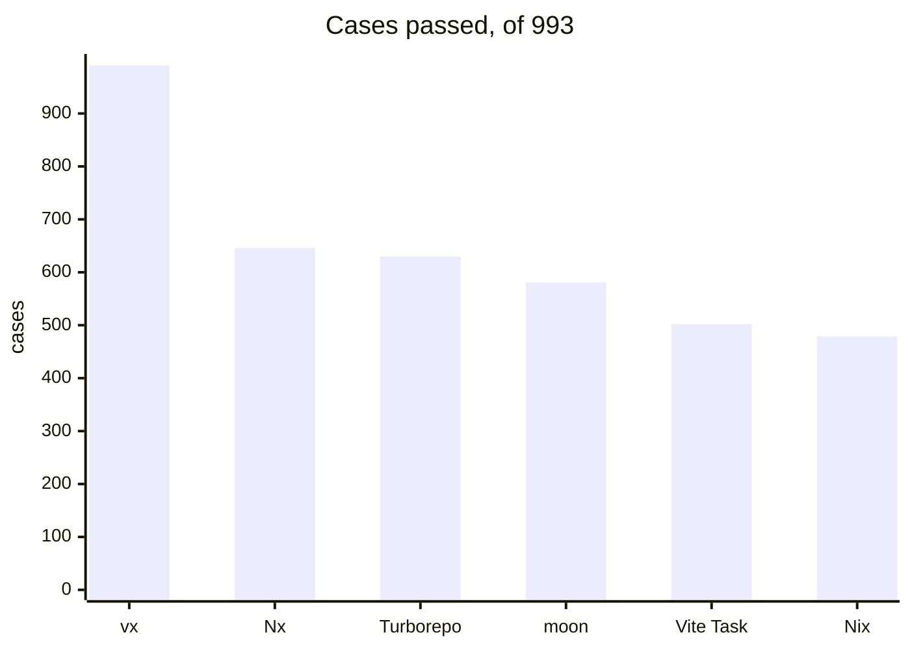
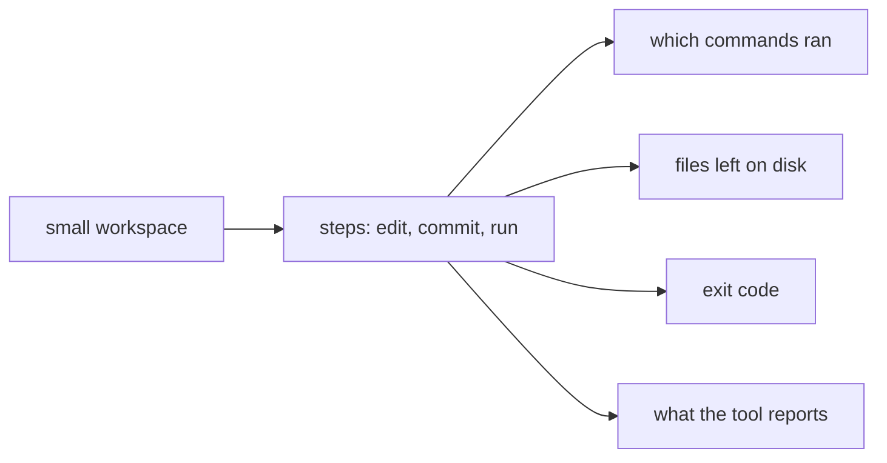

Each case is a small workspace and the outcome a user would see. All six
tools run the same 993 cases, each in a sandbox.



<small>vx 8cbc907 · Turborepo 2.11.10 · Nx 24.0.2 · Vite Task 1.4.0 · moon 2.6.5 · Nix 2.34.6 · 2026-11-11 · [every case](../../conformance/)</small>

## The cases come from every tool's own tests

The cases are compiled from the test suites of Nx, Turborepo, Vite
Task, moon, Nix and vx. A case names no tool's config. It says which
projects exist, what each task runs, and what must hold afterwards.



A thin adapter turns the case into each tool's own config. The harness
marks each command as it starts and ends, so "ran" means it ran.

## Where the scores split

| Group    | Cases | vx  | Nx  | Turborepo | moon | Vite Task | Nix |
| -------- | ----: | --: | --: | --------: | ---: | --------: | --: |
| graph    |   150 | 150 | 114 |        92 |   85 |        86 |  58 |
| inputs   |   305 | 305 | 187 |       187 |  193 |       178 | 177 |
| outputs  |   225 | 225 | 158 |       161 |  122 |       140 | 159 |
| affected |    97 |  97 |  57 |        68 |   69 |         0 |   0 |
| watch    |    31 |  31 |  27 |        28 |    0 |         0 |   0 |
| sandbox  |    18 |  18 |   0 |         1 |    0 |         1 |  15 |

A case a tool cannot express counts as not passed. Its users cannot get
that behaviour either.

## Each case says why it matters

```ansi
Args forwarded to a server reach it as typed, never expanded by a shell
vx        pass
moon      pass
Nx        fail  seen.txt is "<0><0>…", expected "<$(id -u)><`id -u`>…"
```

Every case carries three or four sentences on what goes wrong without
it. Here a second shell ran `$(id -u)`, a command nobody typed.

vx misses 2 cases. Both need programs a dependency puts on PATH, which
vx left to the tools you already have.

All cases, filters and each tool's detail: [Conformance](../../conformance/).
More at [vznjs.github.io/vx](https://vznjs.github.io/vx/).
