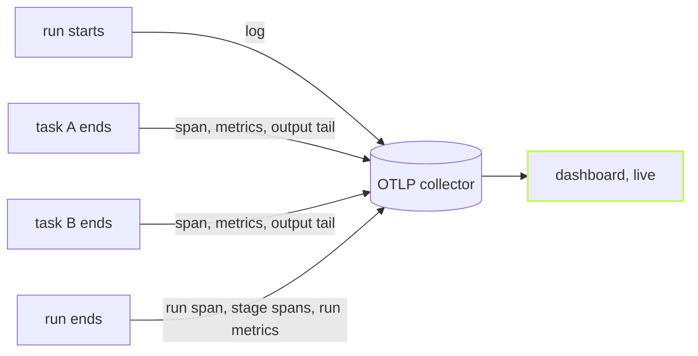

`@vzn/vx-otel` sends each task's trace as soon as it ends. You see the
slow task in Grafana or Honeycomb while the build still runs.



## Turn it on

Add the plugin and point the standard OTel variable at a collector.

```ts
// .vx/workspace.ts
import { defineWorkspace } from '@vzn/vx/config'
import { otel } from '@vzn/vx-otel'

export default defineWorkspace({ plugins: [otel()] })
```

```sh frame="terminal"
$ OTEL_EXPORTER_OTLP_ENDPOINT=http://localhost:4318 vx run build test --all
```

With no endpoint set it sends nothing, so keep it on everywhere.

## What arrives, and when

| When           | What arrives                                      |
| -------------- | ------------------------------------------------- |
| run, task start | a log record (`vx.run.start`, `vx.task.start`)   |
| task running   | process samples                                   |
| task ends      | its span, metrics and output tail                 |
| run ends       | the `vx.run` span, stage spans, run metrics       |

Each record names the run, host, commit and repo, and on CI the
pipeline and pull request.

## It never holds a task

A finished task only queues its records. Sends go at most once a
second, one at a time. A refused send warns once and the build goes on.
Sending live costs no more than one send at the end:

| Export                     | Requests | CPU    | Wall   |
| -------------------------- | -------- | ------ | ------ |
| live (default)             | 4        | 535 ms | 274 ms |
| at the end (`live: false`) | 2        | 575 ms | 291 ms |

<small>Median of 10 interleaved runs · `private/vx-bench/generate.ts`, 60 projects, `build --all --no-cache` · local OTLP stub · CPU is vx's user + system time · Linux x64, 4 cores · vx 4c308fb · 2026-10-23</small>

`otel({ live: false })` sends everything at the end instead. Why
telemetry can never fail a build: [Observability that cannot break a
run](../telemetry-never-breaks-a-run/).

The full attribute list is in the [vx-otel
README](https://github.com/vznjs/vx/tree/main/packages/vx-otel#live-export).
More at [vznjs.github.io/vx](https://vznjs.github.io/vx/).
