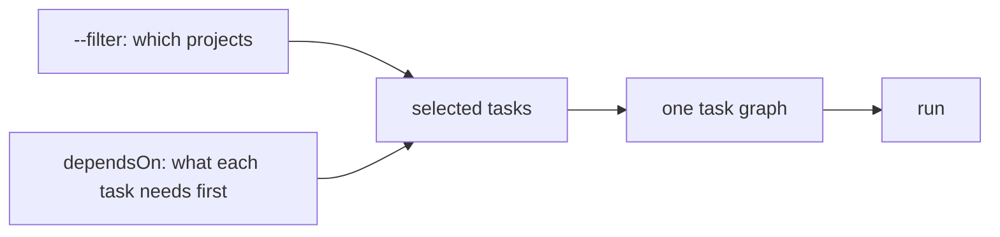

Two small languages pick what runs. `dependsOn` says what a task needs
first. `--filter` says which projects to touch. A name that matches
nothing stops the run.



```sh frame="terminal"
$ vx run build --filter '...packages/a' --dry
would run:
  ✓  packages/a#build  cache hit (local)         6802a43d
  ✓  packages/c#build  cache hit (local)         24d525d5

2 task(s) planned, 2 cache hits (2 local).

$ vx run build lnit --all
✗ vx run  no projects declare task(s): lnit

  Tasks: build, check, codegen, color, count, dev, e2e, env, and 9 more
  A run reads the lock: after editing a vx.config, run `vx lock`
$ echo $?
1
```

`...packages/a` is `a` and everything that depends on it. A typo stops
the run before it starts, so you never get a green run that skipped
your linter.

<small>Demo workspace · vx 69617eb · 2026-10-23</small>

## What a task needs: dependsOn

```ts
// packages/web/vx.config.ts
import { defineProject } from '@vzn/vx/config'

export default defineProject({
  tasks: {
    build: {
      exec: { command: 'vite build' },
      dependsOn: ['^build'], // build every workspace dependency first
      inputs: { files: ['src/**'] }, cache: { outputs: { files: ['dist/**'] } },
    },
    test: { exec: { command: 'vitest run' }, dependsOn: ['build'] }, // this project's build
    e2e: { exec: { command: 'playwright test' }, dependsOn: ['@demo/api#build'] }, // another project's task
    check: { dependsOn: ['lint.*', 'test'] }, // a group: no command, just edges
  },
})
```

- `name` is a task in the same project.
- `^name` is that task in every workspace dependency.
- `pkg#name` is a task in one named project.
- `name.*` and `^name.*` match every task under a prefix, so `lint.*`
  takes `lint.oxlint` and `lint.oxfmt`.

A task with no `exec` is a group. It runs its dependencies and nothing
else.

## Which projects: --filter

The spellings follow pnpm:

```sh frame="terminal"
$ vx run build --filter @demo/web           # one project by name
$ vx run build --filter '@demo/*'           # a glob
$ vx run build --filter 'app...'            # app and its dependencies
$ vx run build --filter '...ui'             # ui and its dependents
$ vx run build --filter ./packages/web      # by folder
$ vx run build --filter tag:frontend        # by the tags a config declares
$ vx run build --all --filter '!@demo/docs' # all but one
$ vx run test --filter '...[main]'          # what changed since main, and its dependents
```

`--exclude-dependencies` runs only what you selected, without its
`dependsOn` tasks.

Every selector is in the [CLI reference](../../cli/), and `dependsOn`
is in the [schema](../../schema/). More at
[vznjs.github.io/vx](https://vznjs.github.io/vx/).
