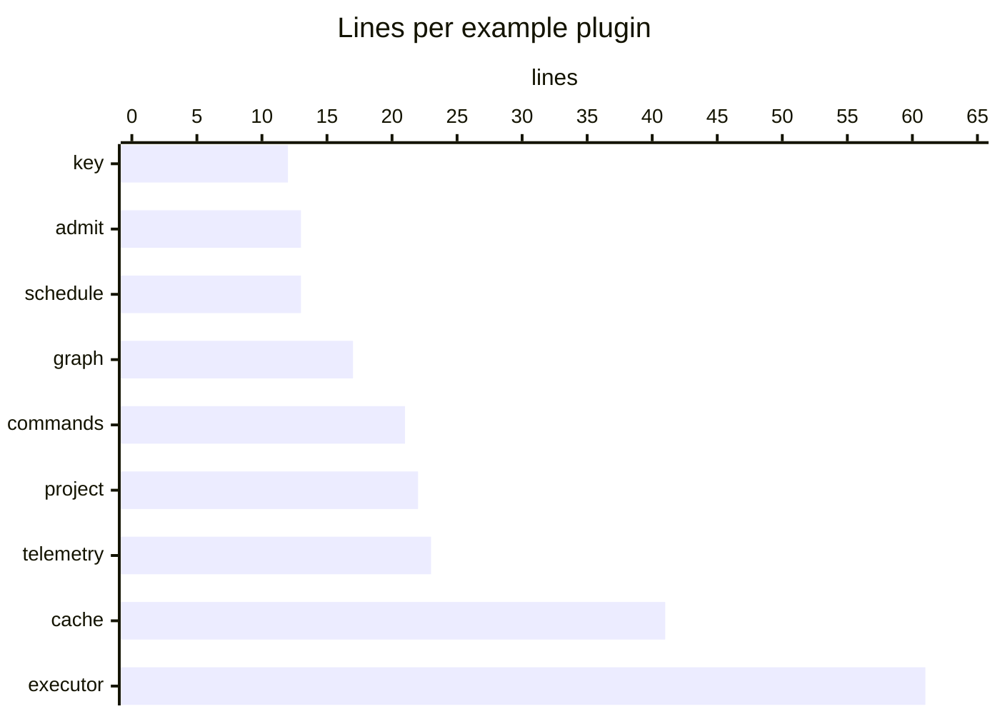
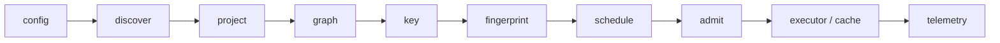

vx is a pipeline with a named hook at every stage. A plugin fills only
the stage it needs. This one picks which ready task starts first:

```ts
import { definePlugin, type VxPlugin } from '@vzn/vx'

export function prioritize(ids: readonly string[]): VxPlugin {
  return definePlugin(import.meta, {
    schedule(nodes) {
      const weights = new Map<string, number>()
      for (const [i, id] of ids.entries()) if (nodes.has(id)) weights.set(id, 1e6 - i)
      return weights
    },
  })
}
```

Add `prioritize(['app#build'])` to `plugins` in `.vx/workspace.ts`.
Every stage has a tested example in `private/vx-plugin-examples`:



## The stages, in order



In words: `config → discover → project → graph → key → fingerprint →
schedule → admit → executor`, with `setup` and `teardown` around the
run and `commands` for new verbs.

| Stage         | What a plugin can do there                                                                 |
| ------------- | ------------------------------------------------------------------------------------------ |
| `config`      | See and adjust the workspace config before anything uses it.                               |
| `discover` | Name directories to make projects beyond the package manager's members. |
| `project`     | Add, remove or edit one loaded project's tasks.                                            |
| `graph`       | Add or drop edges, mark tasks requested.                                                   |
| `key`         | Contribute extra cache-key material per task.                                              |
| `fingerprint` | Claim a root file such as a lockfile and key it per project.                               |
| `schedule`    | Return a priority per ready task.                                                          |
| `admit`       | Vet each local dispatch against what is running right now; `false` holds the task.         |
| `executor`    | Decide where one task's command runs.                                                      |
| `cache`       | Provide a remote where artifacts live.                                                     |
| `telemetry`   | Receive plain-data run records. Cannot change behaviour, by construction.                  |
| `output`      | Return a Logger that draws the run's terminal output in place of vx's.                     |
| `setup`       | Once per run, after the planning stages and before the first task.                         |
| `commands`    | Add a CLI verb. A verb named like a core verb is refused, so nothing shadows `vx run`.     |
| `teardown`    | Flush and close at the end of the run.                                                     |

Plugins run in the order `.vx/workspace.ts` lists them. A plugin's name
is its package name, read from `import.meta`.

## vx's own plugins use the same hooks

| Plugin | Hooks |
| --- | --- |
| `turbo()` (`@vzn/vx-migrate`) | `project`: turbo.json becomes vx tasks |
| `@vzn/vx-lockfile` | `fingerprint`: keys each task on its own dependencies |
| `@vzn/vx-history` | `schedule`, `admit`, `commands` |
| `@vzn/vx-reapi` | `executor` and `cache` over Bazel's remote API |
| `turboCache()`, `nxCache()` | `cache` on Turbo's and Nx's wire |
| `@vzn/vx-otel`, `@vzn/vx-ci` | `telemetry` |

Each imports core only through `@vzn/vx`, and a test pins that surface.
When core grows a branch for one consumer, the plugin point is too
narrow, so we widen it. Core applies no plugin by default.

Only running and caching here are built in ([running here is not a
plugin](../the-local-floor/)).

Guide: [Writing a vx plugin](../../docs/plugins/). More at
[vznjs.github.io/vx](https://vznjs.github.io/vx/).
