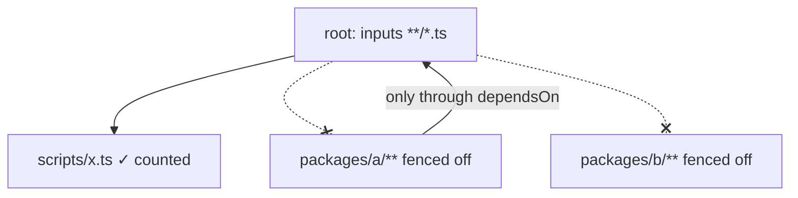

A project's globs stop at the next project's folder. A root task that
globs `**/*.ts` won't rebuild when you edit a package under it:

```ts
// vx.config.ts (workspace root)
count: {
  exec: { command: "find . -name '*.ts' -not -path './node_modules/*' | wc -l" },
  inputs: { files: ['**/*.ts'] },
  cache: { outputs: { files: [] } },
}
```

```sh frame="terminal"
$ echo "// e" >> packages/a/src/index.ts
$ vx run //#count
  cache     local 1✓

$ echo "// e" >> scripts/x.ts
$ vx run //#count
  cache     local 1↑

$ vx why //#count
  what changed (1 component, 6 unchanged):
    changed file  scripts/x.ts  fdfb0708… → b549282e…
```

An edit in `packages/a` doesn't change the root's key, though `**/*.ts`
matches it. A root file does.

<small>Demo workspace · vx 69617eb · 2026-10-23</small>



## Why the fence

| Without it                               | What goes wrong                                    |
| ---------------------------------------- | -------------------------------------------------- |
| root inputs `**/*.ts`                    | every edit anywhere re-runs the root task          |
| root depends on members, no edge says so | `--affected` and the graph disagree with the cache |
| root outputs `**/*.js`                   | the pre-run wipe deletes members' files            |

vx clears a task's outputs before every run and restore, so an output
glob without a fence would delete other projects' files.

## How it works

Once per run, vx lists the projects nested under each project. Every
glob skips paths under them, for inputs and for output cleaning.

A workspace package counts as a project even without a `vx.config.ts`.

One trap: sorted as strings, `foo`, `foo-utils`, `foo/nested` come in
that order, because `-` sorts before `/`.

A scan that stopped at `foo-utils` would miss `foo/nested` and leave a
hole. vx keeps scanning until it leaves the `foo` block.

## The one way across

If A needs B, A says `dependsOn` B's task. B's key goes into A's, so an
edit in B runs A again, and the graph, `--affected` and the cache agree.

With the sandbox on, the fence holds at run time too. Import a sibling
your key never sees and the read fails with a report, instead of
caching a result that wouldn't rerun.

## The escape hatch

`inputs.workspaceFiles` and `cache.outputs.workspaceFiles` start at the
workspace root and have no fence. Use them for root files like a shared
`tsconfig.base.json`.

For another project's files, prefer an edge.

Details: [Caching, cross-project
boundaries](../../caching/#cross-project-boundaries). More at
[vznjs.github.io/vx](https://vznjs.github.io/vx/).
