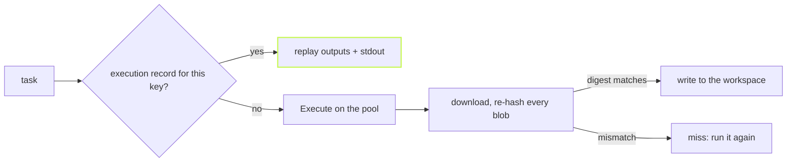

`@vzn/vx-reapi` connects vx to BuildBuddy or any Bazel Remote Execution
server. Repeat runs skip the worker, every downloaded byte is checked,
and a bad server costs you a miss, never a wrong build.



## Connect the way Bazel does

TLS is on by default. A hosted server's API key goes in `headers`.

A private CA and mutual TLS take the same three files as Bazel's
`--tls_certificate`, `--tls_client_certificate` and `--tls_client_key`.

```ts
// .vx/workspace.ts
import { defineWorkspace } from '@vzn/vx/config'
import { reapi } from '@vzn/vx-reapi'

export default defineWorkspace({
  plugins: [
    reapi({
      endpoint: 'remote.buildbuddy.io',
      headers: { 'x-buildbuddy-api-key': process.env.BB_KEY ?? '' },
      execute: true,
    }),
  ],
})
```

A plaintext server needs `grpc://` written out. An unreadable
certificate stops startup and names the setting. With no endpoint, the
plugin does nothing.

## Repeat runs skip the worker

Each successful remote run saves a record under the task's key: its
outputs and its stdout. The next run with that key skips the upload and
the execution, and replays the stdout.

`--force` skips the record. A file edited mid-run isn't recorded under a
key that no longer fits.

## Every byte is checked

Each download is hashed again and checked against what vx asked for.
Bytes that don't match are refused before they touch disk, so a corrupt
server means a miss.

An output path with `..`, or a link pointing out of the workspace, is
refused too.

## A wedged server is a miss, not a hang

A server that's down answers at once. The dangerous one accepts the
connection and never replies.

Every call has a deadline: a short one for small calls, and a longer one
for transfers that grows with size.

## Leave the bytes on the server

`--cache-download` decides where a remotely executed task's outputs land:

```sh frame="terminal"
$ vx run test --all --cache-download=none       # only the verdict comes home
$ vx run app#build --cache-download=toplevel    # only what you asked for
```

With `none`, outputs stay on the server until a local task needs them.
Bazel calls this "build without the bytes". It never changes a cache
key.

The full list of options and guarantees is in the
[vx-reapi README](https://github.com/vznjs/vx/tree/main/packages/vx-reapi#readme). More at
[vznjs.github.io/vx](https://vznjs.github.io/vx/).
