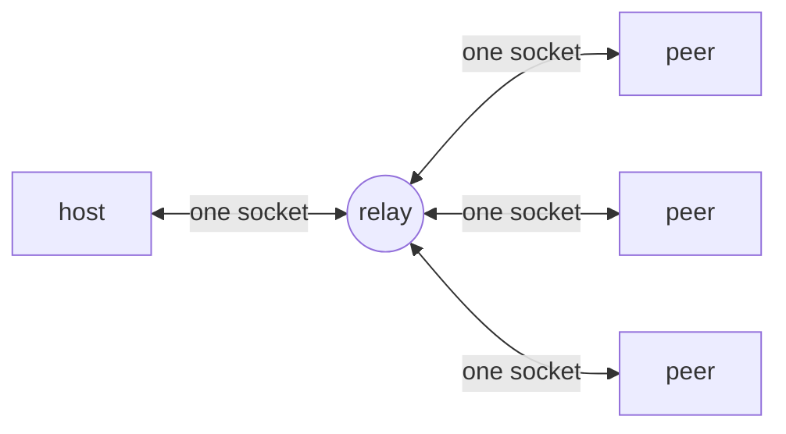
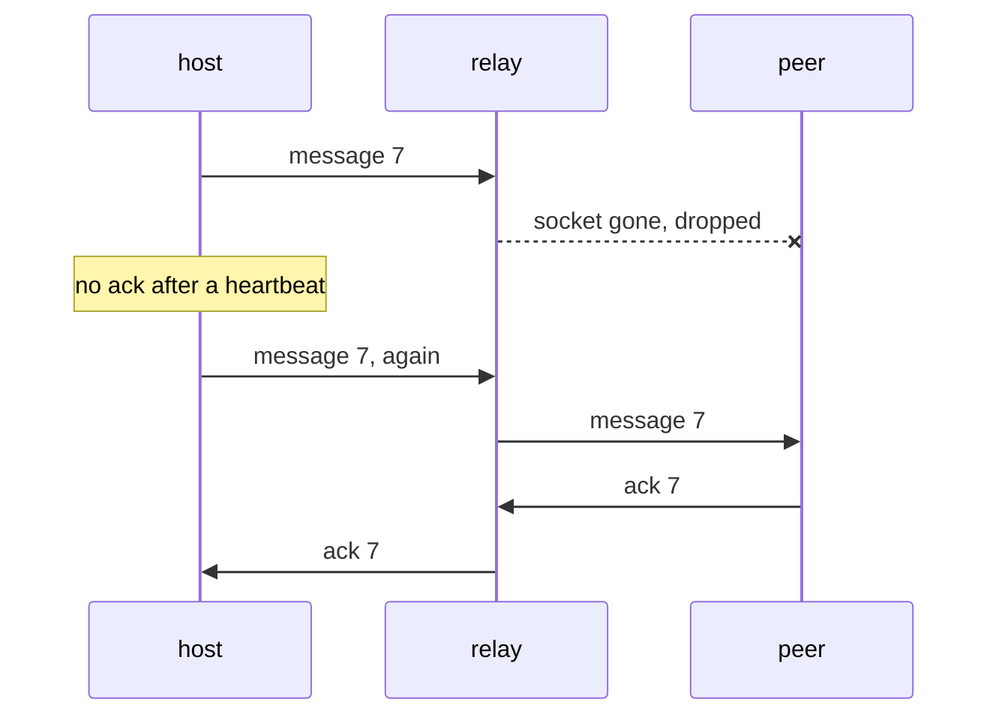
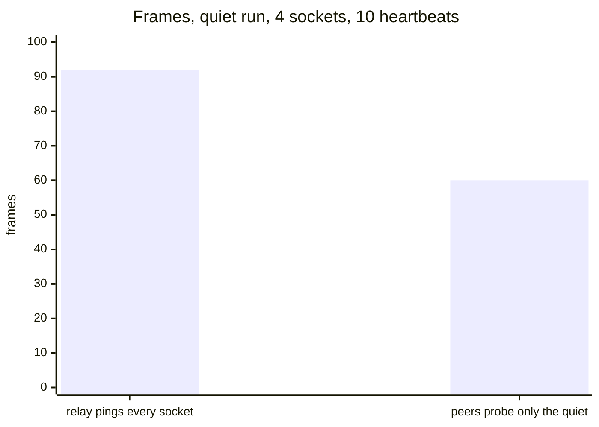

Switchboard is the open protocol under vx DTE's relay. One host and any
number of peers meet at a relay they all dial out to. The relay keeps no
message, sets no timer and writes no storage row.



## Any tool can use it

The host talks to every peer, and a peer talks only to the host. What
they say is their own protocol. In [vx DTE](../one-run-on-your-own-runners/)
the host is the run's orchestrator and each peer a worker.

## One request joins, version included

```http
GET /sessions/<id>/socket?join={"role":"peer"}
Sec-WebSocket-Protocol: switchboard.v1
```

Each side opens one websocket that joins as it opens. The version rides
on the same request, so it costs no round trip. With no version in
common, the relay closes the socket `4406` and names the versions it
speaks.

## The two ends make sure a message lands



The relay pushes a message down the receiver's socket, or drops it. The
sender numbers each message and sends it again until it is acked.

## A closed socket is a lost peer



<small>vx DTE, 1 orchestrator and 3 idle workers · 88-96 frames before, 24 up and 36 down after ([#4309](https://github.com/vznjs/vx/pull/4309))</small>

When a socket closes, its peer is gone at once. vx DTE asks a peer quiet
for 1.5 heartbeats and drops it within 10 s. When the host's socket
closes, the session closes and every peer is told.

## Two relays, one test suite

`@vzn/vx-dte-relay` runs on Cloudflare's free plan, one Durable Object
per session, or on Bun in Docker. Both pass the same conformance suite
over real websockets.

```sh frame="terminal"
docker build -t vx-dte-relay packages/vx-dte-relay
docker run -p 8080:8080 vx-dte-relay --allow https://gitlab.com:group/app:.gitlab-ci.yml --audience https://relay.example.com
```

[The Switchboard spec](../../switchboard/) · more at
[vznjs.github.io/vx](https://vznjs.github.io/vx/).
