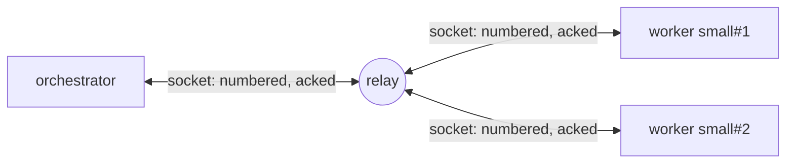
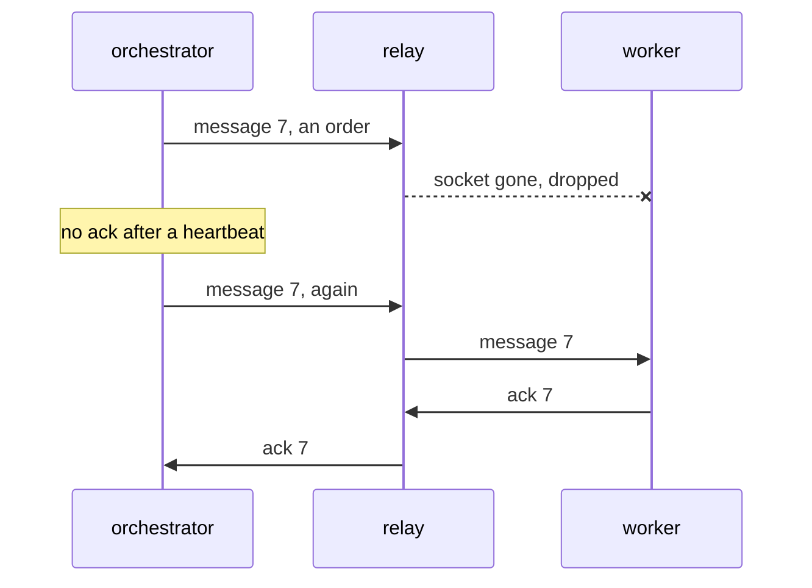
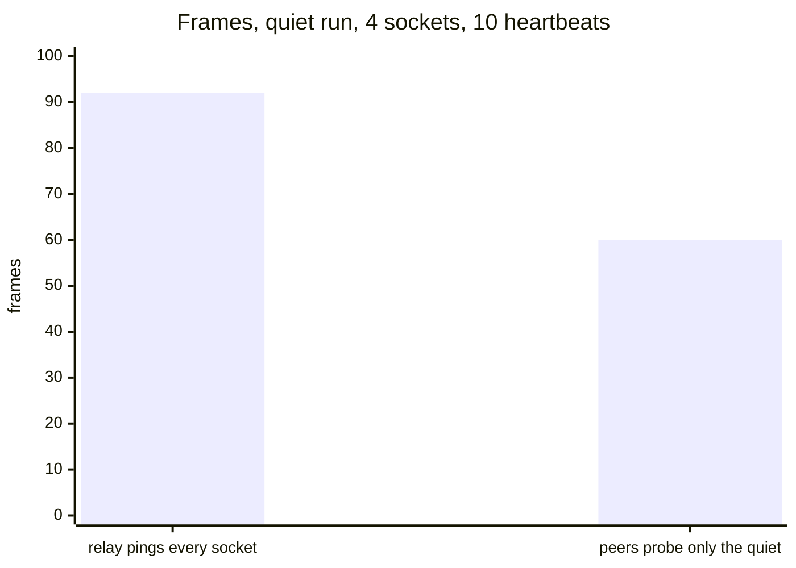

The relay behind [vx DTE](../one-run-on-your-own-runners/) keeps no
message, sets no timer and writes no storage row. A quiet run of four
sockets sends 60 frames through it in ten heartbeats.



## One route, one socket each

Each side opens one websocket and joins on it, with its CI OIDC token.
There is no other route. A refused join gets its socket closed, with
the reason in the last frame and in the close.

## The two ends make sure a message lands



The relay pushes a message down the receiver's socket, or drops it. Each
side numbers what it sends and sends it again until the other acks it.
The receiver takes each number once, in order.

## A closed socket is a lost worker



<small>1 orchestrator, 3 idle workers · 88-96 frames before, 24 up and 36 down after ([#4309](https://github.com/vznjs/vx/pull/4309))</small>

When a socket closes, the relay drops its worker at once. A worker that
goes quiet on an open socket is asked after 1.5 heartbeats. No answer,
and it is lost in about 4 s.

When the orchestrator's socket closes, every worker's closes too.

## Free on Cloudflare, or one container

On Cloudflare the run is one Durable Object, there only to hold its
sockets. What a woken object needs rides on each socket.

A join costs one request, and every 20 websocket messages count as one
more.

```sh frame="terminal"
docker build -t vx-dte-server packages/vx-dte-server
docker run -p 8080:8080 -e ALLOW=https://gitlab.com:group/app:.gitlab-ci.yml \
  -e AUDIENCE=https://relay.example.com vx-dte-server
```

The container is the same relay on Bun. CI builds the image and carries
a run through it (`test.live`).

[Relay README](https://github.com/vznjs/vx/tree/main/packages/vx-dte-server) ·
more at [vznjs.github.io/vx](https://vznjs.github.io/vx/).
