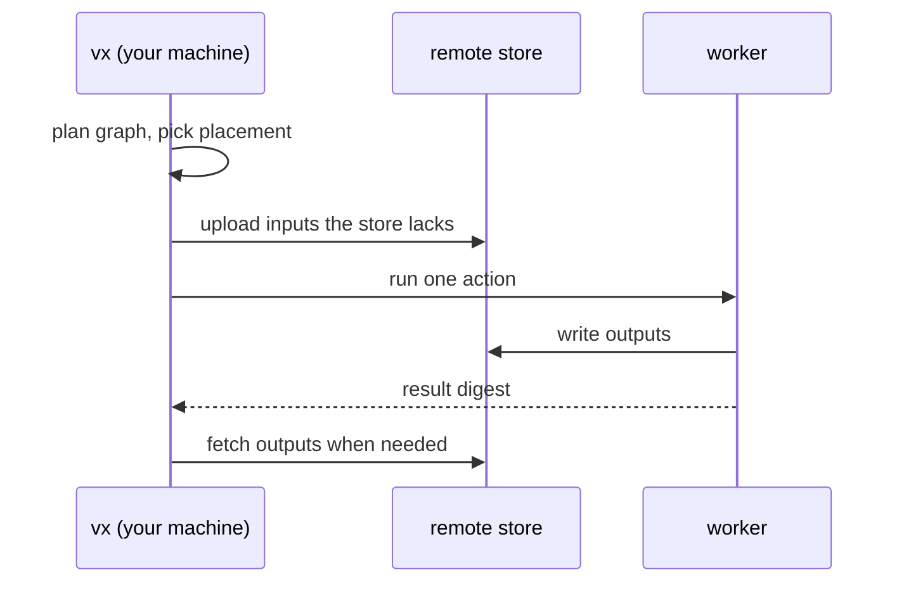

`@vzn/vx-reapi` sends tasks to any Bazel Remote Execution worker pool
(NativeLink, BuildBuddy, Buildbarn). The graph, retries, timeouts and
cache stay on your machine.



```ts
// .vx/workspace.ts
import { defineWorkspace } from '@vzn/vx/config'
import { reapi } from '@vzn/vx-reapi'

export default defineWorkspace({
  plugins: [
    reapi({
      endpoint: 'grpcs://cache.example.com:443',
      execute: true,
      platform: { OSFamily: 'Linux', 'container-image': 'docker://node:22' },
      capacity: 64,
    }),
  ],
})
```

Nothing runs remotely until you set `execute: true`. `capacity` gives
the pool its own slots, so 64 workers are not held to your laptop's
cores.

`vx run --dry` shows where each task goes: `@vx/reapi`, `@local` or
`@noop`.

## What stays local

- **Only cacheable tasks go.** A task with no `cache` block has no
  declared inputs to ship.
- **Not persistent tasks, or anything depending on one.** A worker
  cannot reach a port on your machine.
- **Not sandboxed tasks, or anything depending on one.** The sandbox
  runs only here.
- **Not `exec.remote: false`, or anything depending on it.** Use it for
  Docker, a device or a local daemon.
- **Not a task whose key folds a runtime probe** (`inputs.runtime`,
  `workspaceRuntime`). A worker cannot prove it has your `node -v`.

A worker gets exactly what the cache key declares. Run the task in the
[sandbox](../the-sandbox/) first: if it passes there, it passes on a
worker.

## Install `node_modules` on the pool

```ts
install: {
  exec: { command: 'bun install --frozen-lockfile', remote: 'only' },
  inputs: { files: ['package.json', 'bun.lock'] },
  cache: {
    outputs: { files: ['node_modules/**'] },
  },
},
build: {
  dependsOn: ['install'],
  exec: { command: 'tsc -p .' },
  inputs: { files: ['src/**'] }, cache: { outputs: { files: ['dist/**'] } },
},
```

With `remote: 'only'`, `install` runs on a worker once per lockfile
change. Its outputs go worker to store to worker and never touch your
disk. Tested against a live NativeLink pool.

With no remote executor, `install` does nothing locally.

## A remote error is a local run

The same `tar.zst` bytes serve both caches. An error or timeout is a miss,
and the task runs here. A cache-only server keeps serving the cache.

Guide: [Remote execution](../../docs/remote-execution/). More at
[vznjs.github.io/vx](https://vznjs.github.io/vx/).
