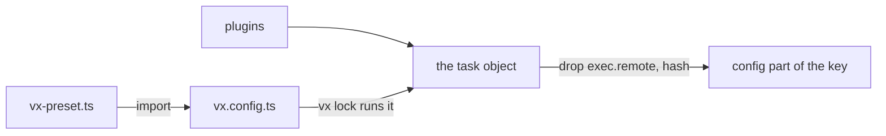

vx hashes your config after it runs, not the file's text. So when a
preset you import changes, every task using it gets a new key. This
config spreads a preset:

```ts
// packages/b/vx.config.ts
import { defineProject } from '@vzn/vx/config'
import { lib } from '../../vx-preset.ts'

export default defineProject({
  tasks: {
    ...lib({ entry: 'src/index.ts' }),
  },
})
```

Change the preset, not the config:

```sh frame="terminal"
$ sed -i 's/--outdir dist`/--outdir dist --minify`/' vx-preset.ts
$ vx lock --check
✗ vx lock --check  packages/b/vx.config.ts evaluates differently from the lock here — its config, a file it imports, or the environment it reads changed; run 'vx lock'

$ vx lock && vx run packages/b#build
  cache     local 1↑

$ vx why packages/b#build
  verdict    cache key changed: config
  what changed (1 component, 3 unchanged):
    changed config  config  59020bd1597ff7c8 → 524418371d4d83ba
```

`packages/b/vx.config.ts` didn't change a byte. Its task did, so its
key did.

<small>Demo workspace · vx 69617eb · 2026-10-23</small>

## The key sees the object



The key hashes the **task object**, the thing the scheduler will run.

What a preset returned, what a template string became, what a plugin
added: all of it is in the object, so all of it is in the key.

Part three of the [key](../keys-from-git/) is
`xxh3(JSON.stringify(hashableConfig(node.config)))`.

- **Presets are safe to share.** No `globalDependencies` list to keep in
  sync.
- **Plugins are in the key.** `turbo()` builds tasks from `turbo.json`,
  and those tasks get hashed. A plugin can't change a task behind the
  key's back.

`exec.remote` is dropped: it says where a task runs, not what it makes.
`timeout`, `retries` and `description` count, because a task given
longer may finish where a shorter one was killed.

## Evaluate once: `vx lock`

A program can give a different answer on another machine. So no run runs
a config. `vx lock` runs them once and saves the objects. Every `vx run`
reads that file, so CI computes the same keys you did.

`vx lock --check` catches drift ([more](../lock-and-frozen/)).

## Why not named inputs

Turborepo's `globalDependencies` and Nx's `namedInputs` exist because
JSON can't import. A `vx.config.ts` can, so a shared input list is a
constant you import.

That's why vx has no named inputs, global inputs or global env, and
won't.

More at [vznjs.github.io/vx](https://vznjs.github.io/vx/).
