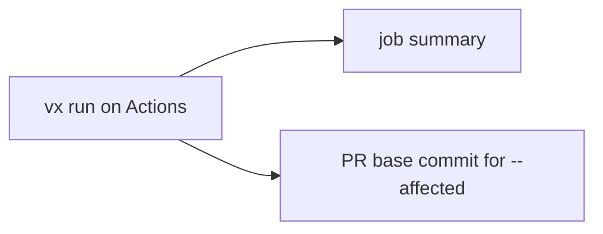

Add one line and every `vx run` shows up on GitHub, failures first. No
more scrolling a red log.

```ts title=".vx/workspace.ts"
import { defineWorkspace } from '@vzn/vx/config'
import { github } from '@vzn/vx-ci'

export default defineWorkspace({
  plugins: [github()],
})
```

Off GitHub Actions the plugin does nothing, so keep it on for laptops
too.



## The job summary

This is what the plugin wrote for a run where one task failed:

````md frame="code" title="$GITHUB_STEP_SUMMARY"
## ❌ vx run

**2** tasks · **1** executed · **1** cache hit (1 up-to-date, 0 restored) · **1** failed · 42ms

### Failures

- **packages/api#typecheck** — exit 1

| Task | Status | Duration |
| --- | --- | --- |
| packages/api#typecheck | ❌ failed | 3ms |
| packages/api#bundle | ✔️ up-to-date | 3ms |

<sub>vx 0.0.0 · `vx run bundle typecheck --all` · 1/2 passed · 1 up-to-date · 0 restored</sub>
````

<small>One-project workspace · vx c1ad075 · 2026-10-23</small>

A killed task reads `exit 137 (128 + SIGKILL)`. A timeout reads
`timed out, exit 143`. Each failure names the tasks it blocked.

## A cache a pull request cannot poison

The cache server decides where a pull request may write. It checks the
CI token: main writes to the trusted cache, a branch to its own.

The plugin also gives the PR's base commit, so a bare `--affected`
works, and a scope name like `acme/app:feat-x`. Opt out with `github({
cacheScope: false })`, or set `VX_CACHE_SCOPE` yourself.

More in [Branch caches a server
enforces](../branch-caches-a-server-enforces/).

## It never breaks the build

The summary is written by a telemetry sink. vx runs sinks apart from the
run with a time limit. A slow or failing GitHub write never fails or
stalls your run.

Guide: [CI](../../docs/ci/). More at
[vznjs.github.io/vx](https://vznjs.github.io/vx/).
