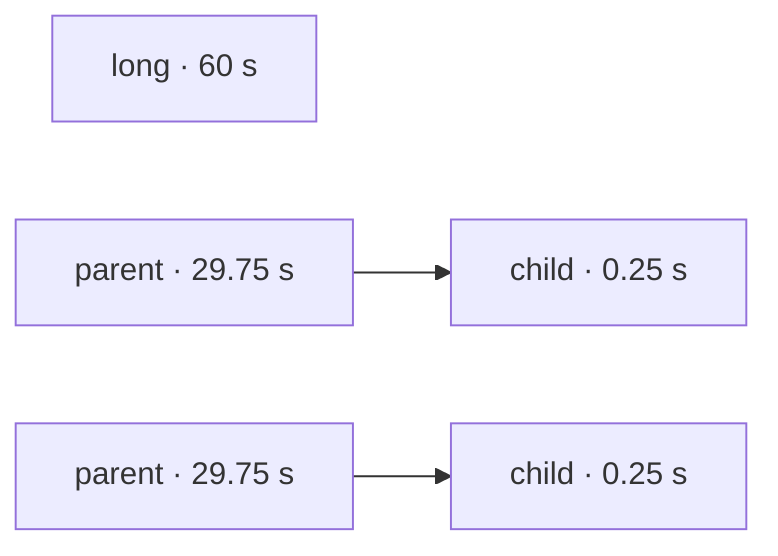
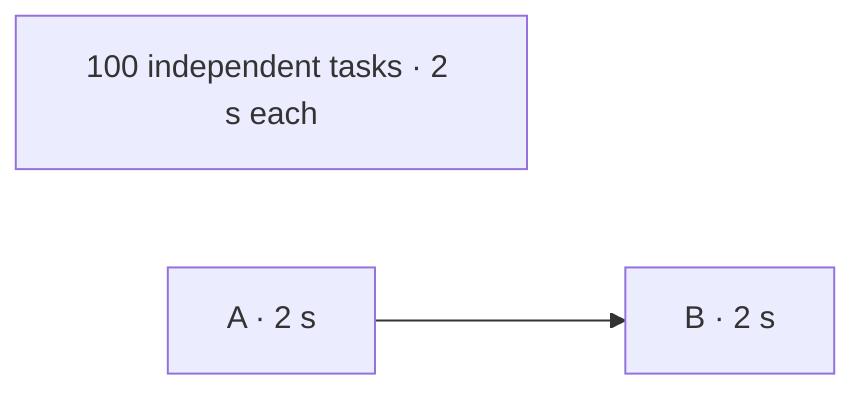

When more tasks are ready than workers, the pick can change a run's wall
time by a third. Every rule without timings loses on some graph.

Recorded timings found the best order in every case we measured.

## The five rules

| Rule | Picks first | Needs timings |
| --- | --- | --- |
| Ready order | The task that became ready first | No |
| Most direct dependents | The task the most tasks wait on directly | No |
| Most transitive dependents (vx's default) | The task the most work waits on, at any depth | No |
| Critical path by step count | The task at the head of the longest chain of tasks | No |
| Critical path by recorded time | The task at the head of the longest chain in seconds | Yes |

The last one is the
[`@vzn/vx-history`](../../plugins/vx-history/) plugin.
It is off by default. With equal tasks, vx's default lands close to
longest chain first. Real tasks are not equal.

## Case 1: a slow task with nothing after it

Two workers. One task takes 60 seconds and nothing depends on it. Two
chains each have a 29.75-second parent and a 0.25-second child.



The best order starts the 60-second task at once. Counting dependents
starts both parents first, since the long task has nothing after it:

| Order | Worker 1 | Worker 2 |
| --- | --- | --- |
| Best: 60 s in all | long | parent → parent → child → child |
| vx default: 90 s in all | parent → long | parent → child → child |

Measured with vx, two workers:

| Rule | Wall time |
| --- | --- |
| Ready order | 60.2 s |
| Most direct dependents | 60.2 s (a tie, settled by ready order) |
| Most transitive dependents (vx's default) | 90.0 s |
| Critical path by step count | 89.9 s |
| Recorded time, run 1 (no history yet) | 90.0 s |
| Recorded time, runs 2 and 3 | 60.2 s, 60.2 s |

vx's default takes 30 s longer here. In a real repo this is a slow
typecheck, lint or unit test that needs no build. Ready order won only
because the long task was first in line.

## Case 2: the mirror image

Ten workers. 100 independent tasks and one chain of two, A then B.
Every task takes 2 seconds.



Counting dependents starts A first. Ready order can leave A behind the
other 100, so B runs one wave late.

| Rule | Wall time |
| --- | --- |
| Ready order | 24.3 s |
| Most direct dependents | 24.3 s (a tie, settled by ready order) |
| Most transitive dependents (vx's default) | 22.3 s |
| Critical path by step count | 22.4 s |
| Recorded time, runs 1 to 3 | 22.3 s, 22.2 s, 22.3 s |

Here ready order takes 2 s longer, about one task's length.

## Case 3: a large graph with equal tasks

1,090 packages, 3,270 tasks, 100 layers, every task 1 second, 10
workers. The best possible run is 218 seconds.

| Rule | Wall time |
| --- | --- |
| Ready order | 301.7 s |
| Most direct dependents | 220.5 s |
| Most transitive dependents (vx's default) | 220.4 s |
| Critical path by step count | 220.6 s |
| Recorded time, runs 1 to 3 | 220.6 s, 220.5 s, 220.5 s |

Every rule that reads the graph lands within 3 seconds of the best.
Ready order takes 81 s longer. With equal tasks, the shape is all there
is to know, so history adds nothing.

## No rule wins every graph without timings

Cases 1 and 2 are mirror images. Shape alone cannot tell a 60-second
task from a 2-second one, so any shape rule loses one of them.

The history plugin ranks each task by its recorded time plus the longest
chain behind it. From the second run on, it found the best order in
every case. So vx ships no more guessing rules.

## A guess for the first run?

Guessing by task kind would help only the very first run. If you know
a task is slow, `assume` gives it a duration until history exists:

```ts
vxHistory({ assume: { 'app#typecheck': 60_000 } })
```

## On CI

A CI runner usually starts empty, so every run there is a first run.
Give the plugin a file and cache it between runs:

```ts
vxHistory({ file: '.vx-timings.json' })
```

The next runner starts with real median times. Local history beats the
file, and the file beats `assume`
([the cache step](../ci-timings-file/)).

## Pick the guess

Before there is any history, one line in `.vx/workspace.ts` picks the
rule vx guesses with:

```ts
// .vx/workspace.ts
export default {
  run: { schedule: 'critical-path' },
}
```

| `run.schedule` | Starts first |
| --- | --- |
| `most-work` (default) | The task the most work waits on, at any depth |
| `critical-path` | The task at the head of the longest chain of tasks |
| `direct-dependents` | The task the most tasks wait on directly |
| `ready-order` | The task that became ready first |

A `schedule` plugin still ranks first. The rule breaks its ties. A slow
typecheck starting late? Try `ready-order`. Long chains finishing last?
Try `critical-path`.

## Turn it on

```sh
bun add -d @vzn/vx-history
```

```ts
// .vx/workspace.ts
import { vxHistory } from '@vzn/vx-history'

export default { plugins: [vxHistory()] }
```

It learns from the last 20 local runs. A plugin can also read timings
from a shared store and rank with core's `criticalPath`.

<small>How we measured: every task is a `sleep` · linux x64, 4 cores, Bun 1.4.2 · vx `a85223a`, one cold run (`--force`) per row · 2026-10-09 · rules other than the default and history are small `schedule` plugins · Cases 1 and 2 end in one group task, so "most direct dependents" ties and falls back to ready order · each history arm starts empty</small>

More at [vznjs.github.io/vx](https://vznjs.github.io/vx/).
