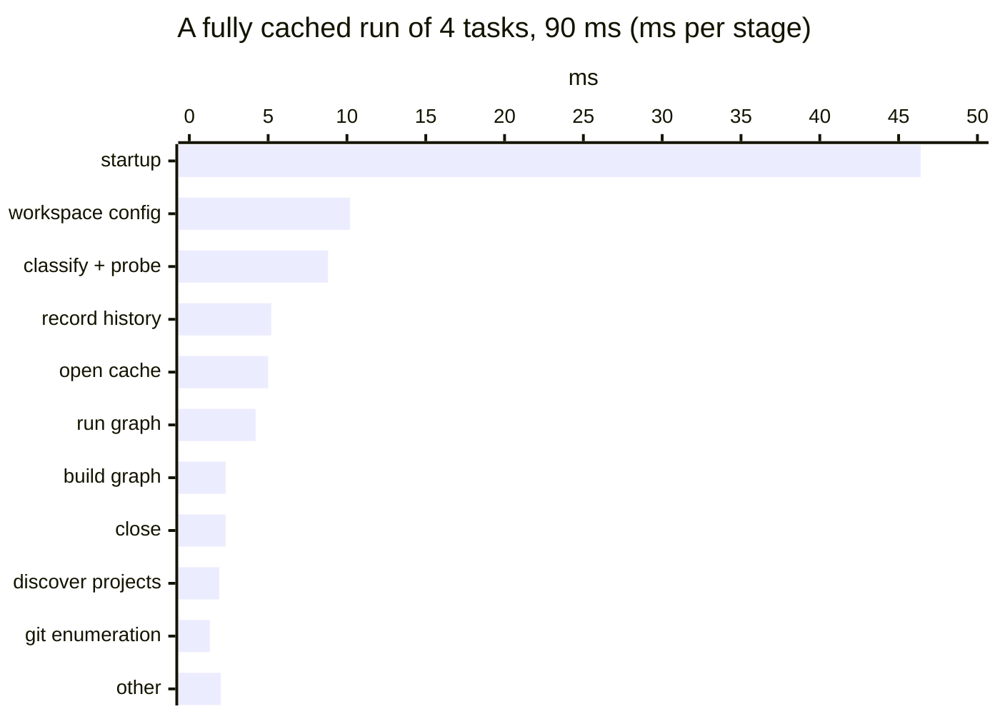

Four questions, four commands. Each prints text you can read, or JSON a
script or agent can use.

| Question                  | Command                           |
| ------------------------- | --------------------------------- |
| Why does this task run?   | `vx run --affected=HEAD --dry`    |
| What did the run do?      | `vx last --format json`           |
| What depends on what?     | `vx run --dry=json`               |
| Where did vx spend time?  | `VX_DEBUG_TIMING=1 vx run`        |

## Why a task runs

Edit one file in `packages/a` and ask what a pull request would run:

```sh frame="terminal"
$ vx run build --all --affected=HEAD --dry
would run:
  ▶  packages/a#build  cache miss — would exec   2feaa870  ~15ms
                       affected: packages/a/src/index.ts changed (an input)
  ▶  packages/c#build  cache miss — would exec   7ed8a143  ~7ms
                       affected: packages/a/src/index.ts changed (an input), via packages/a#build

2 task(s) planned, 2 would run.
predicted: ~22ms wall · ~22ms total execution
```

Each task names the changed file, or the chain that reached it.

## What the run did

```sh frame="terminal"
$ vx last --format json | jq -c '.invocation | {command, taskCount, failedCount, hitCount, totalDurationMs}'
{"command":"vx run build --all","taskCount":4,"failedCount":0,"hitCount":4,"totalDurationMs":9}
$ vx last --format json | jq -c '.tasks[0] | {project, task, status, durationMs, hash}'
{"project":"packages/d","task":"build","status":"cache-hit","durationMs":0,"hash":"9f1cef08a2fd4006"}
```

`vx last --list --format json` lists recent runs, newest first.

## What depends on what

```sh frame="terminal"
$ vx run build --all --dry=json \
    | jq -r '"digraph G {", (.tasks[] | .id as $t | .deps[] | "  \"\(.)\" -> \"\($t)\""), "}"'
digraph G {
  "packages/a#build" -> "packages/c#build"
}
```

Pipe it into `dot -Tsvg`.

## Where vx spends time



<small>`VX_DEBUG_TIMING=1 vx run build --all`, fastest of 7 · demo workspace · vx 22f6eb7 · 2026-10-23</small>

`VX_DEBUG_TIMING=1` prints this table for any run. A slow config or a
slow cache lookup stands out at once.

Every flag: [CLI reference](../../cli/). The run JSON's fields:
[Built for agents](../built-for-agents/). More at
[vznjs.github.io/vx](https://vznjs.github.io/vx/).
