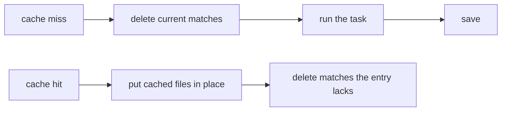

After a cache hit, your output folder holds exactly what was cached. A
deleted file never lingers in `dist/` and gets shipped.

```sh frame="terminal"
$ echo "stale" > packages/a/dist/old.js
$ ls packages/a/dist
index.js  old.js

$ vx run packages/a#build
└─ packages/a#build ── (20ms) restored-local

$ ls packages/a/dist
index.js
```

<small>Demo workspace · vx `69617eb` · 2026-10-23</small>

## A task owns its output globs



Before a miss runs, vx deletes what the output globs match. So an old
`dist/old.js` cannot be saved as new output. A hit moves each file into
place, so a reader never sees one missing.

## Two tasks cannot own one file

```sh frame="terminal"
$ vx lock
✗ vx lock  lock not written

  packages/a#notes and packages/a#slow both write out/** / out/copy.ts
  vx clears a task's outputs before it runs, so one deletes the other's

  fix  give each task its own output path
```

Overlaps vx can prove are refused. Set `rules.exclusiveOutputs: false`
to let a later task add to an earlier one's folder. It works, but its
own output path is faster.

## It is also the fast path

vx records each output file `(size, mode, mtime-ms, inode, ctime)`.

On the next hit, if the set and every file match, the restore is a few
stats and no writes, and it is the no-op row in the
[benchmarks](../../benchmarks/).

Their restore row deletes the outputs first, so every artifact is
extracted, and it costs more.

## What the wipe never touches

- Files outside the declared globs.
- Another project's directory.
- The project root's `.git`, `.vx` and `vx.lock.json`.
- A file git tracks. It is still saved and restored.
- `node_modules`, unless a glob names it. `node_modules/**` is a legitimate output of an install task.

## You get a clean git status

A task with no `cache` block owns nothing, and vx leaves its files
alone. More at [vznjs.github.io/vx](https://vznjs.github.io/vx/).
