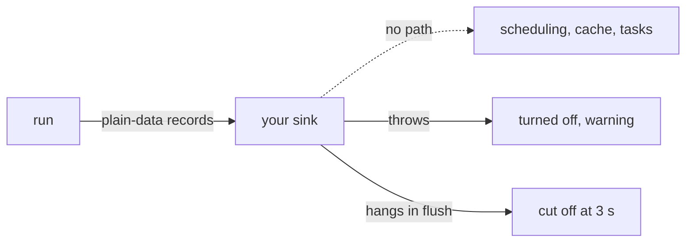

A broken telemetry plugin costs you a warning, never a red build. Here
are two: one throws on every record, one never finishes its `flush`.

```ts
telemetry: () => ({ onRecord() { throw new Error('collector is down') } })
telemetry: () => ({ onRunSummary() {}, flush: () => new Promise<void>(() => {}) })
```

```sh frame="terminal"
$ vx run build test --all
[vx] telemetry sink 'sink-that-throws' threw in onRecord; disabled for this run: collector is down
 ⏺︎     9ms success miss     packages/a#test
 ⏺︎    15ms success miss     packages/b#test
[vx] telemetry flush timed out after 3000ms; buffered records lost
            8 success · 8 total
$ echo $?
0
```

<small>Demo workspace, wall 3.19 s · vx `0be0367` · 2026-10-23</small>

All green, exit 0, one warning per broken sink.

## A sink has no way back into the run



```ts
interface TelemetrySink {
  readonly name?: string
  readonly wants?: ReadonlyArray<'run.start' | 'task.start' | 'task.end' | 'task.log' | 'task.sample' | 'run.end'>
  onRecord?(record: TelemetryRecord): void          // must return promptly; buffer here
  onRunSummary?(summary: RunSummaryRecord): void    // one per run, at the end
  flush?(signal: AbortSignal): Promise<void>        // awaited at end of run, time-bounded;
                                                    // `signal` aborts at the deadline
}
```

A sink gets plain-data records and a read-only context: workspace root,
cache folder, a `warn` function. Nothing it holds can change a build.
Buffer in `onRecord` and send in `flush`.

## No sink, no cost

With no telemetry plugin, vx adds no listener, builds no summary and
spawns no `git`. A plugin whose `setup()` throws stops the run early and
names itself.

## What runs on it

- **`@vzn/vx-otel`** sends OTLP traces, metrics and logs with no
  OpenTelemetry SDK. Each task's span goes out as the task ends.
- **`@vzn/vx-ci`** writes a GitHub job summary and a check run.

A remote cache follows the same rule. An error or timeout is a miss and
a warning, and the run goes on.

Guide: [Writing a vx plugin](../../docs/plugins/). More at
[vznjs.github.io/vx](https://vznjs.github.io/vx/).
