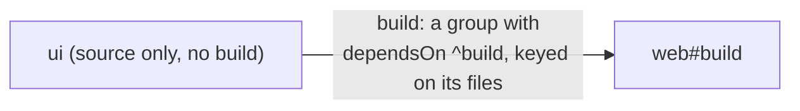

`vx run` picks the project you are in, never hangs in a pipe, and folds
each task on GitHub Actions. Small things, done carefully.

```sh frame="terminal"
$ cd packages/a && vx run build     # the project you stand in
┌─ packages/a#build > $ bun build src/index.ts --outdir dist
Bundled 1 module in 3ms

$ vx run | cat                      # a pipe: no picker
✗ vx run  missing task name (stdin is not a TTY, so no picker; tasks here: build, check, e2e, flip, notes, plain, slow, test)

  see vx run --help
```

<small>Demo workspace · vx 69617eb · 2026-10-23</small>

## Run what you mean

```sh frame="terminal"
$ vx run build                      # the project you stand in
$ vx run build --all                # every project that declares build
$ vx run packages/c#test            # one task, from anywhere
$ vx run build test lint --all      # several at once, one graph
```

## No picker in a pipe

In a terminal, a bare `vx run` opens a picker. In a pipe or a script
nobody can pick, so vx lists the tasks and exits 1. The live progress
area is off too, and the log gets plain lines.

## One fold per task on GitHub Actions

On Actions, each task gets its own log group with its result and time.
A long run collapses to one line per task:

```sh frame="terminal"
$ GITHUB_ACTIONS=true CI=true vx run build --filter packages/c --force
::group::packages/a#build (success 7ms)
::stop-commands::95fb31f4-10a0-4d85-8a5d-1a444d8bb4de
┌─ packages/a#build > success
$ bun build src/index.ts --outdir dist
├─ OUTPUT ────────────────────────────────────────────────────
Bundled 1 module in 3ms
  index.js  78 bytes  (entry point)
└─ packages/a#build ── (7ms) success
::95fb31f4-10a0-4d85-8a5d-1a444d8bb4de::
::endgroup::
```

A failed task stays open with an error note like
`failed (exit 137, 128 + SIGKILL)`. The `stop-commands` token stops a
task's output from being read as a workflow command.

## Colors that listen

Color on a terminal, plain elsewhere. `NO_COLOR` turns it off.
`FORCE_COLOR` turns it on, but `FORCE_COLOR=0` or `false` mean off, as
in chalk and Node.

## Packages shipped as source



A package with no build step still matters to its users. vx gives it a
`build` that runs nothing but is keyed on its files. Edit it, and the
packages that use it build again, and `--affected` finds them.

Every flag is in the [CLI reference](../../cli/). More at
[vznjs.github.io/vx](https://vznjs.github.io/vx/).
