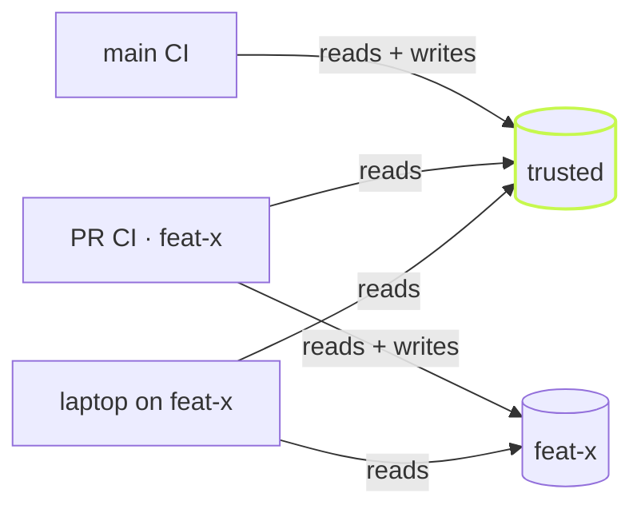

Turn the cache off, refresh it, or read one layer and write another.
Every clone of a repo shares one store. A pull request never writes
what main reads.

## Three switches

```sh frame="terminal"
$ vx run build --all
  cache     local 4✓
  time      15ms

$ vx run build --all --force
  cache     local 4↑
  time      56ms

$ vx run build --all --no-cache
  cache     local 4∅
  time      42ms
```

`--force` runs everything and saves what the cache lacks. It doesn't
upload a key that's already stored. `--no-cache` neither reads nor
writes. `--cache-policy` sets read/write per layer:

```sh frame="terminal"
$ vx run build --all --cache-policy=local:rw,remote:r   # read the remote, never upload
$ vx run build --all --cache-policy=local:r             # read local, write nothing local
$ vx run build --all --cache-policy=local:,remote:rw    # skip local, still upload
```

`VX_CACHE_POLICY` sets it for a shell or CI job, `cache.policy` in
`.vx/workspace.ts` sets the default. The flag wins. A lookup always asks
the local cache first, then each remote in order.

```ts
// .vx/workspace.ts
import { defineWorkspace } from '@vzn/vx/config'

export default defineWorkspace({ cache: { policy: 'local:rw,remote:r' } })
```

An empty spec is refused, not read as "everything on":

```sh frame="terminal"
$ vx run build --all --cache-policy=
✗ vx run  --cache-policy needs a spec like local:r, local:rw, remote:, or local:,remote:rw — pass --no-cache to disable every axis

  see vx run --help
```

## One store for every checkout

Artifacts live in `~/.vx/<id>/cache`, keyed by the repo's remote. Each
checkout keeps only a small index. A fresh `git worktree` hits what the
first one built:

```sh frame="terminal"
$ git worktree add ../demo-wt && cd ../demo-wt
$ vx run build --all
  cache     ▰▰▰▰▰▰▰▰▰▰▰▰▰▰▰▰▰▰▰▰▰▰▰▰▰▰▰▰▰▰▰▰▰▰▰▰▰▰▰▰▰▰▰▰▰▰▰▰▰▰
            local 4↓
  time      30ms
```

The new worktree had no `dist`. All four builds came back in 30 ms.
Move the cache with `--cache-dir`, `VX_CACHE_DIR` or `cache.dir`.

## Who may write the remote cache

A remote cache is shared, so a write affects everyone who reads it. The
policy says whether a run writes at all: off CI, the default only reads.
The cache server says where a write lands:



- The server checks the CI token and sends a write to trusted, the
  branch's own scope, or nowhere.
- A read tries the branch's scope first, then trusted.
- The local cache has no branches, so the same inputs hit locally on
  any branch.

[Branch caches a server enforces](../branch-caches-a-server-enforces/)
shows how a server builds its half.

<small>Demo workspace · vx 4c308fb · 2026-10-23</small>

Every flag: [CLI reference](../../cli/). `cache`: [schema](../../schema/). More at
[vznjs.github.io/vx](https://vznjs.github.io/vx/).
