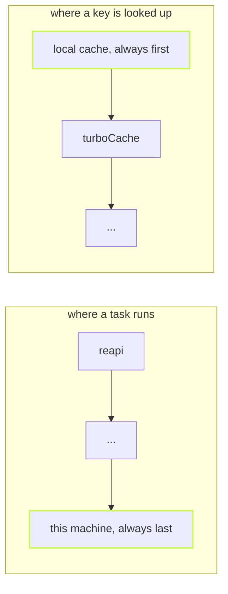

Your machine is always the last place a task can run, and the local
cache is always asked first. So a dead remote cache never breaks a
build. Point one at a port nothing listens on:

```ts
// .vx/workspace.ts
import { defineWorkspace } from '@vzn/vx/config'
import { turboCache } from '@vzn/vx-migrate'

export default defineWorkspace({
  plugins: [turboCache({ apiUrl: 'http://127.0.0.1:9', token: 'demo' })],
})
```

```sh frame="terminal"
$ vx run build --all
[vx] plugin '@vzn/vx-migrate': probe of 4 artifacts at http://127.0.0.1:9/v8/artifacts failed: ECONNREFUSED: Unable to connect. Is the computer able to access the url?

 ⏺︎     7ms success miss     packages/c#build
 ⏺︎    19ms success miss     packages/b#build
 ⏺︎    22ms success miss     packages/a#build
 ⏺︎    17ms success miss     packages/d#build
[vx] plugin '@vzn/vx-migrate': 4 more requests failed the same way: ECONNREFUSED: Unable to connect. Is the computer able to access the url?
  …
  tasks     4 success · 4 total
  cache     remote 4✗
$ echo $?
0

$ vx run build --all
  …
  tasks     4 success · 4 total
  cache     local 4✓
  time      20ms
```

The remote is down. The run is green and warns once. The second run
hits the local cache.

<small>Linux x64 · vx 0be0367 · 2026-10-23</small>

Running here and caching here aren't plugins. They are built into
vx.

## Two lists, one built-in end



You never declare them and can't remove them. With no plugins, `vx run
build` still works. A save reaches every remote.

The local artifacts live in `~/.vx/<id>/cache`, shared by every checkout
([storage](../../caching/#storage-layout)).

## A plugin may say no

Because this machine is always there, a plugin can turn a task down
without failing the run:

| Case                                         | Runs where       |
| -------------------------------------------- | ---------------- |
| task with no `cache` block                   | here             |
| persistent task, and what depends on it      | here             |
| sandboxed task, and what depends on it       | here, sandboxed  |
| remote cache errors or times out             | miss on that layer, warning |
| REAPI server that only offers caching        | executor declines, cache works |

A remote worker has an empty tree, can't reach your laptop's ports and
has no sandbox, so those tasks stay.

`vx run --dry` prints where each task goes: `@vx/reapi`, `@local`, or
`@noop` for an `exec.remote: 'only'` task no remote takes.

## Why not a default plugin

A default local plugin would leave a hole: once you add any plugin, the
default is gone unless you remember it, and a declined task has nowhere
to go.

As part of every list, no setup can leave a task with nowhere to run.

Everything else, like a remote cache, exists only if you
name it in the workspace file.

More at [vznjs.github.io/vx](https://vznjs.github.io/vx/).
