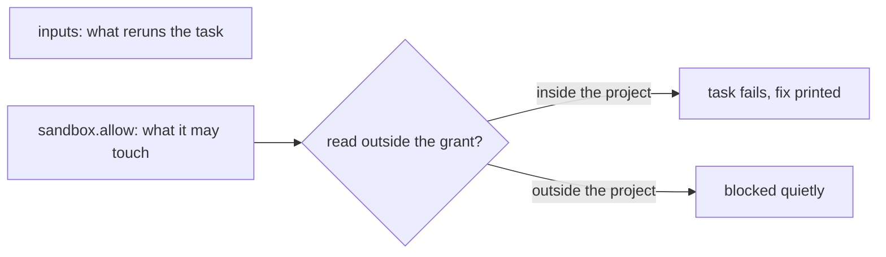
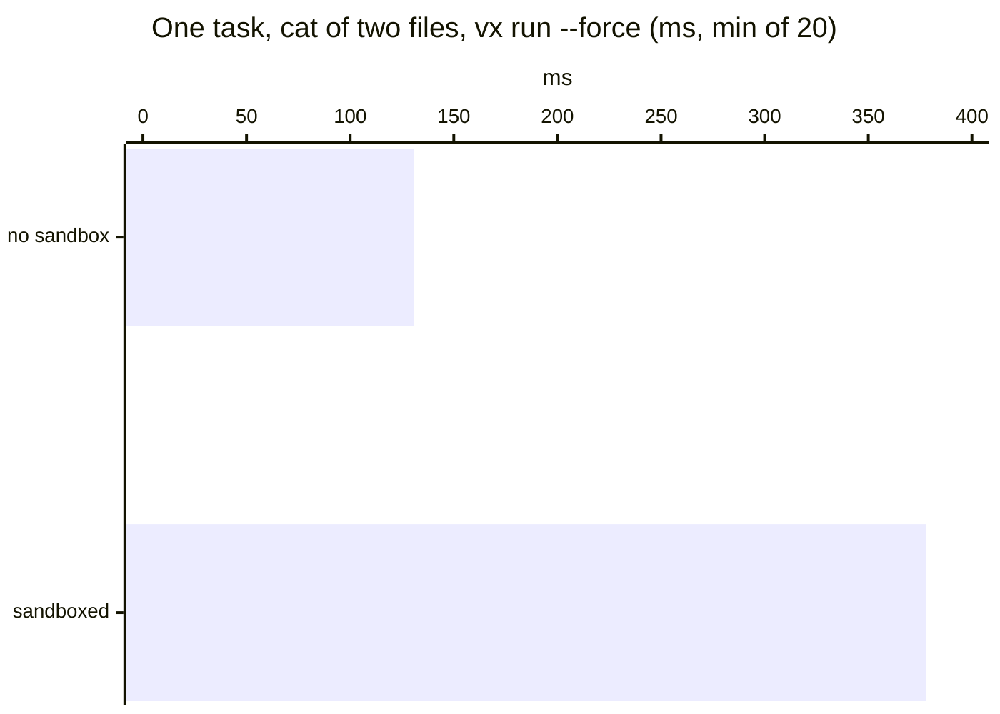
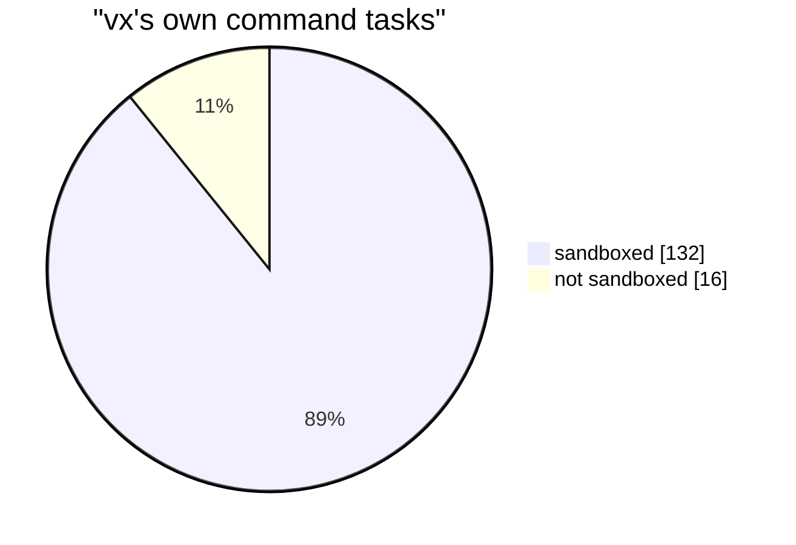

Forget to declare an input and the cache can serve a stale hit. The
sandbox fails the task instead, and prints the fix.

```ts
check: {
  exec: {
    command: 'cat src/index.ts notes.md',
    sandbox: { allow: { read: ['src'] } },
  },
  inputs: { files: ['src/**'] },
  cache: { outputs: { files: [] } },
}
```

```sh frame="terminal"
$ vx run packages/a#check
┌─ packages/a#check > $ cat src/index.ts notes.md
export const a = (n: number) => n * 2
export const extra = 1
cat: notes.md: No such file or directory
├─ SANDBOX VIOLATIONS (1) ────────────────────────────────────

openat(notes.md) = -1 ENOENT  [.../packages/a/notes.md]

fix: exec.sandbox.allow: { read: ['notes.md'] }
and, if the output depends on them, inputs.files: ['notes.md']

└─ packages/a#check ── (109ms) failed (exit 1, 1 sandbox violation)
```

Inside the sandbox an undeclared file does not exist. A failed task is
never cached, so the mistake cannot reach the cache.

## A sandboxed task starts with nothing

`sandbox: {}` reads nothing in the workspace, writes only its `TMPDIR`
and has no network. Most tasks start with
`sandbox: { allow: { read: ['.'] } }`. `~/.ssh` and `~/.npmrc` stay
closed unless a grant names them.

| Grant          | What it opens                                                     |
| -------------- | ----------------------------------------------------------------- |
| `read`         | paths or globs: project-relative, absolute or `~`                 |
| `write`        | the same; a write grant is readable too (`.tsbuildinfo`)          |
| `network`      | `true`, or domains with wildcards, through one proxy per run      |
| `localBinding` | ports a test server listens on                                    |
| `unixSockets`  | unix sockets                                                      |
| `systemInfo`   | named system values                                               |
| `gitConfig`    | writing `.git/config`, for this task only                         |
| `machLookup`   | macOS services                                                    |
| `pty`          | a terminal, on macOS                                              |

Those are the keys of `allow`. `deny` blocks network domains for the whole run. `ignore` hides a known,
harmless denial. Each task lists its own grants, with no defaults.

## Grant no wider than your inputs



vx links neither to the other, so the violation is judged against the
grants alone. Grant `read: ['src', '.eslintrc']` and every failure is an
input you missed. The fix line never offers `~/.ssh` or a `.env` file.

## What it costs



<small>linux x64, 4 cores, root in a container · vx `0be0367` · 2026-10-23</small>

Turn it on where inputs matter: in CI, and before a task goes to
[remote execution](../remote-execution/).

## Linux and macOS

Linux needs `bwrap`, `socat` and `rg`, plus `strace` for the report.
macOS uses seatbelt. Windows runs it through WSL.



The 16 are suites a sandbox cannot host, Docker services and checks that
drive the sandbox themselves. Guide: [Sandboxing
tasks](../../docs/sandboxing/). More at
[vznjs.github.io/vx](https://vznjs.github.io/vx/).
