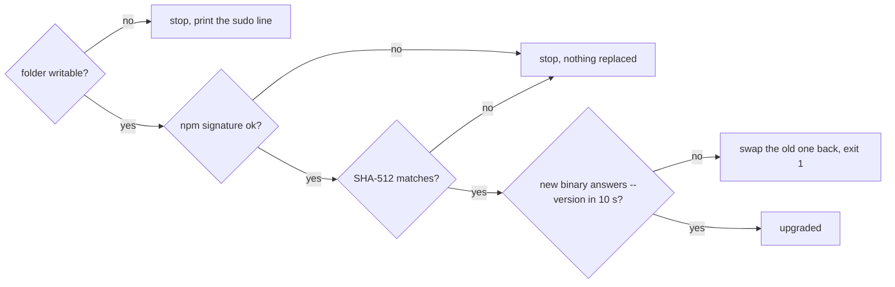

`vx upgrade` swaps the binary you run only after every check passes.
Any failure keeps the old one.



npm signs each release with a key vx pins. A server that swaps the file
cannot make that signature. No network or a captive portal prints one
line: nothing was replaced.

## A package manager install upgrades through it

```sh frame="terminal"
$ vx upgrade
› vx upgrade  0.0.635 → 0.0.640

  pnpm add @vzn/vx@0.0.640 --save-dev in /repo
```

If npm, pnpm, bun or yarn installed vx, that manager runs the upgrade.
In a project, `package.json` and the lockfile change together.

## Each repo runs the vx it pins

```sh frame="terminal"
$ vx --version
vx 0.0.640 (/repo/node_modules/@vzn/vx-linux-x64/vx, handed off from /usr/local/bin/vx)
```

A global vx hands the call to the project's own `@vzn/vx`. So the
whole team and CI run the version in the lockfile. It never runs a
`node_modules/.bin/vx` that another user owns.

## You can check who built it

```sh frame="terminal"
$ gh attestation verify vx-linux-x64 --repo vznjs/vx
```

Every binary carries a signed record of the repo, commit and CI workflow
that built it. npm packages publish from CI, so no npm token exists to
steal.

## A typo gets a fix, never a guess

```sh frame="terminal"
$ vx run build --concurrency 0x10
✗ vx run  --concurrency must be a positive integer, or a share of the cores like '50%' (got 0x10)

  see vx run --help

$ vx run build --timeout 1e3
✗ vx run  --timeout must be a duration like '500ms', '30s' or '5m', at most 24 days (got 1e3)

  see vx run --help

$ vx run build --retry 2
✗ vx run  unknown flag: --retry

  see vx run --help

  fix  --retries
```

Full reference: [CLI](../../cli/). More at
[vznjs.github.io/vx](https://vznjs.github.io/vx/).
