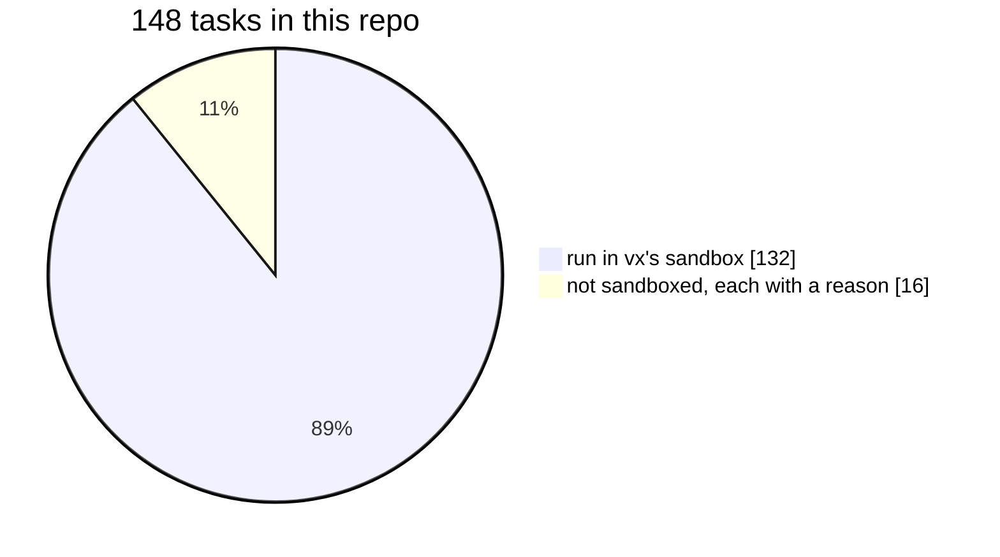

When two designs both look fine, the one that wins on the earlier
priority wins, and we don't reopen it.

1. **Performance.** Measured, not claimed.
2. **Modularity.** Each module's `index.ts` is its contract. A test
   fails any import that goes around it.
3. **Extensibility.** A plugin point for every stage, a plugin for
   everything remote.

The order says what loses. A plugin point that costs a millisecond on a
warm run, even unused, waits until it costs nothing.

## The nine principles

**Perf first.** Measure before and after, the two runs interleaved, the
fastest of N. A change to the warm path without a number isn't done.
Lookahead scheduling felt good, lost to plain critical-path order, and
was dropped.

**Explicit over magical.** Caching is opt-in, `inputs.files` is
required, nothing is guessed. The sandbox is how a task proves what it
touches ([why](../explicit-over-magical/)).

**One command per task; the shell is the API.** A plugin changes where
a command runs, never what it is. No JavaScript-function tasks.

**Resolved-config hashing.** The key sees the config after it runs, so
imports, presets and computed values all count.

**Cascade through deps by folding upstream input keys, never outputs.**
Every key is known before anything runs. `--dry` and remote execution
depend on that ([we tried the other way](../cascade-through-inputs/)).

**Project boundaries are hard.** A glob never reaches into another
project. What one project needs from another comes through the graph.

**No defaults.** Core turns on no plugin. A remote cache exists only if
you name it in `.vx/workspace.ts`.

**Plugin point over special case.** If core grows a branch for one user, the
plugin point is too narrow. The Turbo and Nx mappers and the
history-based scheduler moved to their own packages this way.

**Once per run.** A run reads each file once, looks up each path once,
asks each process once. A test traces a run and fails on any repeat
without a written reason.

## Said no to, and written down

Named inputs and global env. Guessing inputs by tracing. `NODE_OPTIONS`
in the key. Lookahead scheduling. Our own dashboard or cloud. Turbo's
cache protocol in core. HTTP/3.

Each lost a measurement or broke a rule above.

## vx builds itself under these rules

<small>From this repo's `.vx/projects.lock.json`, 2026-10-23 · 714 core test files</small>

The 16 can't be sandboxed: test shards for the sandbox itself (a
sandbox can't nest), the REAPI suites and their Docker services, one
`npm` install, and two checks that drive the sandbox.

Every bug fix comes with a test that fails without it. A skipped test
is treated as a hidden failure. A feature ships with its docs in the
same commit.

More at [vznjs.github.io/vx](https://vznjs.github.io/vx/).
