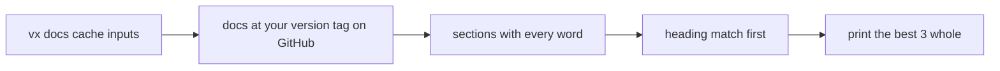

The site shows docs for the newest vx. `vx docs` searches the docs for
the version you run.

```sh frame="terminal"
$ vx docs exit codes --limit 1
── cli.md § Exit codes · https://vznjs.github.io/vx/cli/watch/#exit-codes

### Exit codes
…
```

A query takes about one second, mostly the download (948 to 1,095 ms,
two queries, Linux x64, 2026-10-23).

## How it finds an answer



Nothing ships inside vx. `--limit` changes how many sections print.

## What to ask

| You ask                     | You get                               |
| --------------------------- | ------------------------------------- |
| `vx docs cache inputs`      | how a task's inputs are declared      |
| `vx docs exit codes`        | each verb's exit codes                |
| `vx docs sandbox allow`     | what a sandboxed task may touch       |
| `vx docs VX_E_UNKNOWN_TASK` | the fix for that [refusal](../error-codes/) |
| `vx docs ... --format json` | `{query, hits: [{page, heading, url, text}]}` |

Offline, it stops with `VX_E_NETWORK` and names the site. The JSON shape
is `schemas/docs.json`. Guides stay on the site, indexed in
[llms.txt](https://vznjs.github.io/vx/llms.txt).

Reference: [`vx docs`](../../cli/docs/). More at
[vznjs.github.io/vx](https://vznjs.github.io/vx/).
