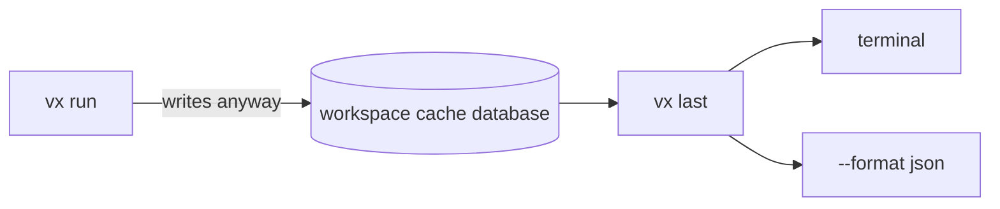

A test failed and the terminal scrolled away. `vx last --failed` finds
it and gives you the command to run only that again:

```sh frame="terminal"
$ vx last --failed
run 01a16ada-e526-75db-8cd6-f58c924aa0a3 — FAILED
  $ vx run build test --all
  2026-10-23T22:21:32.842Z · 49ms · master @ aa76c317+dirty
  8 tasks · 5 hits (5 up-to-date, 0 restored) · 1 failed

  failed (exit 1)   packages/b#test       14ms  99fea7dfce8b1fb5  0.6× cpu
  success           packages/b#build      16ms  0ff42f6215707c25  0.5× cpu
  success           packages/c#test       10ms  441a55956428a465  0.9× cpu
  up-to-date        packages/c#build       3ms  ce5c731444829c07
  up-to-date        packages/d#test        0ms  5b40789165953450
  up-to-date        packages/a#test        0ms  9ea4543bb5eed678
  up-to-date        packages/d#build       0ms  9f1cef08a2fd4006
  up-to-date        packages/a#build       1ms  4ab2bc0d55dd78a0

  re-run what failed: vx run packages/b#test

$ vx last --log packages/b#test
src/sum.test.ts:
3 | test('adds', () => { expect(sum(2, 2)).toBe(4) })
                                           ^
error: expect(received).toBe(expected)

Expected: 4
Received: 5
…
```

<small>Demo workspace · vx 69617eb · 2026-10-23 · log trimmed</small>

## Four questions

| Command              | Answers                                     |
| -------------------- | ------------------------------------------- |
| `vx last`            | what the last run did                       |
| `vx last --failed`   | the newest run that failed, and the re-run  |
| `vx last --list`     | recent runs, one line each                  |
| `vx last --log <id>` | what one task printed                       |

```sh frame="terminal"
$ vx last --list
FAILED 2026-10-23T22:21:32.842Z  01a16ada-e526  8 tasks · 5 hits (5 up-to-date, 0 restored) · 1 failed  49ms  $ vx run build test --all
ok     2026-10-23T22:21:27.007Z  01a16ada-ce5a  5 tasks · 5 hits (5 up-to-date, 0 restored)             23ms  $ vx run build test flip --filter packages/a --filter packages/b
ok     2026-10-23T22:21:26.832Z  01a16ada-cdaa  4 tasks · 3 hits (3 up-to-date, 0 restored)             54ms  $ vx run build --all
```

`--log` reads the last run that ran the task. Failed output is kept, and
a cached task's log is in its cache entry, so passes work too.

## It costs nothing extra



The record is the cache database every run already writes. Nothing
extra is stored and nothing is uploaded.

Reference: [the CLI](../../cli/). More at
[vznjs.github.io/vx](https://vznjs.github.io/vx/).
