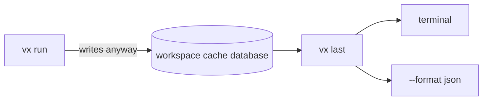

A test failed and the terminal scrolled away. `vx last --failed` finds
it and gives you the command to run only that again:

```sh frame="terminal"
$ vx last --failed
─ Run 01a16ada-e526-75db-8cd6-f58c924aa0a3 ───────────────────
  status    FAILED
  command   vx run build test --all
  when      2026-10-23T22:21:32.842Z · 49ms · master @ aa76c317+dirty
  tasks     8 tasks · 5 hits (5 up-to-date, 0 restored) · 1 failed

─ Tasks 8 ────────────────────────────────────────────────────
      time  ±usual status  cache      cpu    mem outputs  blocks worker       task
 ◼︎    14ms         failed  miss       60%      —               0 local        packages/b#test  exit 1
 ⏺︎    16ms         success miss       50%      —     2KB       1 local        packages/b#build
 ⏺︎    10ms         success miss       90%      —               0 local        packages/c#test
 ►     3ms         success fresh                      0B       1 local        packages/c#build
 ►     0ms         success fresh                      0B       0 local        packages/d#test
 ►     0ms         success fresh                      0B       0 local        packages/a#test
 ►     0ms         success fresh                      0B       1 local        packages/d#build
 ►     1ms         success fresh                      0B       2 local        packages/a#build

  next      vx run packages/b#test

$ vx last --log packages/b#test
src/sum.test.ts:
3 | test('adds', () => { expect(sum(2, 2)).toBe(4) })
                                           ^
error: expect(received).toBe(expected)

Expected: 4
Received: 5
…
```

<small>Demo workspace · vx 69617eb · 2026-10-23 · log trimmed</small>

## Four questions

| Command              | Answers                                     |
| -------------------- | ------------------------------------------- |
| `vx last`            | what the last run did                       |
| `vx last --failed`   | the newest run that failed, and the re-run  |
| `vx last --list`     | recent runs, one line each                  |
| `vx last --log <id>` | what one task printed                       |

```sh frame="terminal"
$ vx last --list
FAILED 2026-10-23T22:21:32.842Z  01a16ada-e526  8 tasks · 5 hits (5 up-to-date, 0 restored) · 1 failed  49ms  $ vx run build test --all
ok     2026-10-23T22:21:27.007Z  01a16ada-ce5a  5 tasks · 5 hits (5 up-to-date, 0 restored)             23ms  $ vx run build test flip --filter packages/a --filter packages/b
ok     2026-10-23T22:21:26.832Z  01a16ada-cdaa  4 tasks · 3 hits (3 up-to-date, 0 restored)             54ms  $ vx run build --all
```

`--log` reads the last run that ran the task. Failed output is kept, and
a cached task's log is in its cache entry, so passes work too.

## It costs nothing extra



The record is the cache database every run already writes. Nothing
extra is stored and nothing is uploaded.

Reference: [the CLI](../../cli/). More at
[vznjs.github.io/vx](https://vznjs.github.io/vx/).
