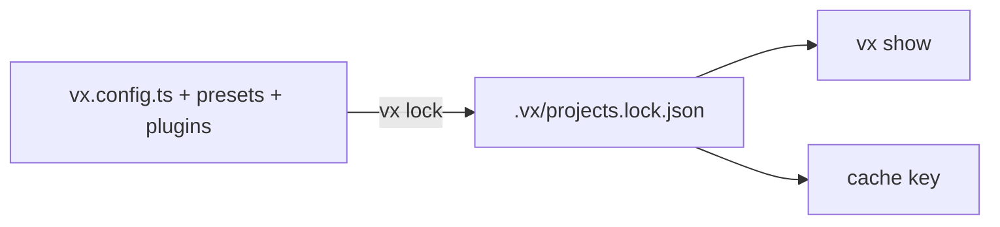

`vx show` prints a task the way the run sees it. Presets, plugins and
computed commands are already applied.

```sh frame="terminal"
$ vx show packages/a#build

─ packages/a#build ───────────────────────────────────────────
  dir            packages/a
  command        bun build src/index.ts --outdir dist
  inputs.files   src/**
  outputs.files  dist/**
```

This is what the cache key is built from. If a preset set `outputs` or
a plugin changed the command, you see it here.

## It reads the same file the run reads



`vx show` reads the lock file, like `vx run`. Change a config, run
`vx lock`, and the change shows.

## Every project on one screen

```sh frame="terminal"
$ vx show
  project     dir         tasks
  packages/a  packages/a  7 tasks
  packages/b  packages/b  4 tasks
  packages/c  packages/c  5 tasks
  packages/d  packages/d  2 tasks
```

`vx show --affected` lists the projects your change reaches, without
running anything.

<small>Demo workspace · vx 69617eb · 2026-10-23</small>

## JSON for scripts and agents

```json
{"name":"packages/a","dir":"packages/a","task":"build","config":{"exec":{"command":"bun build src/index.ts --outdir dist"},"inputs":{"files":["src/**"]},"cache":{"outputs":{"files":["dist/**"]}}}}
```

`--format json` prints the object. On this repository that is 13
projects and 201 tasks in 5,807 bytes.

Reference: [the CLI](../../cli/). More at
[vznjs.github.io/vx](https://vznjs.github.io/vx/).
