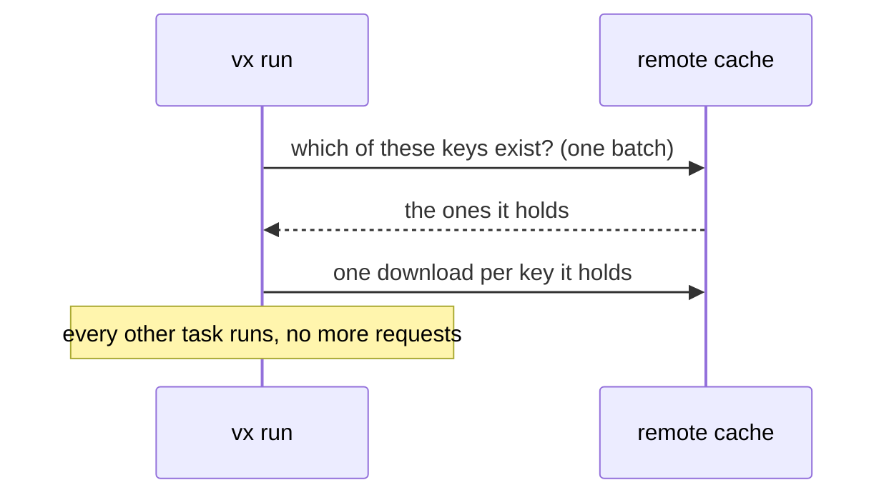

Cache uploads and downloads mostly wait on the network, so vx runs up
to 64 at once even on a 4-core machine. 1,000 uploads to a cache 30 ms
away take 2.5 s. With only 4 at once:

```sh frame="terminal"
$ time vx run build --all --cache-concurrency-upload 4
  cache     remote 1000↑ 269 KB
  time      2.27s
real    0m8.345s

$ time vx run build --all
  cache     remote 1000↑ 269 KB
  time      2.38s
real    0m2.649s
```

The run's `time` ends with its last task. Uploads finish in the
background, and the process exits when they are done.

| Lane limit       | Upload all 1,000 | Restore all 1,000 from the remote |
| ---------------- | ---------------- | --------------------------------- |
| 1                | 31.6 s           | 9.0 s                             |
| 4                | 8.4 s            | 8.4 s                             |
| 16               | 2.7 s            | 2.6 s                             |
| default (64)     | 2.5 s            | 1.6 s                             |

<small>Min of 3 interleaved runs · `private/vx-bench/generate.ts`, 1,000 projects, `build --all` · Turborepo-protocol cache that answers after 30 ms, `turboCache()` · `CI=1` · Linux x64, 4 cores · vx a1786b3 · 2026-10-23</small>

## Three lanes, three limits

| Lane       | Default                                 | Why                                      |
| ---------- | --------------------------------------- | ---------------------------------------- |
| `download` | min(96, max(cores × 3, 64))             | mostly waiting on the network            |
| `upload`   | min(96, max(cores × 3, 64)), per remote | the same, and it runs in the background  |
| `restore`  | twice `run.concurrency`                 | local disk work, closer to a task        |

The network formula is pnpm's: at least 64 at once, at most 96. If your
server wants fewer connections, set fewer:

```ts
// .vx/workspace.ts
import { defineWorkspace } from '@vzn/vx/config'

export default defineWorkspace({
  cache: { concurrency: { download: 32, upload: 16 } },
})
```

```sh frame="terminal"
vx run build --all --cache-concurrency-upload 16
```

## A missing key costs no request



Before tasks start, vx asks each remote in one batch which keys exist.
A missing key costs nothing more. A key it has costs one download.

## One request per plugin read

Plugins keep entries in the same cache, like the timings
`@vzn/vx-history` learns. `ctx.cache.get`, `has` and `hasMany`
each make one request.

Settings: [schema](../../schema/). Flags: [CLI reference](../../cli/).
More at [vznjs.github.io/vx](https://vznjs.github.io/vx/).
