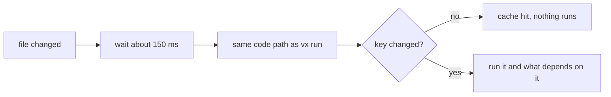

`vx watch` runs only what an edit really affects. A README edit runs
nothing. A source edit runs that project and everything after it.

```sh frame="terminal"
$ vx watch build test --all
watching 4 projects · 8 tasks

changed packages/c README.md

changed packages/c src/index.ts
 ⏺︎     7ms success miss     packages/c#build
 ⏺︎    20ms success miss     packages/c#test
```

| Edit   | Until                  | Time        |
| ------ | ---------------------- | ----------- |
| README | "changed" line shown   | 154–161 ms  |
| src    | test finished          | 180–195 ms  |

<small>5 runs each · Linux x64, 4 cores · vx 0be0367 · 2026-10-23</small>

About 150 ms of each is the debounce, the wait for more edits.

## The key decides, not the event



vx doesn't match file events against your input globs. The cache key
already knows if a change matters, and a second set of rules would
drift from it.

## The content gate

A task that writes into its own project can loop forever: it writes,
the watcher sees it, the task runs again.

vx ignores every task's declared outputs. For everything else it checks
**content**: a file with the same bytes as last time is not an edit. A
task that rewrites its own files costs one extra cycle from the cache,
then it settles.

Always ignored:

- `node_modules`, `.git` and `.vx/cache`;
- the run's cache directory, wherever `--cache-dir` put it;
- editor backups (a trailing `~`);
- any untracked path git ignores (one `git check-ignore` per debounce
  window).

## Watchers that are really watching

On macOS a watcher can start before its events are live, and an edit in
that gap is lost. vx writes a probe file under each watcher and prints
`watching` only after every probe is seen.

A directory whose watcher stays silent for two seconds is polled
instead, with a warning.

The workspace root is watched too (not recursively), so a lockfile edit
is heard.

## The rest

- Events during a cycle queue; re-runs fire about 150 ms after the last
  event.
- A failed cycle prints its failure and waits for the next change.
- Ctrl-C prints `vx watch: stopped`, tears down the cycle's children,
  and exits 0 once they are gone.
- Flags that describe one run (`--dry`, `--profile`, `--verbosity`
  above 0) are refused up front: a loop has no single run.
- A persistent task starts once and stays up. It restarts only when its
  own config or forwarded args change, or when it dies.

Reference: [`vx watch`](../../cli/watch/). More at
[vznjs.github.io/vx](https://vznjs.github.io/vx/).
