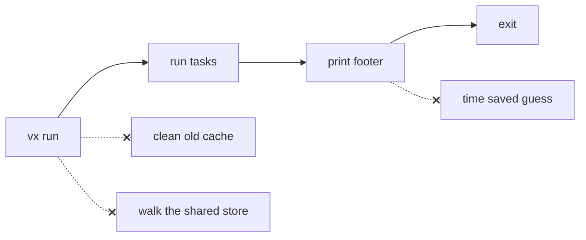

A warm run is fast mostly because of work it skips. Here is what a vx
run never does.



## Cleanup runs when you choose

```sh frame="terminal"
$ vx cache clean --older-than 30d --max-size 10G
› vx cache clean  nothing to free

$ vx cache clean --max-size 100K
✓ vx cache clean  freed 94 MB

  999 entries
```

Cleanup at the end of every run would be seven `DELETE`s, four of them
full scans, and it grows with history. Run `vx cache clean` from cron or
a scheduled CI job instead.

There is no `cache.retention` setting.

## The shared store opens by its index

The store under `~/.vx` opens by its index file. A run never lists its
entries or checks their folders.

## The footer shows only what it measured

```ansi
  time      63ms · max 8ms · avg 6ms · min 4ms
```

That is wall time, then the slowest, average and fastest task. Adding
up the stored time of every cache hit would overstate the saving.
Tasks that would have run side by side cost the clock only once.

What each run does, stage by stage: [Architecture](../../architecture/).
More at [vznjs.github.io/vx](https://vznjs.github.io/vx/).
