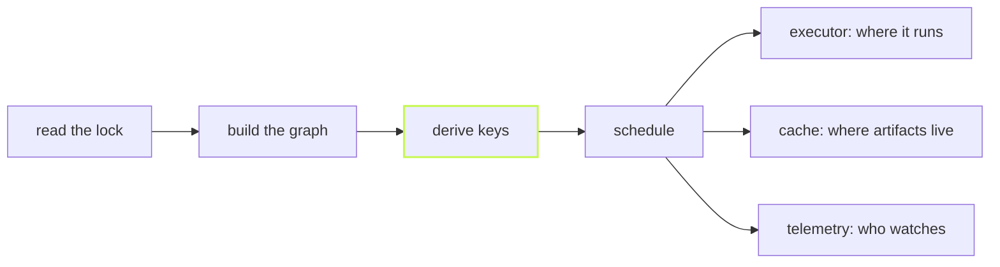

**vx runs and caches your task graph, correctly, and stops there.**
Here is what that means in practice.

## A run is a pipeline



1. **Lock.** `vx lock` runs each `vx.config.ts` once and saves the
   result. A run reads only that.
2. **Graph.** One task graph for the whole repo.
3. **Key.** Each task gets a hash of its inputs, its config and the
   keys of everything before it.
4. **Schedule.** Restore hits. Run misses. Save.

In plugin terms the stages are named, in order:

- `config` → `discover` → `project` → `graph` → `key` → `fingerprint`
  → `schedule` → `admit`
- then `executor`, `cache`, `telemetry`, `output`, `setup`, `teardown`
  and `commands`

A plugin can fill any of them.

Core turns on **no** plugin by default. With none, vx still runs and
caches on your machine.

## A task is one command

```ts
build: {
  exec: { command: 'tsc -b' },
  inputs: { files: ['src/**', 'tsconfig.json'] },
  cache: { outputs: { files: ['dist/**'] } },
}
```

- **Caching is opt-in.** No `cache` block, no cache. vx never guesses
  what a task reads.
- **One command per task.** A plugin may change *where* it runs, never
  *what* it is.
- **A project reads only its own folder.** What it needs from another
  project comes through the graph.

## What is not inside

| Never in vx                     | Why                                                                 |
| ------------------------------- | ------------------------------------------------------------------- |
| A cloud, account or dashboard   | vx does not need to know your company exists.                       |
| A daemon                        | A second copy of the truth can go stale. Git is read fresh per run. |
| Inferred or traced inputs       | A trace says what a task read once. A key is needed before it runs. |
| JavaScript-function tasks       | The shell is the API. Your tools stay yours.                        |
| Named, global inputs or env     | Configs are TypeScript. A shared preset is an import.               |

Remote caches, remote execution, telemetry and CI summaries are plugins
in their own packages. `@vzn/vx-reapi` (Bazel's Remote Execution API)
shows the plugin points are wide enough.

With no cloud to sell, vx has one job: be correct and fast on the
machine in front of you.

Next: [Why vx is fast](../why-vx-is-fast/). Reference:
[Architecture](../../architecture/). More at
[vznjs.github.io/vx](https://vznjs.github.io/vx/).
