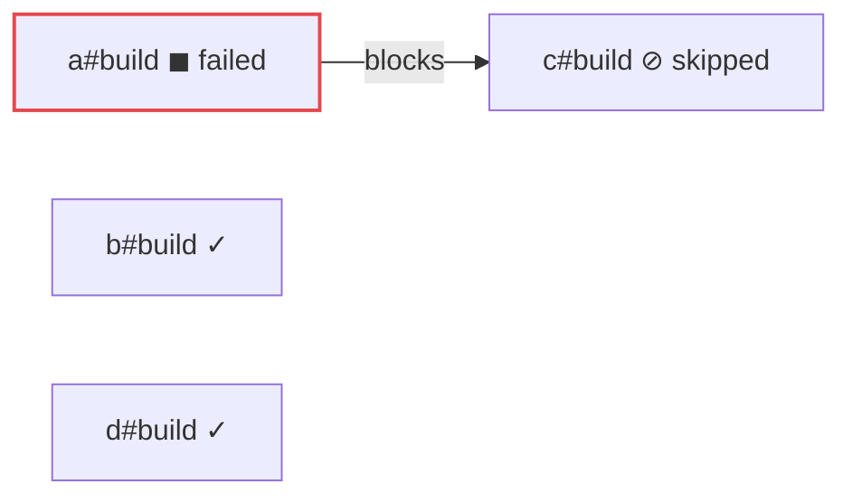

A broken build skips only what depends on it. Everything else runs, and
each skip names the failure behind it.



`packages/a` has a syntax error. `c#build` depends on `a#build`. `b`
and `d` don't:

```sh frame="terminal"
$ vx run build test --all
 ⏺︎     7ms success no-cache packages/e#codegen
 ◼︎    10ms failed  miss     packages/a#test
 ◼︎    10ms failed  miss     packages/a#build
 ⊘         skipped          packages/c#build • blocked by packages/a#build
┌─ packages/a#test > failed (exit 1)
…
12 | export const = ;
                  ^
error: Expected identifier but found "="
```

`b` and `d` were cache hits, so they print nothing. A skip names the
failure at the root of its chain, so you fix one thing.

<small>Demo workspace · vx 69617eb · 2026-10-23</small>

## Pick how far a failure reaches


| `--continue=`               | On a failure                                 |
| --------------------------- | -------------------------------------------- |
| `deps-ok` (default)         | skip its dependents, run the rest            |
| `never`                     | stop dispatch; running tasks finish          |
| `always`, or bare `--continue` | run dependents anyway                     |

```sh frame="terminal"
$ vx run build test --all --continue=never --force
 ⏺︎    13ms success no-cache packages/e#codegen
 ◼︎     9ms failed  miss     packages/a#build
 ⊘         skipped          packages/c#test
 ⊘         skipped          packages/d#test
 ⊘         skipped          packages/b#test
 ⊘         skipped          packages/e#build
 ⊘         skipped          packages/c#build • blocked by packages/a#build
 ⏺︎    12ms success miss     packages/d#build
 ⏺︎    16ms success miss     packages/b#build
 ◼︎    10ms failed  miss     packages/a#test
```

Running tasks finished (`b#build`, `d#build`, `a#test`). Nothing new
started. A skip with no blocker means the run stopped.

## How many at once

`--concurrency` takes a count or a share of the CPUs:

```sh frame="terminal"
$ vx run build --all --concurrency 8
$ vx run build --all --concurrency 50%   # half the CPUs, never below 1
$ vx run lint --all --concurrency 200%   # I/O-bound work can go over
```

The default is the core count, capped by the container's CPU quota.
`run.concurrency` in `.vx/workspace.ts` changes it for everyone.

Cache hits don't count: restores run on their own lane, up to twice the
limit.

## A table when you want one

`--verbosity 1` adds one row per task after the run:

```sh frame="terminal"
$ vx run build --all --verbosity 1
packages/e#codegen  success                                    10ms
packages/a#build    failed (exit 1)                             8ms
packages/c#build    skipped (blocked by packages/a#build)       0ms
```

Every flag is in the [CLI reference](../../cli/). More at
[vznjs.github.io/vx](https://vznjs.github.io/vx/).
