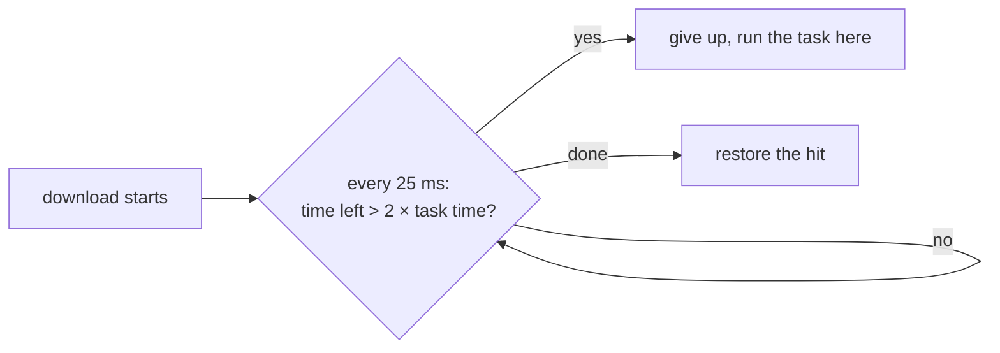

If a download would take longer than running the task, vx runs the task.
Here 500 tasks are remote hits, and 20 of them are 8 MB on a 4 MB/s
link:

```sh frame="terminal"
$ vx run build --all --dry
500 task(s) planned, 500 cache hits (500 remote, 153 MB).

$ vx run build --all
  cache     local 20↑ · remote 480↓ 129 KB
  time      1.02s
```

Those 20 would take 2 s each to download. Their tasks run in
milliseconds, so vx ran them here (`local 20↑`) and downloaded the
other 480.

| The remote says               | Full run | Downloaded |
| ----------------------------- | -------- | ---------- |
| size and task time            | 1.15 s   | 129 KB     |
| size only                     | 3.12 s   | 153 MB     |

<small>Min of 3 interleaved runs, empty local cache · `private/vx-bench/generate.ts`, 500 projects, 20 writing 8 MB · Turborepo-protocol stub 30 ms away at 4 MB/s, `turboCache()` · Linux x64, 4 cores · vx 22f6eb7 · 2026-10-23</small>

## Weigh the download against the task



The remote has to tell vx the entry's size and its task's time. Turbo's
cache API sends both (`Content-Length`, `x-artifact-duration`), and
`turboCache()` passes them on.

Twice the task time, because a run here also saves its outputs. The task
counts as a miss and uploads nothing.

A remote that doesn't send the time is always waited for, as in the
second row. vx won't guess.

## Know what a run will pull

The footer shows the bytes each way. `--dry` shows what the remote hits
would download, before anything runs.

## For plugin authors

A remote's `has` returns `{ size, durationMs }`, either one, `{}`, or
`null` for a missing key. `hasMany` returns a `Map` of the same. Send a
size and you get the `--dry` figure.

Send a duration too and you get the slow-download check. [Your own
cache](../../docs/writing-plugins/#your-own-cache) shows a whole remote.

Setup: [Remote cache](../../docs/remote-cache/). More at
[vznjs.github.io/vx](https://vznjs.github.io/vx/).
