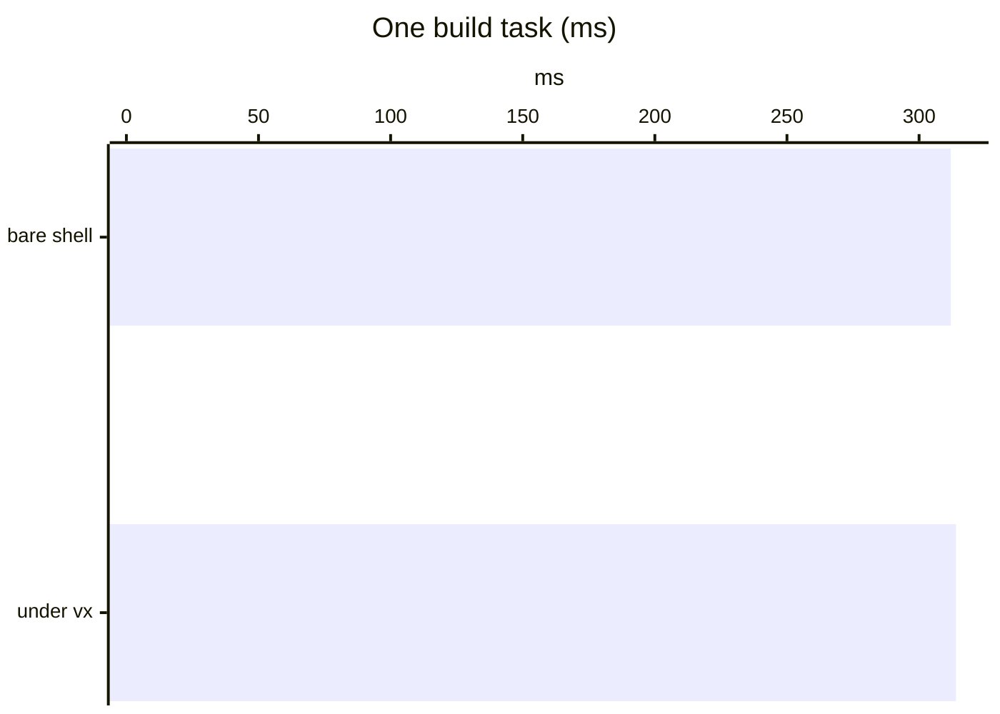

We traced one 8,002-task run through vx, Turborepo and Nx. A cold run is
almost all task time. A warm run is how little the tool does.

| Run                          | vx                 | Turborepo 2.11.8 |
| ---------------------------- | ------------------ | ---------------- |
| Cold                         | 120.2 s            | 127.3 s          |
| Warm                         | 892 ms             | 2,496 ms first, 909 ms second |
| One source file changed      | 100.1 s (6,607 run) | 105.8 s (6,607 run) |
| That edit reverted           | 3.6 s (1,321 tasks restored, the rest left in place) | 5.2 s (all 8,002 replayed) |

<small>Synthetic bench, 1,601 projects, 9,603 graph nodes · 4 cores, concurrency 10, `CI=1`, local cache only, Linux · vx `9388bad8f` (`VX_DEBUG_TIMING=1`), Turborepo 2.11.8 (`--profile`), Nx 23.3.0 (`nx:run-commands`, daemon off, `.env` off) · 2026-10-13/14 · [method](../../benchmarks/)</small>

## A cold run is the tasks

vx adds about 0.4 ms per task for spawn, env and output capture. Before
the first task it spends about 640 ms on projects, graph and git.
Turborepo's precompute is about 0.7 s.

## Some extra work is a safety check

| Check | Cost |
| --- | --- |
| Graph rules (output overlap, missing edge) | none at run time, `vx lock` checks once |
| [Input recheck](../an-input-moves-four-tools/) after a miss | about 0.2 ms per miss |
| Clear outputs before a miss | about 0.15 ms per miss |
| Save before dependents start | at most about 0.14 s of 120 s |
| Blob-size check, cold cache | about 330 ms, once per git index |

Remote uploads run in the background. Only the end of the run waits for
them. We measured each check and kept it.

## A warm run decides not to work

| Step                   | vx                                          | Turborepo 2.11.8                         |
| ---------------------- | ------------------------------------------- | ---------------------------------------- |
| Projects and graph     | discover, then graph with rules             | precompute                               |
| File hashes            | git's own index (63 ms)                     | git index, then per-package file hashes  |
| Keys                   | one per task                                | one per task                             |
| On a hit               | checks each task's outputs on disk; restores a task's outputs only if one differs | restores every output and log |

Without its daemon, Turborepo rewrites every output on a hit
([`restore_outputs`][turbo-restore]).

vx leaves a task's outputs alone if each file still matches its record
(size, mode, modification time, inode, change time).

[turbo-restore]: https://github.com/vercel/turborepo/blob/v2.11.8/crates/turborepo-run-cache/src/lib.rs

## Nx 23.3.0, warm: 21 to 24 s

| Self time | Where                                                                  |
| --------- | ---------------------------------------------------------------------- |
| 6.10 s    | `hashTasksUpfront`: hands each task's environment to the native hasher |
| 5.55 s    | garbage collection                                                     |
| 3.03 s    | `getTaskSpecificEnv`: copies `process.env` for each task               |
| 2.89 s    | `copyFilesFromCache`: writes every cached output back                  |
| 1.56 s    | `plan`, the native planner                                             |

<small>CPU profile of the main process, all 9,603 tasks hit, 173 env vars · source `nx@23.3.0` `task-env.js`, `cache.js`</small>

`getTaskSpecificEnv` copies `process.env` for every task, so it grows
with your environment.

## What a change reruns

| Change                         | vx         | Turborepo 2.11.8 |
| ------------------------------ | ---------- | ---------------- |
| Unrelated env var set          | all hit    | all hit          |
| Root `package.json` edited     | all hit    | all 8,002 miss   |
| One project's `package.json`   | 6,607 miss | 6,607 miss       |
| `bun.lock` added               | all miss   | all miss         |

vx sees root dependencies through the lockfile. A lockfile plugin such as
`bun()` narrows the last row to the projects whose dependencies moved.

## What we checked in vx and dropped

The output check on hits looked like 655 ms. Alone it is 10.8 ms over
1,600 hits: the trace summed ten workers.

A tool that rewrites outputs with the same bytes makes vx restore them,
but a content hash on every save would cost more. Neither became a
patch.

The bench and its scripts are in the repository. More at
[vznjs.github.io/vx](https://vznjs.github.io/vx/).
