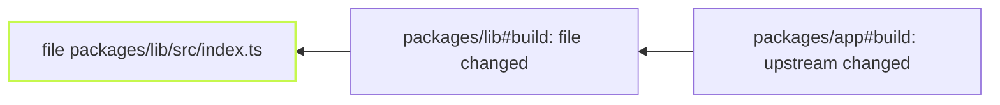

`vx why` tells you which part of a cache key changed, with the before
and after.

```sh frame="terminal"
$ vx why packages/b#build
packages/b#build — run 01a16ac6-3270-70fe-aad8-7c5385ba6c66
  this run   2026-10-23T21:58:56.386Z · success · executed · key c3ee933a220000aa
  previous   2026-10-23T21:58:05.369Z · cache-hit · up-to-date · key e96eab4891dec23d
  verdict    cache key changed: file packages/b/src/index.ts

  what changed (1 component, 3 unchanged):
    changed file  packages/b/src/index.ts  8e079521fa79cce256e6f53a5428ae3a347fc0de → 9b735bd1261c512e4b0bf2f2546c2b5e4e14d075

  what to do:
    file  an edit re-runs by design; a file the task does not read belongs out of inputs.files
```

<small>Demo workspace · 2026-10-23</small>

## It follows the change upstream



```ansi
  root cause:
    packages/app#build ← packages/lib#build ← file packages/lib/src/index.ts
```

## It only reads the cache database

`vx why` reads the local `cache.db`. It loads no config and runs
nothing, so it answers later and on another machine. Keep a CI job's
`cache.dir` and ask it from your laptop. A key has these parts:

| Kind         | What it is                                                        |
| ------------ | ----------------------------------------------------------------- |
| `file`       | a path and its blob id                                            |
| `linked`     | what a symlinked `file` points to                                 |
| `env`        | a variable from `inputs.env`                                      |
| `runtime`    | a declared command's output, run in the project                   |
| `ws-runtime` | the same, run at the workspace root                               |
| `forward`    | the argv forwarded after `--`                                     |
| `config`     | the evaluated task config                                         |
| `upstream`   | a dependency's input key, by task id                              |
| `plugin`     | a plugin's material, by name (`plugin @vzn/vx-lockfile/pnpm`)     |
| `platform`   | the platform, for a task that names `exec.platforms`              |
| `format`     | the key format; moves only with a vx upgrade                      |

## When the key did not change

Most reruns keep the same key. `vx why` says which case it was, in one
of these exact sentences:

<details>
<summary>Every verdict vx prints</summary>

| vx says                                                                                                    | What happened                                                    |
| ---------------------------------------------------------------------------------------------------------- | ---------------------------------------------------------------- |
| cache key changed: file packages/app/src/input.txt | the key moved; up to three components are named, then a count, and listed below |
| cache key changed between the previous run and this one (inputs differ) | the key moved but neither entry kept its components (pruned, or a failed run saved none) |
| never cached: its key includes a task that declares no `inputs`, so each run derives a new key               | declare `inputs` on the task it names                            |
| cache key unchanged — this run was served from cache, nothing re-ran                                       | it was a cache hit                                               |
| cache key unchanged — the previous run on this key failed and saved nothing, so there was nothing to hit | a failure saves no entry |
| cache key unchanged — re-executed because this run did not read the cache (--force, or a --cache-policy without read) | the run's policy read no cache |
| cache key unchanged — re-executed because this run did not use the cache (--no-cache, or a --cache-policy without read or write) | the run used no cache |
| cache key unchanged — neither run saved it: each ran beside a failed task (…), and a task run past a failed dependency (--continue) is never cached | both runs went past a failure under `--continue` |
| cache key unchanged — the previous run on this key ran beside a failed task (…) and was not saved: a task run past a failed dependency (--continue) is never cached, so there was nothing to hit | the previous run went past a failure under `--continue` |
| cache key unchanged — no entry for this key was in the cache when it ran (pruned or evicted), so it executed and saved one | the entry was gone |
| cache key unchanged — the previous run on this key executed but no entry for it is in the cache (its save failed, or it was pruned since), so there was nothing to hit | the previous run's save failed, or a prune took the entry |
| cache key unchanged — the previous run on this key built on a dependency it left out (…), so it saved nothing and there was nothing to hit | the previous run left that dependency out, and saves nothing built on one |
| cache key unchanged — the previous run on this key did not write the cache (--no-cache, or a --cache-policy without write), so there was nothing to hit | the previous run's policy wrote no cache |
| cache key unchanged — re-executed on the same key though this run read the cache; vx cannot name the cause | none of the above; vx cannot name the cause |
| cache key unchanged — re-executed on the same key (--no-cache / --force, or unrelated) | no invocation recorded the run's cache policy |
| cache key unchanged — this run recorded no cache outcome, so whether it re-ran is unknown                  | the run recorded no outcome for this task; vx says so, not guesses |
| this task declares no `cache` block — it runs on every invocation; its key is folded by dependents only    | not a cache decision at all                                      |
| this task declares no `cache` block — it runs on every invocation; it declares no `inputs` either, so each run derives a new key and every task that depends on it misses; declare its `inputs` | not cached, and no task depending on it can hit |
| this task recorded no cache key (skipped, or a persistent task) — nothing to compare | there is no key to compare |

</details>

A missing input never shows up here. The task hits and brings back old
output. The [sandbox](../the-sandbox/) catches that.

## Scripts and agents get JSON

`vx why --format json` prints `{ taskId, runId, why, diff, roots }`.
The [agent skill](../../docs/agents/) teaches it to coding agents.

Guide: [Caching › Why did it re-run?](../../docs/caching/#why-did-it-re-run).
More at [vznjs.github.io/vx](https://vznjs.github.io/vx/).
