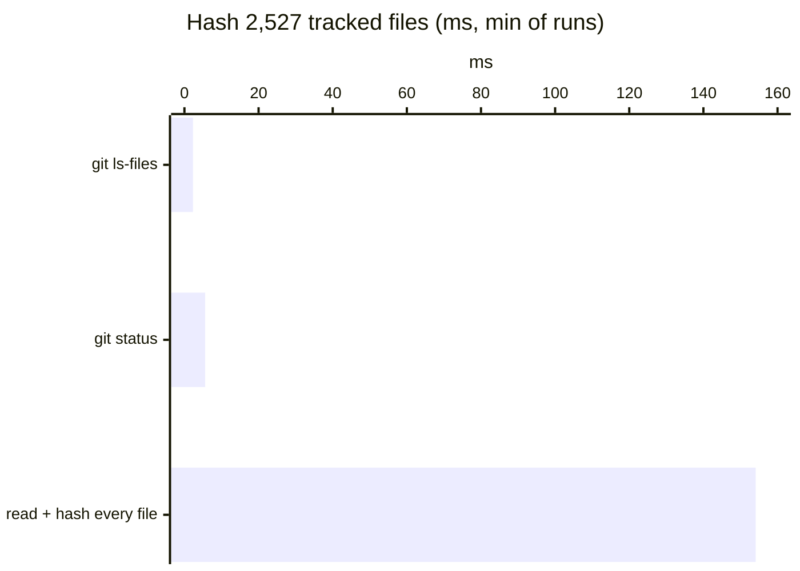
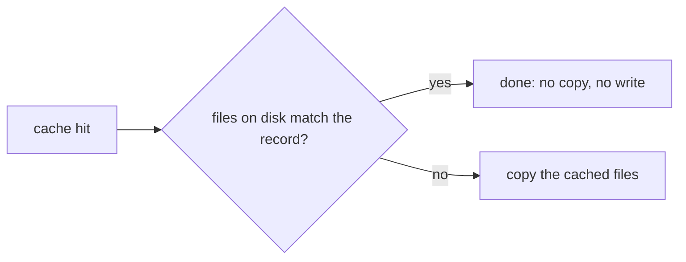
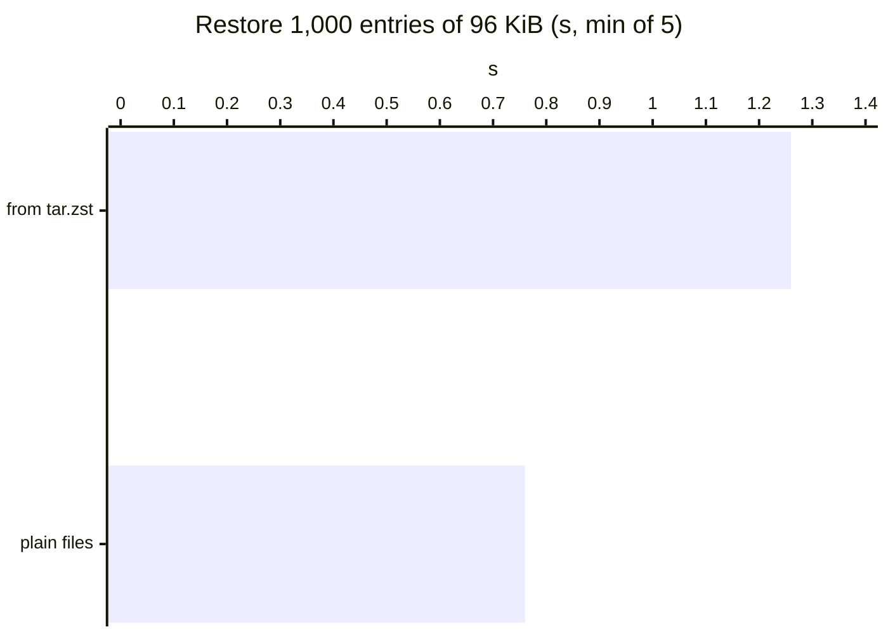

With nothing changed, vx adds **799 ms** to a 9,603-task run. No daemon
keeps it warm.

| Time added over the ideal run, 1,601 projects, 9,603 tasks | vx      | Turborepo | Nx         | Vite Task |
| ---------------------------------------------------------- | ------- | --------- | ---------- | --------- |
| Nothing changed                                            | 799 ms  | 927 ms    | 24.15 s    | 12.07 s   |
| Nothing changed, outputs restored                          | 1.28 s  | 2.01 s    | 24.45 s    | 11.86 s   |
| Cold build                                                 | 7.57 s  | 9.63 s   | 3 min 6 s  | 9.01 s    |
| Cold build: CPU the runner burns                           | 36.64 s | 1 min 12 s | 5 min 34 s | 25.32 s  |

<small>Synthetic monorepo, 1,601 projects, 30 levels · linux x64, 4 cores, concurrency 10 · vx `0be036747`, Turborepo 2.11.10, Nx 24.0.1, Vite Task (vite-plus) 1.4.0, native configs · 2026-10-23 · [benchmarks](../../benchmarks/)</small>

Five design choices make that number. Each one also makes the cache
harder to get wrong.

## 1. Git already hashed your files

<small>This repo, 48 MB · linux x64, 4 cores, warm page cache · 2026-10-23</small>

Git keeps a hash of every tracked file. vx asks git instead of reading
them. Clean-tree key derivation costs zero source-file reads.

A dirty file gets the same hash git would give it, so a commit never
changes a key ([how](../keys-from-git/)).

## 2. The scheduler counts with bitsets

vx starts the task with the most work below it first. Counting that with
a graph walk took 8.5 s of a 10 s run on a 1,090-package graph.

Bitsets do it in milliseconds ([how](../bitsets-and-the-scheduler/)).

## 3. A hit on an up-to-date tree is a few stat calls

vx wipes outputs before a task runs, so it knows what a hit leaves on
disk. If each file still matches (size, mode, millisecond mtime, inode
and ctime), there is nothing to restore.

## 4. A hit is a file copy

The local cache stores plain files and the kernel copies them.

Metadata and the captured stdout live in the index (the stdout in a side
table), so the log comes back with one SQL read
([how](../a-hit-is-a-file-copy/)).

## 5. Nothing runs that is not needed

A run reads `.vx/projects.lock.json` and evaluates no config. No
telemetry plugin means no listener and no `git` spawn. A plugin that
skips a task costs nothing.

Every change to this path ships with a measured before and after
([Optimizations](../../optimizations/)). More at
[vznjs.github.io/vx](https://vznjs.github.io/vx/).
