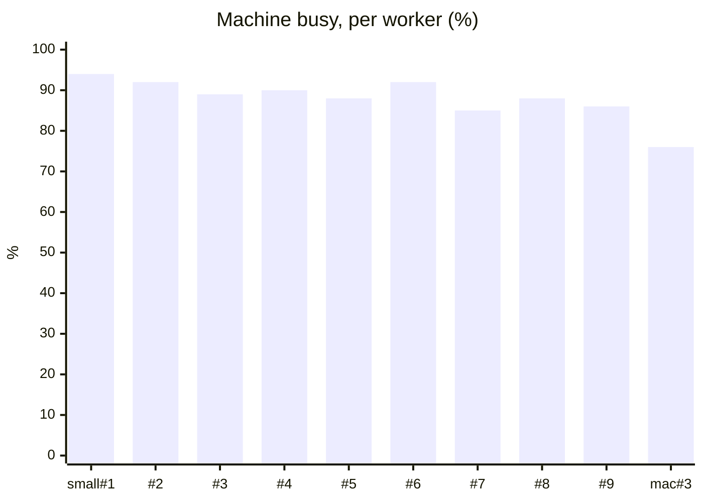
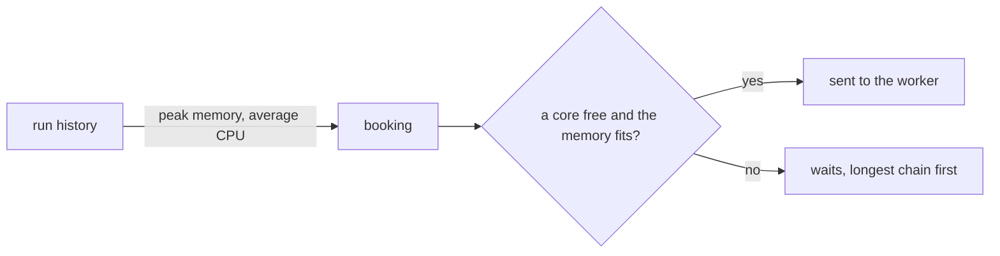

On vx's own main branch, nine Linux workers ran 88% busy for one run.
The footer prints that for every worker, every run.



<small>vx CI on GitHub runners, 160 tasks to run · 4a86e02 · 2026-11-07 · [the run](https://github.com/vznjs/vx/actions/runs/42373931129)</small>

## A Mac starts only for a Mac task

```ts
dte({
  workers: {
    hosted: {
      machines: {
        small: { max: 9, cpu: 4, memory: '16GB', platform: 'linux-x64' },
        arm: { max: 1, cpu: 4, memory: '16GB', platform: 'linux-arm64' },
        mac: { max: 4, cpu: 3, memory: '7GB', platform: 'darwin-arm64' },
      },
    },
  },
})
```

A task runs on a machine of its own platform, Linux unless it names
another. A Mac starts only when a task needs macOS, and only as many as
those tasks fill. `exec.worker` sends a task to one named type.

## A task is booked by what it used last time



Memory is booked at its peak, since running out kills a task. CPU is
booked at its average, so a worker is not left half idle.

## A server stops once no task needs it

A dev server or database a test depends on starts on that test's
worker. It stops when no task left in the run uses it, and its CPU is
charged to the tasks it served.

## The footer shows three numbers per worker

```ansi
  hosted.small#1  left     12 done · warm-up 91.9s
                  declared 4c/16G · actual 4c/17G
                  online 122.2s · busy 122.1s · idle 0.1s
                  cpu utilization machine 94% · tasks 67% · worker 3%
  best            8 × hosted.small + 1 × hosted.arm + 2 × hosted.mac: 160.9s
  total           cpu utilization machine 88% · tasks 63% · worker 2%
```

`machine` counts any process on the box, `tasks` only your tasks, and
`worker` vx itself. The `best` line says which workers would have run
this run soonest, with the fewest machines.

How DTE places work: [vx-dte](https://github.com/vznjs/vx/tree/main/packages/vx-dte#what-runs-where).
More at [vznjs.github.io/vx](https://vznjs.github.io/vx/).
