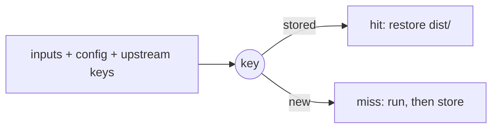

import { Aside } from '@astrojs/starlight/components'

A task with a `cache` block runs once per set of inputs. List what the
command reads under `inputs`, and what it writes under `cache.outputs`
(`[]` for test or lint).

```sh
vx run build
vx run build
```

The first run executes the task and stores `dist/`. The second finds the
same inputs and skips the work.

```ts title="packages/app/vx.config.ts" {9-14,16-18}
import { defineProject } from '@vzn/vx/config'

export default defineProject({
  tasks: {
    build: {
      dependsOn: ['^build'],
      exec: { command: 'vite build', env: { passThrough: ['NODE_ENV'] } },
      inputs: {
        files: ['src/**', 'index.html', '!**/*.test.ts'],
        env: ['NODE_ENV'],
        workspaceFiles: ['tsconfig.base.json'], // from the workspace root
      },
      cache: {
        outputs: { files: ['dist/**'] },
      },
    },
  },
})
```



---

## Inputs

<Aside type="tip" title="Not sure the list is complete?">
  Add [`exec.sandbox`](../../docs/sandboxing/) with `allow.read` listing the same
  files. A workspace read outside it fails the task and names the file.
</Aside>

A task with no `cache` block is keyed on its `inputs` all the same, so a
cached task behind it re-runs when they change. One that declares no
`inputs` has no key, and every task behind it misses.

<details>
<summary>What the key holds</summary>

| The key                | Holds                                                                                   |
| ---------------------- | --------------------------------------------------------------------------------------- |
| Always in it           | the keys of the tasks it depends on, the task's config, arguments after `--` |
| In, with a lockfile plugin | the package's `package.json` and its own dependencies from the lockfile ([Lockfiles](../lockfiles/)) |
| Always excluded        | an untracked `node_modules` git does not ignore (an install), `.git`, `.vx/cache`, `.vx/projects.lock.json`, `vx.lock.json`, `.vx/.gitattributes`, `.vx/.gitignore`, `.vx/tmp` (restore staging), each at the project's root only, the task's own outputs, a nested project's files |
| Excluded unless named  | files git ignores, an ignored `node_modules` included: a broad glob like `src/**` skips them, an exact path or a glob whose fixed part git ignores (`.env.local`, `node_modules/.prisma/client/**`) keys them |
| In, when you say so    | a tool's version: `inputs.workspaceRuntime: ['node -v']` runs once per run at the root and folds its output; `runtime` runs in the package |
| Out, when you say so   | a dependency only for order: `inputs.tasks: []`, as the [dev task](../dev-servers/) does |

Every part, in order: [Caching in depth](../../caching/).

</details>

---

## Outputs

- Declared outputs are wiped before every run that writes the cache.
- A hit rewrites only the files that differ from the entry, then removes
  the ones it does not hold, so `dist/` ends as the cache stored it. A
  hit that finds them already as stored writes nothing.
- A restore writes only files the task's `cache.outputs` declare.
- A failed task is never saved.
- `--force` runs and refreshes the cache; `--no-cache` ignores it.

---

## Why did it re-run?

`vx why` names the part of the key that changed since the task's last run
([guide](../../guides/caching/why-a-task-missed/)):

```sh
vx why app#build
```

A hit after you changed something means that something is not declared.

<details>
<summary>Every verdict <code>vx why</code> prints</summary>

| The verdict line says | It means |
| --- | --- |
| `cache key changed: env MODE, file packages/app/src/index.ts` | those inputs moved (three named, then a count); the lines below show each |
| `cache key changed between the previous run and this one (inputs differ)` | the key moved and neither entry kept its components (pruned, or a failed run saved none) |
| `` never cached: this task declares no `inputs`, so each run derives a new key; declare its `inputs` `` | the task itself declares no `inputs`, so its key is new every run |
| `` never cached: its key includes //#stamp, which declares no `inputs`, so each run derives a new key; declare inputs on //#stamp `` | a task this key includes declares no `inputs`, so the key is new every run; declare them on that task |
| `cache key unchanged — this run was served from cache, nothing re-ran` | a hit |
| `cache key unchanged — the previous run on this key failed and saved nothing, so there was nothing to hit` | a failure saves no entry |
| `cache key unchanged — re-executed because this run did not read the cache (--force, or a --cache-policy without read)` | the run's policy read no cache |
| `cache key unchanged — re-executed because this run did not use the cache (--no-cache, or a --cache-policy without read or write)` | the run used no cache |
| `cache key unchanged — neither run saved it: each ran beside a failed task (…), and a task run past a failed dependency (--continue) is never cached` | both runs went past a failure under `--continue` |
| `cache key unchanged — the previous run on this key ran beside a failed task (…) and was not saved: a task run past a failed dependency (--continue) is never cached, so there was nothing to hit` | the previous run went past a failure under `--continue` |
| `cache key unchanged — no entry for this key was in the cache when it ran (pruned or evicted), so it executed and saved one` | the entry was gone |
| `cache key unchanged — the previous run on this key executed but no entry for it is in the cache (its save failed, or it was pruned since), so there was nothing to hit` | the previous run's save failed, or a prune took the entry |
| `cache key unchanged — the previous run on this key built on a dependency it left out (…), so it saved nothing and there was nothing to hit` | the previous run left that dependency out, and saves nothing built on one |
| `cache key unchanged — the previous run on this key did not write the cache (--no-cache, or a --cache-policy without write), so there was nothing to hit` | the previous run's policy wrote no cache |
| `cache key unchanged — re-executed on the same key though this run read the cache; vx cannot name the cause` | none of the above; vx cannot name the cause |
| `cache key unchanged — re-executed on the same key (--no-cache / --force, or unrelated)` | no invocation recorded this run's cache policy, so vx cannot rule the flags out |
| `cache key unchanged — this run recorded no cache outcome, so whether it re-ran is unknown` | vx does not guess |
| `` this task declares no `cache` block — it runs on every invocation; its key is folded by dependents only `` | not cached at all |
| `` this task declares no `cache` block — it runs on every invocation; it declares no `inputs` either, so each run derives a new key and every task that depends on it misses; declare its `inputs` `` | not cached, and no task depending on it can hit |
| `this task recorded no cache key (skipped, or a persistent task) — nothing to compare` | no key to compare |
| `no prior run for this (project, task)` | nothing to compare with yet |

</details>

See [Caching in depth](../../caching/) for every part of the key.
