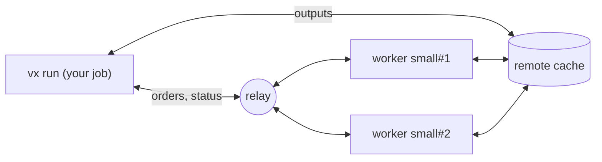

import { Aside } from '@astrojs/starlight/components'

When one CI runner is too slow for your whole run, `@vzn/vx-dte` spreads
it over several. You still start one job that runs `vx run`. That job
starts workers on your own CI, hands each one tasks, and reports every
task as if it ran in one place.

```text frame="terminal"
 ⏺︎   308ms success miss     c#build · small#1
  workers    small#1  online    3 done · 2 running
            small#2  starting
```

The job you start runs no task itself. It plans, hands out tasks, and
restores what the cache already has. Workers start only when a task
misses the cache, so a run with nothing to do starts none.

<Aside title="Not on npm yet">
  `@vzn/vx-dte` ships to npm with an upcoming release. Until then you can
  [try it on your machine](#try-it-on-your-machine) from a checkout of the
  vx repository.
</Aside>

## How it works



- **A relay** connects the run to its workers, because a CI runner
  accepts no incoming connection. You host it: the
  [DTE server](../servers/dte/).
- **A remote cache** carries files. A worker saves each task's outputs
  to it, and the run and the other workers read them from there. The
  relay carries only orders and status ([Remote cache](../remote-cache/)).
- **The relay reads nothing it carries.** The run and each worker talk
  over an encrypted session, and each proves who it is with its CI job's
  token. No secret is stored anywhere.

---

## Set it up on GitHub Actions

You need vx running on CI ([CI](../ci/)) and a
[remote cache](../remote-cache/) that every job can reach.

### 1. Deploy the relay

Follow [DTE server](../servers/dte/) to deploy it. Its URL looks like
`https://vx-dte-server.acme.workers.dev`. Leave `ALLOW` for step 4.

### 2. Declare `dte()`

```ts title=".vx/workspace.ts" ins={4,12-16}
import { defineWorkspace } from '@vzn/vx/config'
import { vxCache } from '@vzn/vx-cache'
import { github as ci } from '@vzn/vx-ci'
import { dte, github } from '@vzn/vx-dte'
import { bun } from '@vzn/vx-lockfile'

export default defineWorkspace({
  plugins: [
    bun(),
    ci(),
    vxCache({ url: 'https://vx-cache-server.acme.workers.dev', issuer: 'https://token.actions.githubusercontent.com', repository: 'acme/app' }),
    dte({
      relay: 'https://vx-dte-server.acme.workers.dev',
      workers: { small: { max: 8, cpu: 4, memory: '16GB' } },
      adapter: github(),
    }),
  ],
})
```

`workers` names the kinds of worker the run may start. Here: up to 8
`small` workers, each with 4 cores and 16 GB, as GitHub's
`ubuntu-latest` runner has for a public repository. Declare what your
runners really have: vx plans by it. To use other runners, add sizes and name
their label in `github({ runsOn: { large: 'ubuntu-latest-16-cores' } })`.

### 3. Write the workflows

```sh
vx dte init
```

```text frame="terminal"
vx dte init: wrote .github/workflows/ci.yml
vx dte init: wrote .github/workflows/vx-worker.yml

Next:
  1. The relay at https://vx-dte-server.acme.workers.dev must admit these workflows.
     Its ALLOW (a plain var, no secret): https://token.actions.githubusercontent.com:<owner>/<repo>:ci.yml https://token.actions.githubusercontent.com:<owner>/<repo>:vx-worker.yml
  2. A remote cache the run and the workers share: workers hand back outputs only through it. https://vznjs.github.io/vx/docs/remote-cache/
  3. Commit .github/workflows/ci.yml, .github/workflows/vx-worker.yml, .vx/workspace.ts and the lock (vx lock), and push.
```

`ci.yml` is the job that runs `vx run`. `vx-worker.yml` is the job each
worker runs. In a terminal, `vx dte init` asks which tasks to run.
Otherwise, name them yourself in the last line of `ci.yml`:

```yaml title=".github/workflows/ci.yml"
      - run: bun vx run build test ${{ github.event_name == 'pull_request' && '--affected' || '--all' }}
```

Run `vx dte init` again after you change `workers`.

### 4. Let the workflows in

Put the `ALLOW` line `vx dte init` printed into the relay's settings,
with your repository in place of `<owner>/<repo>`, and deploy the relay
again ([DTE server](../servers/dte/#2-say-who-may-use-it-allow)).

### 5. Push

Commit the two workflows, `.vx/workspace.ts` and the lock, and push.
The run's log and job summary show each worker beside the tasks it ran.

---

## Try it on your machine

`local()` starts each worker as a process in its own git worktree, so
you can watch a distributed run with no CI and no relay:

```ts title=".vx/workspace.ts"
import { defineWorkspace } from '@vzn/vx/config'
import { dte, local } from '@vzn/vx-dte'
import { bun } from '@vzn/vx-lockfile'

export default defineWorkspace({
  plugins: [
    bun(),
    dte({
      workers: { small: { max: 2, cpu: 1, memory: '1GB' } },
      adapter: local({ prepare: 'bun install' }),
    }),
  ],
})
```

```sh
vx lock
git add -A && git commit -m "try vx-dte"
VX_DTE_RUN=$(uuidgen) vx run build --all
```

```text frame="terminal"
 ⏺︎    10ms success miss     @demo/ui#build · small#1
 ⏺︎     6ms success miss     @demo/web#build · small#1

  workers   small#1  stopped  2 done · warm-up 0.1s · @demo/ui#build, @demo/web#build
```

`VX_DTE_RUN` names the run and turns distribution on. Without it,
`vx run` runs here as always. On GitHub Actions the run names itself.

A worker checks out your files as git has them, uncommitted changes
included. A file git does not track is not there: a task that reads one
fails, naming it.

Until `@vzn/vx-dte` is on npm, link it from a checkout of the vx
repository. The vx you run must come from the same checkout:

```sh
git clone https://github.com/vznjs/vx ~/vx
cd ~/vx && bun install
(cd packages/vx && bun link) && (cd packages/vx-dte && bun link) && (cd packages/vx-lockfile && bun link)
cd ~/your-repo
bun link --save @vzn/vx @vzn/vx-dte @vzn/vx-lockfile
```

---

## Adapters

The adapter decides how workers start:

| Adapter    | Starts each worker as                                                  |
| ---------- | ---------------------------------------------------------------------- |
| `github()` | a job of `.github/workflows/vx-worker.yml`, dispatched by the run      |
| `gitlab()` | a pipeline of `.gitlab-ci.yml`, triggered by the run                   |
| `local()`  | a process in its own git worktree on this machine                      |
| `docker()` | a container held to the size's `cpu` and `memory`                      |
| none       | nothing: the run uses whichever workers join its relay                 |

With no adapter, start the run first, then each worker with
`vx dte worker` and the same `VX_DTE_RUN`. A worker started before its
run says the relay has no live run.

## What runs where

- Every task runs on a worker, including one with `exec.remote: false`
  and an interactive one. Only cache hits restore on the run's machine.
- A task no worker can take, such as one whose `exec.platforms` no
  worker size offers, stops the run before any task starts.
- A sandboxed task runs inside the same `exec.sandbox` on its worker.
- A task's `exec.timeout` counts from its start on its worker, not from
  the wait for one.
- A worker that is idle and that the rest of the run cannot keep busy
  leaves.

vx can also send tasks to a Bazel REAPI worker pool you already run:
[Remote execution](../remote-execution/).

See [`@vzn/vx-dte`](https://github.com/vznjs/vx/tree/main/packages/vx-dte)
for GitLab, Docker, every option and every line the run prints.
