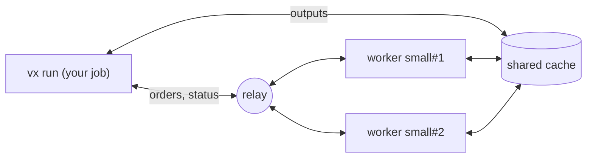

import { Aside } from '@astrojs/starlight/components'

`@vzn/vx-dte` spreads one `vx run` over workers your own CI starts. The run
you start runs no task itself, only restores cache hits, and hands the
ready tasks to workers with room, longest chain first. It reports every task as its own.

```ts title=".vx/workspace.ts"
import { defineWorkspace } from '@vzn/vx/config'
import { dte, github } from '/path/to/vx/packages/vx-dte/src/index.ts'

export default defineWorkspace({
  plugins: [
    dte({
      relay: 'https://relay.example.com',
      workers: { small: { max: 8, cpu: 4, memory: '16GB' } },
      adapter: github(),
    }),
  ],
})
```

```sh
vx dte init               # writes ci.yml and vx-worker.yml from dte(), asking the tasks
vx run build test --all
```

```text
 ⏺︎   308ms success miss     c#build · small#1
  workers    small#1  online    3 done · 2 running
            small#2  starting
```

<Aside title="Not on npm yet">
  Until `@vzn/vx-dte` is on npm, import it from a checkout of the vx
  repository, as above ([its README](https://github.com/vznjs/vx/tree/main/packages/vx-dte#try-it)).
</Aside>

---

## How it works



- Workers and the run meet at a relay, since CI runners take no inbound
  connection. Host your own: [Deploy a relay](../relay/) takes four
  steps, on Cloudflare's free plan, Bun or Docker.
- The relay carries orders and status, never files. A worker saves each
  task's outputs to the cache the run reads, so they need one cache in
  common ([Remote cache](../remote-cache/)).
- The relay reads nothing it carries: each worker and the run talk over
  an encrypted session. On GitHub Actions each side proves itself with the
  job's OIDC token, so no secret is stored.
- Workers check out the run's commit, uncommitted changes included. A
  task whose inputs hold an untracked file fails, naming it: no worker has
  it.
- Workers start at the first task the cache does not answer, so a warm
  run starts none. An idle worker the rest of the run cannot keep busy
  leaves.

---

## Adapters

| Adapter    | Starts each worker as                                                  |
| ---------- | ---------------------------------------------------------------------- |
| `github()` | a job of `.github/workflows/vx-worker.yml`, dispatched by the run      |
| `gitlab()` | a pipeline of `.gitlab-ci.yml`, triggered by the run                   |
| `local()`  | a process in its own git worktree on this machine                      |
| `docker()` | a container held to the size's `cpu` and `memory`                      |
| none       | nothing: the run uses whichever workers join its relay                 |

Try it on one machine with `local()`:

```ts title=".vx/workspace.ts"
dte({
  workers: { small: { max: 4, cpu: 2, memory: '8GB' } },
  adapter: local({ prepare: 'bun install' }),
})
```

```sh
VX_DTE_RUN=$(uuidgen) vx run build --all
```

`VX_DTE_RUN` names the run and turns distribution on; without it, `vx run`
runs here as always. On GitHub Actions with a relay, the run names itself.

---

## Nothing runs on this machine

Every task runs on a worker, one with `exec.remote: false` or an
interactive one too; only cache hits restore here. A task no worker can
take, such as one whose `exec.platforms` no worker size offers or a
persistent task you asked for on its own, refuses the run before any task
starts. A sandboxed task runs on its worker inside the same `exec.sandbox`.

---

## Other options

vx can also send tasks to a Bazel REAPI worker pool you already run:
[Remote execution](../remote-execution/).

See [`@vzn/vx-dte`](https://github.com/vznjs/vx/tree/main/packages/vx-dte) for
the workflow files, every option and what the run shows.
