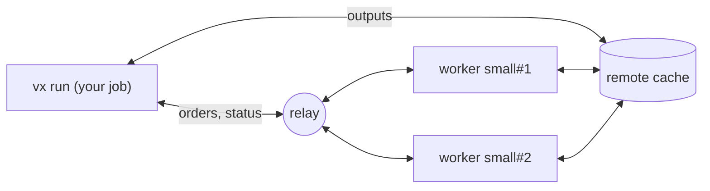

When one CI machine is too slow for your build, vx can run your tasks
on several machines at once. You still start one CI job, and you still
get one result.

That job works out which tasks need to run. It starts more CI jobs,
called **workers**, and gives each one tasks.

When a worker finishes a task, its output and logs come back to your
job, as if the task had run there.

A task the cache already has never runs, so a push that changes nothing
starts no workers.

## How it works



- **A relay** connects the run to its workers, because a CI runner
  accepts no incoming connection. You host it: the
  [DTE server](../servers/dte/).
- **A remote cache** carries files. A worker saves each task's outputs
  to it, and the run and the other workers read them from there. The
  relay carries only orders and status ([Remote cache](../remote-cache/)).
- **The relay reads nothing it carries.** The run and each worker talk
  over an encrypted session, and each proves who it is with its CI job's
  token. No secret is stored anywhere.

---

## Set it up on GitHub Actions

You need vx running on CI ([CI](../ci/)) and a
[remote cache](../remote-cache/) that every job can reach.

### 1. Deploy the relay

Follow [DTE server](../servers/dte/) to deploy it. Its URL looks like
`https://vx-dte-server.acme.workers.dev`. Leave `ALLOW` for step 4.

### 2. Declare `dte()`

```sh
bun add -d @vzn/vx-dte
```

```ts title=".vx/workspace.ts" ins={4,12-16}
import { defineWorkspace } from '@vzn/vx/config'
import { vxCache } from '@vzn/vx-cache'
import { github as ci } from '@vzn/vx-ci'
import { dte, github } from '@vzn/vx-dte'
import { bun } from '@vzn/vx-lockfile'

export default defineWorkspace({
  plugins: [
    bun(),
    ci(),
    vxCache({ url: 'https://vx-cache-server.acme.workers.dev', issuer: 'https://token.actions.githubusercontent.com', repository: 'acme/app' }),
    dte({
      relay: 'https://vx-dte-server.acme.workers.dev',
      workers: { small: { max: 8, cpu: 4, memory: '16GB' } },
      adapter: github(),
    }),
  ],
})
```

`workers` names the kinds of worker the run may start. Here: up to 8
`small` workers with 4 cores and 16 GB each, as GitHub's `ubuntu-latest`
runner has for a public repository.

Declare what your runners really have: vx plans by it. For other
runners, add a size and name its label:
`github({ runsOn: { large: 'ubuntu-latest-16-cores' } })`.

### 3. Write the workflows

```sh
vx dte init
```

```ansi
vx dte init: wrote .github/workflows/ci.yml
vx dte init: wrote .github/workflows/vx-worker.yml

Next:
  1. Let these workflows use the relay at https://vx-dte-server.acme.workers.dev: set its ALLOW.
     Its ALLOW (a plain var, no secret): https://token.actions.githubusercontent.com:acme/app:ci.yml https://token.actions.githubusercontent.com:acme/app:vx-worker.yml
  2. A remote cache the run and the workers share: workers hand back outputs only through it. https://vznjs.github.io/vx/docs/remote-cache/
  3. Commit .github/workflows/ci.yml, .github/workflows/vx-worker.yml, .vx/workspace.ts and the lock (vx lock), and push.
  How a run spreads over workers: https://vznjs.github.io/vx/docs/distributed-task-execution/
```

`ci.yml` is the job that runs `vx run`. `vx-worker.yml` is the job each
worker runs. In a terminal, `vx dte init` asks which tasks to run.
Otherwise, name them yourself in the last line of `ci.yml`:

```yaml title=".github/workflows/ci.yml"
      - run: bun vx run build test ${{ github.event_name == 'pull_request' && '--affected' || '--all' }}
```

Run `vx dte init` again after you change `workers`.

### 4. Let the workflows in

Put the `ALLOW` line `vx dte init` printed into the relay's settings,
and deploy the relay again ([DTE server](../servers/dte/#2-say-who-may-use-it-allow)).

### 5. Push

Commit the two workflows, `.vx/workspace.ts` and the lock, and push.
The run's log and job summary show each worker beside the tasks it ran.

---

## Try it on your machine

`local()` starts each worker as a process in its own git worktree, so
you can watch a DTE run with no CI and no relay:

```sh
bun add -d @vzn/vx-dte @vzn/vx-lockfile
```

```ts title=".vx/workspace.ts"
import { defineWorkspace } from '@vzn/vx/config'
import { dte, local } from '@vzn/vx-dte'
import { bun } from '@vzn/vx-lockfile'

export default defineWorkspace({
  plugins: [
    bun(),
    dte({
      workers: { small: { max: 2, cpu: 1, memory: '1GB' } },
      adapter: local({ prepare: 'bun install' }),
    }),
  ],
})
```

```sh
vx lock
git add -A && git commit -m "try vx-dte"
VX_DTE_RUN=$(uuidgen) vx run build --all
```

```ansi
 ⏺︎   1.35s success miss     @demo/ui#build · small#1
 ⏺︎   1.55s success miss     @demo/web#build · small#1

  workers   small#1  stopped  2 done · warm-up 0.4s · @demo/ui#build, @demo/web#build
```

`VX_DTE_RUN` names the run and turns distribution on. Without it,
`vx run` runs here as always. On GitHub Actions the run names itself.

A worker checks out your files as git has them, uncommitted changes
included. A file git does not track is not there: a task that reads one
fails, naming it.

---

## Adapters

The adapter decides how workers start:

| Adapter    | Starts each worker as                                                  |
| ---------- | ---------------------------------------------------------------------- |
| `github()` | a job of `.github/workflows/vx-worker.yml`, dispatched by the run      |
| `gitlab()` | a pipeline of `.gitlab-ci.yml`, triggered by the run                   |
| `local()`  | a process in its own git worktree on this machine                      |
| `docker()` | a container held to the size's `cpu` and `memory`                      |
| none       | nothing: the run uses whichever workers join its relay                 |

With no adapter, start the run first, then each worker with
`vx dte worker` and the same `VX_DTE_RUN`. A worker started before its
run says the relay has no live run.

## What runs where

- Every task runs on a worker, including one with `exec.remote: false`
  and an interactive one. Only cache hits restore on the run's machine.
- A task no worker can take, such as one whose `exec.platforms` no
  worker size offers, stops the run before any task starts.
- A sandboxed task runs inside the same `exec.sandbox` on its worker.
- A task's `exec.timeout` counts from its start on its worker, not from
  the wait for one.
- A worker that is idle and that the rest of the run cannot keep busy
  leaves.

vx can also send tasks to a Bazel REAPI worker pool you already run:
[Remote execution](../remote-execution/).

See [`@vzn/vx-dte`](https://github.com/vznjs/vx/tree/main/packages/vx-dte)
for GitLab, Docker, every option and every line the run prints.
