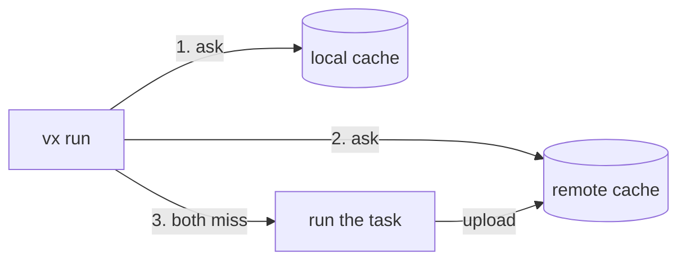

import { Tabs, TabItem, Aside } from '@astrojs/starlight/components'

On its own, vx caches on the machine that ran the task. A remote cache
shares those results. When the run on `main` builds `@acme/ui`, a pull
request's run downloads that build instead of running it again.



vx asks its local cache first and the remote second. It uploads each new
result in the background. A remote that is down or says no never fails
a run: vx runs the task, as it would with no remote.

This page sets up the vx cache server, which you host. It keeps results
in one bucket and stores no secret: each CI job proves who it is with
the token its CI gives it. Already have a Turborepo, Nx or Bazel cache?
See [Other remote caches](#other-remote-caches).

<Aside title="Before you start">
  You need vx running on CI ([CI](../ci/)) and a Cloudflare account. The
  [Cache server](../servers/cache/) page shows how to host it on Bun or
  Docker with an S3 bucket instead.
</Aside>

## 1. Deploy the server

Get the server's code:

```sh
git clone https://github.com/vznjs/vx
cd vx/packages/vx-cache-server
bun install
```

Open `wrangler.jsonc` and say who may use the server, in `ALLOW`.
With this, every run of `acme/app`'s `ci.yml` workflow on GitHub
Actions may use the cache:

```jsonc title="wrangler.jsonc"
"vars": {
  "ALLOW": "https://token.actions.githubusercontent.com:acme/app:ci.yml"
},
```

Then deploy it:

```sh
bunx wrangler login
bunx wrangler deploy
```

wrangler creates the R2 bucket `vx-cache` and prints the server's URL,
such as `https://vx-cache-server.acme.workers.dev`.

## 2. Check it answers

```sh
curl https://vx-cache-server.acme.workers.dev/v1/capabilities
```

A request from outside vx is refused, and the reason shows the server
works:

```text
{"code":"bad_request","message":"vx-issuer and vx-repository: the issuer's and the repository's hashes (PROTOCOL.md § Keys)"}
```

If it says `the server admits no CI: set ALLOW`, `ALLOW` is empty: fill
it in and deploy again.

## 3. Point vx at it

```sh
bun add -d @vzn/vx-cache @vzn/vx-ci
```

<Aside title="Not on npm yet">

`@vzn/vx-cache` ships to npm with the next release. Until then, link it from a
checkout of the vx repository. The vx you run must come from the same
checkout:

```sh
git clone https://github.com/vznjs/vx ~/vx
cd ~/vx && bun install
(cd packages/vx && bun link) && (cd packages/vx-cache && bun link)
cd ~/your-repo
bun link --save @vzn/vx @vzn/vx-cache
```

</Aside>

```ts title=".vx/workspace.ts" ins={2,3,9-14}
import { defineWorkspace } from '@vzn/vx/config'
import { vxCache } from '@vzn/vx-cache'
import { github } from '@vzn/vx-ci'
import { bun } from '@vzn/vx-lockfile'

export default defineWorkspace({
  plugins: [
    bun(),
    github(),
    vxCache({
      url: 'https://vx-cache-server.acme.workers.dev',
      issuer: 'https://token.actions.githubusercontent.com',
      repository: 'acme/app',
    }),
  ],
})
```

`issuer` and `repository` must match your `ALLOW` entry. `github()` tells
the cache which branch a run is on, so a pull request reads its own
results first, then `main`'s.

Run `vx lock` and commit.

## 4. Let CI jobs prove who they are

Give the workflow's job permission to ask GitHub for a token:

```yaml title=".github/workflows/ci.yml" ins={3}
    permissions:
      contents: read
      id-token: write
```

vx asks GitHub for the token itself. Nothing goes in your repository
secrets.

## 5. Push

The first run on `main` runs its tasks and uploads them. The summary
says how many went up:

```text frame="terminal"
  cache     remote 2↑ 776 B
```

A pull request opened after it downloads what it did not change:

```text frame="terminal"
  cache     remote 2↓ 776 B
```

To delete old results, give the bucket an expiry rule. This one deletes
each result a day after it was written:

```sh
bunx wrangler r2 bucket lifecycle add vx-cache all '' --expire-days 1
```

---

## Who reads and who writes

| Run | Reads | Writes |
| --- | --- | --- |
| push to `main` | `main` | `main` |
| pull request from `feat-x` | `feat-x`, then `main` | `feat-x` |
| `pull_request_target` | `main` | nothing |
| a laptop | nothing, unless the server sets `READ_ACCESS=public` | nothing |
| another repository | refused | refused |

A pull request writes only its own branch, so code that is not merged
never reaches `main`'s runs. The server decides this from the job's
token; no option in your config can change it.

## Your laptop

A laptop has no CI token, so by default it reads nothing from the
server and runs with its local cache. To let anyone who can reach the
server read from it, set `READ_ACCESS` to `public` beside `ALLOW`.
Writes still need a CI token.

To keep the server private, put Cloudflare Access or another proxy in
front of it, and pass its headers with `vxCache({ headers })`
([Cache server](../servers/cache/#point-vx-at-it-vxcache)).

## When it does not work

vx says what went wrong once, then runs on without the remote:

```text frame="terminal"
[vx] plugin '@vzn/vx-cache': download 1849970be23e053c from https://vx-cache-server.acme.workers.dev failed: HTTP 401: no bearer token: a read with no token was refused; remote cache off for this run
```

- **`no bearer token`** on CI: the job lacks `id-token: write`. On a
  laptop it is expected; see [Your laptop](#your-laptop).
- **`403`**: the token's repository or workflow is not in `ALLOW`, or
  the repository does not match `vxCache({ repository })`.

---

## Other remote caches

<Tabs>
  <TabItem label="Turborepo / Vercel">
    ```sh
    bun add -d @vzn/vx-migrate
    bunx turbo login && bunx turbo link        # stores a token and a team
    export TURBO_TOKEN=… TURBO_TEAM=…
    ```

    Then declare `plugins: [turboCache()]` from `@vzn/vx-migrate`. It reads
    Turbo's own variables. On GitHub Actions, `turboCache({ oidc: true })`
    with `permissions: id-token: write` swaps the job's OIDC token for a
    short-lived one, so no token is stored. On a laptop it asks for a
    read-only token once and keeps it in the OS keychain.
  </TabItem>
  <TabItem label="Nx">
    `nxCache()` from `@vzn/vx-migrate` does the same for a self-hosted Nx
    cache.
  </TabItem>
  <TabItem label="Bazel REAPI">
    If you already run a Bazel remote cache (NativeLink, BuildBuddy,
    Buildbarn, bazel-remote), `reapi()` from `@vzn/vx-reapi` uses it:

    ```ts title=".vx/workspace.ts"
    import { defineWorkspace } from '@vzn/vx/config'
    import { reapi } from '@vzn/vx-reapi'

    export default defineWorkspace({
      plugins: [reapi({ endpoint: 'grpcs://cache.example.com:443' })], // or VX_REAPI_ENDPOINT
    })
    ```
  </TabItem>
  <TabItem label="Your own">
    Any backend is [a plugin](../../docs/writing-plugins/#your-own-cache).
  </TabItem>
</Tabs>

## Cache scopes and tokens

`--cache-policy` decides whether a run reads and writes the remote at
all. By default CI (`CI` set) reads and writes, and a laptop only reads
(`local:rw,remote:r`). The server decides the rest, from the token.

Each read names the branches the run reads, its own first, and the
server answers from the first one that holds the result. On CI,
`github()` or `gitlab()` ([`@vzn/vx-ci`](../../plugins/vx-ci/)) names
them. Without one, a CI run reads git's branch (none on a detached
checkout) and the default branch. On a laptop, git's:

| Run | Branches read, in order |
| --- | --- |
| push to `main` | `refs/heads/main` |
| pull request from `feat-x` | `refs/heads/feat-x, refs/heads/main` |
| merge queue or train into `main` | `refs/heads/main` |
| laptop on `feat-x` | `refs/heads/feat-x, refs/heads/main` |

`vxCache()` sends each branch as a hash, so no branch name leaves the
machine. `turboCache()` sends them in `x-artifact-read-scopes`. For a
server that ignores that header (Vercel), `turboCache({ scope: 'key' })`
folds the branch into each key: branches stay apart, but nothing
enforces it. [Branch caches a server enforces](../../blog/branch-caches-a-server-enforces/)
shows the server side.

Next: [Distributed runs](../distributed-runs/) spread one run over many
runners.
