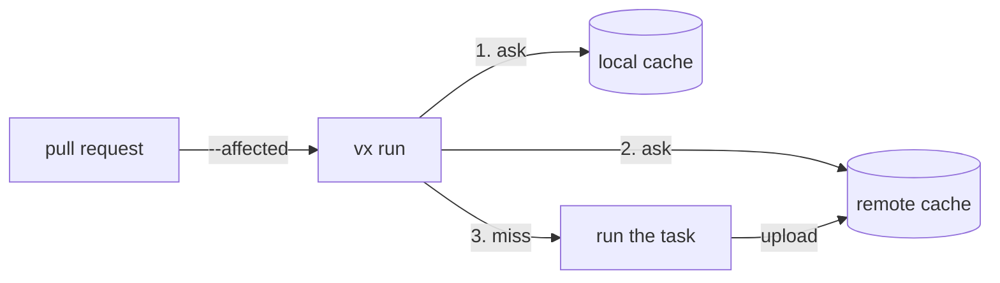

import { Tabs, TabItem, Aside } from '@astrojs/starlight/components'

A shared cache is a plugin for the server you already have. vx asks the
local cache, then the remote, and uploads new results in the background. A down server or a bad token is a
miss, never a failure.



<Tabs>
  <TabItem label="vx cache server">
    ```ts title=".vx/workspace.ts"
    import { defineWorkspace } from '@vzn/vx/config'
    import { vxCache } from '/path/to/vx/packages/vx-cache/src/index.ts'

    export default defineWorkspace({
      plugins: [
        vxCache({
          url: 'https://cache.example.com', // or VX_CACHE_URL
          issuer: 'https://token.actions.githubusercontent.com',
          repository: 'acme/app',
        }),
      ],
    })
    ```

    [`@vzn/vx-cache-server`](../servers/cache/), which you host on Workers,
    Bun or Docker. Until it is on npm, run vx from the same checkout
    ([how](../servers/cache/#point-vx-at-it-vxcache)). No token is stored: each CI job proves itself with its
    OIDC token.
  </TabItem>
  <TabItem label="Bazel REAPI">
    ```ts title=".vx/workspace.ts"
    import { defineWorkspace } from '@vzn/vx/config'
    import { reapi } from '@vzn/vx-reapi'

    export default defineWorkspace({
      plugins: [reapi({ endpoint: 'grpcs://cache.example.com:443' })], // or VX_REAPI_ENDPOINT
    })
    ```

    Any Bazel REAPI server: NativeLink, BuildBuddy, Buildbarn,
    bazel-remote. Every blob read is re-hashed. With no endpoint it declines.
  </TabItem>
  <TabItem label="Turborepo / Vercel">
    ```sh
    bun add -d @vzn/vx-migrate
    bunx turbo login && bunx turbo link        # stores a token and a team
    export TURBO_TOKEN=… TURBO_TEAM=…
    ```

    Then declare `plugins: [turboCache()]` from `@vzn/vx-migrate`. It reads
    Turbo's own variables. On GitHub Actions, `turboCache({ oidc: true })`
    with `permissions: id-token: write` swaps the job's OIDC token for a
    short-lived one, so no token is stored.
  </TabItem>
  <TabItem label="Nx">
    `nxCache()` from `@vzn/vx-migrate` does the same for a self-hosted Nx
    cache.
  </TabItem>
  <TabItem label="Your own">
    Any backend is [a plugin](../../docs/writing-plugins/#your-own-cache).
  </TabItem>
</Tabs>

`--cache-policy` decides what a run reads and writes, and the server
decides what its token may do:

| Where | Default `cache.policy` | `vxCache()` | `turboCache()`, `nxCache()`, `reapi()` |
| --- | --- | --- | --- |
| CI (`CI` set) | every layer reads and writes | the job's OIDC token: it writes its own branch | a read-write token, a repository secret |
| a laptop | `local:rw,remote:r` | no token: it reads from a server with `READ_ACCESS=public` | a read-only token (`turboCache()` and `nxCache()` ask for it once and keep it in the OS keychain) |

A CI job with no token reads only, and a refused token turns the remote
off for the run; each is said once.

<Aside type="caution" title="Write access is the boundary">
  Let only CI you trust write: a fork's pull request gets no secrets
  ([security](../../security/#cache-poisoning)), and `vxCache()`'s server
  lets a job write only its own branch, by its `TRUST`.
</Aside>

## Cache scopes and tokens

The server decides where a write lands, from the CI OIDC token; no
client option changes that. A read names the run's refs, own branch
first, and the server answers from the first that holds the key:
`vxCache()` sends each ref's hash in its check, `turboCache()` the refs
in `x-artifact-read-scopes`. On CI the refs are `github()`'s or
`gitlab()`'s ([`@vzn/vx-ci`](../../plugins/vx-ci/)), so declare the one
for your CI beside the cache plugin; without it a CI run reads git's
branch (none on a detached checkout) and the default branch only. On a
laptop, git's:

| Run | Refs read, in order |
| --- | --- |
| push to `main` | `refs/heads/main` |
| pull request from `feat-x` | `refs/heads/feat-x, refs/heads/main` |
| merge queue or train into `main` | `refs/heads/main` |
| laptop on `feat-x` | `refs/heads/feat-x, refs/heads/main` |

For a server that ignores the header (Vercel), `turboCache({ scope: 'key' })`
folds the ref into each key. That keeps branches apart but does not
secure them. [Branch caches a server enforces](../../blog/branch-caches-a-server-enforces/)
shows the server side.

See [Remote execution](../remote-execution/) to run tasks on a worker pool too.
