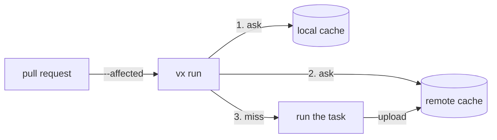

import { Tabs, TabItem, Aside } from '@astrojs/starlight/components'

A shared cache is a plugin for the server you already have. vx asks the
local cache, then the remote, and uploads new results in the background. A down server or a bad token is a
miss, never a failure.



<Tabs>
  <TabItem label="Bazel REAPI">
    ```ts title=".vx/workspace.ts"
    import { defineWorkspace } from '@vzn/vx/config'
    import { reapi } from '@vzn/vx-reapi'

    export default defineWorkspace({
      plugins: [reapi({ endpoint: 'grpcs://cache.example.com:443' })], // or VX_REAPI_ENDPOINT
    })
    ```

    Any Bazel REAPI server: NativeLink, BuildBuddy, Buildbarn,
    bazel-remote. Every blob read is re-hashed. With no endpoint it declines.
  </TabItem>
  <TabItem label="Turborepo / Vercel">
    ```sh
    bun add -d @vzn/vx-migrate
    bunx turbo login && bunx turbo link        # stores a token and a team
    export TURBO_TOKEN=… TURBO_TEAM=…
    ```

    Then declare `plugins: [turboCache()]` from `@vzn/vx-migrate`. It reads
    Turbo's own variables. On GitHub Actions, `turboCache({ oidc: true })`
    with `permissions: id-token: write` swaps the job's OIDC token for a
    short-lived one, so no token is stored.
  </TabItem>
  <TabItem label="Nx">
    `nxCache()` from `@vzn/vx-migrate` does the same for a self-hosted Nx
    cache.
  </TabItem>
  <TabItem label="Your own">
    Any backend is [a plugin](../../docs/writing-plugins/#your-own-cache).
  </TabItem>
</Tabs>

On a laptop with no token, the first run asks for one and keeps it in
the OS keychain. On CI a missing token is a warning and a local-only run.
`--cache-policy` alone decides what a run reads and writes:

| Where | Default `cache.policy` | Token |
| --- | --- | --- |
| CI (`CI` set) | every layer reads and writes | read-write, a repository secret |
| a laptop | `local:rw,remote:r` | read-only, in `VX_CACHE_TOKEN` |

<Aside type="caution" title="The write token is the boundary">
  Give write tokens only to CI you trust; a fork's pull request gets no
  secrets ([security](../../security/#cache-poisoning)).
</Aside>

## Cache scopes and tokens

The server decides where a write lands, from the CI OIDC token; no
client option changes that. `turboCache()` only steers reads: each names
the run's refs, own branch first, in `x-artifact-read-scopes`, and the
server answers from the first that holds the key:

| Run | `x-artifact-read-scopes` |
| --- | --- |
| push to `main` | `refs/heads/main` |
| pull request from `feat-x` | `refs/heads/feat-x, refs/heads/main` |
| merge queue | `refs/heads/gh-readonly-queue/main/…, refs/heads/main` |
| laptop on `feat-x` | `refs/heads/feat-x, refs/heads/main` |

For a server that ignores the header (Vercel), `turboCache({ scope: 'key' })`
folds the ref into each key. That keeps branches apart but does not
secure them. [Branch caches a server enforces](../../blog/branch-caches-a-server-enforces/)
shows the server side.

See [Remote execution](../remote-execution/) to run tasks on a worker pool too.
